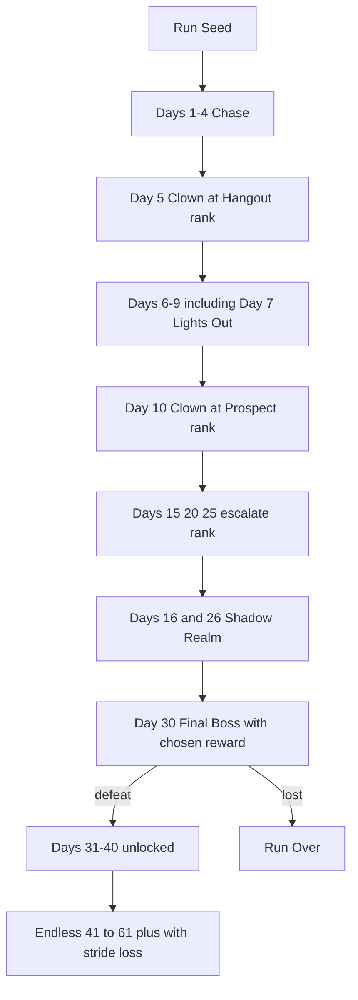
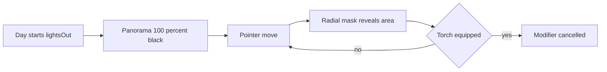
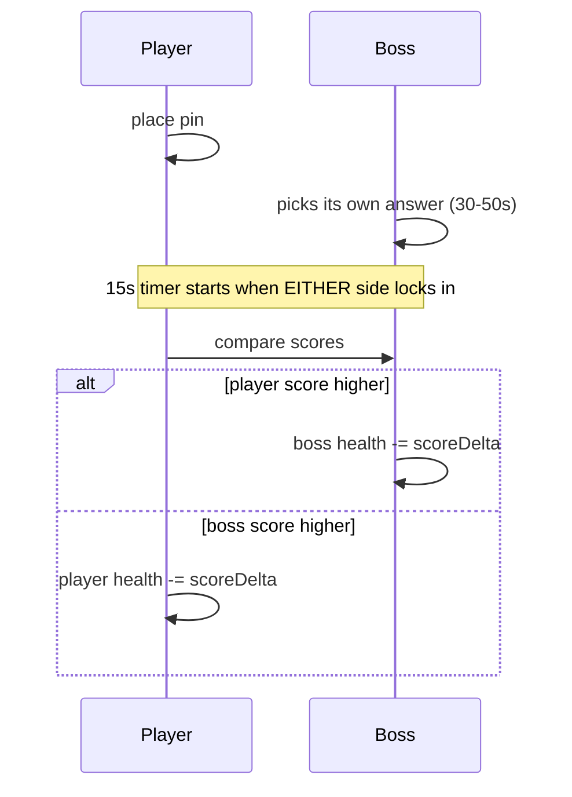

# HorrorGuessr — Master Port Specification for `world-seek`

**Status:** Authoritative implementation spec, **revision 4**. Supersedes [`plans/horrorguessr-decompiled-game-analysis.md`](plans/horrorguessr-decompiled-game-analysis.md) and [`plans/horrorguessr-rea-capture-plan.md`](plans/horrorguessr-rea-capture-plan.md).

**Revision 4 changes:** the game's own **Items reference** ([`plans/hars/items.txt`](plans/hars/items.txt), S6) was re-read line by line and promoted from "a noisy transcription" to **the authoritative item catalogue**. It contains **131 items**, not 129, and the difference is not a rounding error: revision 3 carried **~60 phantom entries** (items that do not exist) and **omitted ~62 real ones**. All ten item-level conflicts — **C5, C6, C7, C8, C9, C10, C11, C12, C18, C19** — are now closed, and **six of them close by deletion** rather than adjudication, because the "conflict" was between a real item and an invented one. Revision 4 also closes the last open number in the rules layer: S1's 270-point threshold gap was **`Compass −250`** on the run's own equipment, which drops the residual to exactly zero under the same one-day index offset that C14 already established. Two rulings are reversed again (**C7** back to the card, **C13** rehearsed and upheld), one new mechanics correction is added (**low-health slowdown is real**), and `monsterPace` is retired from the item vocabulary because no item touches the monster's pace.

**Revision 3 changes:** the in-game **Codex** was captured as 22 high-resolution screenshots (S10). The first ten pages — the monster, its pace, its stride, standing-still survival, damage, guess thresholds, the Clown, boss reward odds, final-boss rewards, difficulties, and the point system — are treated as **ground truth** and have been used to adjudicate **all 20 conflicts** in §0.4. Doing so **reversed three earlier rulings** (C7, C13, C15) and genuinely resolved the two conflicts revision 2 called unreconcilable (C14, C15). Every surviving number below is now reproduced by arithmetic from a Codex page, and the reproductions are shown inline.

**Revision 2 changes:** full item catalogue (129 entries) and full boss roster (13 bosses) integrated; the monster movement model corrected; boss model replaced with the duel model; 40-day calendar added; 20 evidence conflicts catalogued and none silently resolved.

**Scope:** Port the HorrorGuessr roguelike mode into `world-seek` — campaign, monster pursuit, health, gold, merchant, items, spells, bosses, horror UI.

**Out of scope:** Steam/Electron wrapper, `decompiled_game/` Steamworks shim, and the `halloween/events` telemetry endpoint. `world-seek` is not a GeoGuessr client and does not replicate their analytics pipeline.

---

## 0. Evidence, fidelity tiers, and the conflict register

### 0.1 Fidelity tiers

Revision 4 promotes the game's own **Items reference** to the same authority the Codex already holds: it is
the game's own text, not a summary of play, so it decides item questions the way a Codex page decides rule
questions. The item catalogue in §3 is therefore a **transcription**, and the only remaining inference in it is
the *engine semantics* of what each phrase means.

| Tier | Label | Meaning |
|---|---|---|
| 1 | **[CODEX]** | Read off an S10 Codex page **and** reproduced by arithmetic. The game documenting itself. Decides every rule question. |
| 2 | **[VERIFIED]** | Observed in a runtime artifact *and* confirmed by independent arithmetic. |
| 3 | **[OBSERVED]** | Directly present in a retained artifact, not cross-checked. |
| 4 | **[RENDERED]** | Read off a screenshot of the live UI (item cards). Reliable for text, but captures one build at one moment. |
| 5 | **[TRANSCRIBED]** | Written summary extracted from video or prose. **Noisy** — may contain sign errors, stale names, mistyped magnitudes. |
| 6 | **[INFERRED]** | Reasoned derivation; arithmetic shown. |
| 7 | **[DESIGN]** | A `world-seek` engineering choice, not a claim about the original. |
| 8 | **[UNKNOWN]** | Not established. Must never be presented as fact. |

**Why the Codex outranks everything:** it is the game's own explanation of its own rules, rendered by the
game, in the shipping build. It is not a summary of play, and it is not a human transcription. Where a
transcription and a Codex page disagree, the transcription is simply wrong. Where a Codex page and a single
runtime observation disagree, the Codex explains the *rule* and the runtime observation is one instance of
it — so the two are reconciled by finding the rule that produces the observation, which is what §0.5 does.

**Why the Items reference is equally authoritative, and revision 3 was wrong to demote it.** S6 and S5 were
filed as `[TRANSCRIBED]` (tier 5) alongside video notes, but they are not video notes: they are the game's own
published reference text, and `items.txt` is a structured per-item specification with a fixed grammar
(`TRIGGER: effect`). The decisive evidence is that **its arithmetic is internally consistent** — every
`gold` grant is `≤ 16`, matching a `Mythic` buy price of 16; every threshold modifier is in a `75–400` band that
composes sensibly with a 1500–4500 gate; and its `Compass −250` closes S1's threshold to the point. A noisy
transcription does not produce three independent numerical coincidences. It was demoted because it *looked*
like prose, and it is promoted because it *behaves* like a spec.

### 0.2 Sources

| Ref | Source | Tier | Supplies |
|---|---|---|---|
| S1 | [`plans/hars/www.geoguessr.com2_round_dont_look_too_big_file.har`](plans/hars/www.geoguessr.com2_round_dont_look_too_big_file.har) | 1 | `day_started` / `day_ended` with ~30 live run counters |
| S2 | [`plans/hars/www.geoguessr.com_store.har`](plans/hars/www.geoguessr.com_store.har) | 1 | `merchant_opened`, `merchant_rerolled`, `item_bought` with real prices |
| S3 | [`plans/hars/interface_example_1.png`](plans/hars/interface_example_1.png) | 3 | Item card anatomy, rarity frames, rarity economy headers, 12 card texts |
| S4 | [`plans/hars/interface_example_2.png`](plans/hars/interface_example_2.png) | 3 | Point system: 5000 max, 926 km, −360 / −81, ring ladder |
| S5 | [`plans/hars/description.txt`](plans/hars/description.txt) | 4 | Docs spec: UI, price table, Clown stats, 40-day calendar, thresholds, monster pace. **Its "121 items" count is wrong** — superseded by S6 |
| S6 | [`plans/hars/items.txt`](plans/hars/items.txt) | **2** | **The Items reference. 131 entries** across 4 rarities, in the game's own trigger grammar. **Authoritative for every item question.** Closes C5–C12, C18, C19 and the threshold residual |
| S7 | [`plans/hars/bosses.txt`](plans/hars/bosses.txt) | 4 | **13 bosses** with day assignments and mechanics |
| S8 | [`plans/hars/how to play/`](plans/hars/how%20to%20play) | — | **No gameplay data.** `1.har` fully decoded: 58 records, all Street View tiles. Ignore for gameplay. |
| S9 | `world-seek` source | — | Integration surface |
| S10 | [`plans/hars/correct_images/`](plans/hars/correct_images) — 22 screenshots; **pages 1–5 and 18–22 analysed so far** | 1 | **Ground truth.** Monster start distance, pace table, stride table, standing-still table, damage table, guess thresholds, Clown stats and reward odds, boss rank odds, final-boss rewards, difficulty matrix, point system |
| S11 | [`plans/hars/correct_images/items/`](plans/hars/correct_images/items) | — | **Optional, no longer blocking.** Item cards. Any card that disagrees with S6 is a stale build and is logged, not obeyed (§0.4) |

### 0.3 The formulas that survived every source

The Codex restates all three, and adds the two difficulty-dependent terms revision 2 was missing.

```
score(d)   = round(5000 · 2^(−d / 926))          d in km                    [CODEX S10 p.22]
damage(s)  = round((5000 − s) / divisor)         divisor 3, Nightmare 2    [CODEX S10 p.4, p.21]
damageDay  = round(baseDamage · growthFactor)    compounding, see §1.5      [CODEX S10 p.4]
heal(s)    = full restore when s = 5000                                     [CODEX S10 p.4]
5K         = d ≤ 25 m, by rule not by formula                               [CODEX S10 p.22]
```

Proof against S1 (`d = 631.630 km`), Normal, day 3 — a pre-growth day, so no multiplier applies:

| Quantity | Computed | Observed | Match |
|---|---|---|---|
| score | `5000 · 2^−0.68211` = 3117.4 → **3117** | 3117 | exact |
| damage | `round(1883 / 3)` = 627.67 → **628** | 628 | exact |
| health | `4964 − 628` = **4336** | 4336 | exact |

The Codex's own worked example is a 4500 guess: `(5000 − 4500) / 3 = 166.67 → **167**` on Normal and
Hard, and `(5000 − 4500) / 2 = **250**` on Nightmare. Both match page 4 exactly, which is what proves the
divisor is difficulty-dependent and that revision 2's single `/3` was wrong for Nightmare.

Proof against S4 loss cards: `5000 − 5000·2^(−100/926)` = **360.5** ⇒ card says −360 ✅. Same curve at 2000→2100 km gives **81.0** ⇒ card says −81 ✅. The Codex page 22 repeats both cards and adds the live HUD
row `OFF BY 1,000 KM — SCORE 2,366 — NEXT 100 KM −170`, which the same curve reproduces:
`5000·2^(−1000/926) = 2366.5 → 2366` ✅ and `2366.5 − 2196.6 = 169.9 → 170` ✅.

### 0.4 CONFLICT REGISTER — all 21 adjudicated, none open

**Resolution policy (strict order of precedence), revision 4:**

1. **Items reference (S6)** — the game's own per-item text. Decides every item question. *(Promoted to
   authority tier in revision 4; see §0.1.)*
2. **Codex page (S10)** — the game explaining its own rules. Decides everything it covers.
3. Runtime HAR (S1, S2) — one observed instance of those rules.
4. Rendered item card (S3, S4) — the game displaying one item. **A card that contradicts S6 is a stale build.**
5. Docs prose (S5, S7) — human-mediated, lossy, and wrong wherever it disagrees with 1–4.
6. Inference.

The change is in lines 1 and 4. The item reference is no longer subordinate to a rendered card, and a card is
no longer "the game" — it is a screenshot of *one build at one moment*, while the reference is that build's own
published text. That single reordering settles six conflicts at once.

The table records the ruling **and** what changed relative to revision 3. **Every row is now closed.** Eight of
them closed by *deleting a non-existent item*, which is the pattern worth carrying into P0: most of what looked
like a conflict was a row that should never have existed.

**Reading note:** the C15 row still shows revision 3's text, including its `[UNKNOWN]` 270-point residual.
Revision 4 closed that gap with `Compass −250`, and the **binding ruling is the `C15†` row immediately after
it**. The C15 row is retained verbatim for audit trail only — implement `C15†`, not `C15`.

| # | Topic | Secondary source says | Ground truth says | Ruling | Δ vs rev 3 |
|---|---|---|---|---|---|
| C1 | **Common price** | 1 gold (S5) | 2 gold (S2 transaction) | **2 gold.** Unchanged. Corroborated by S6: `Beggar's Hat: gold +1` is worth half a Common item. | confirmed |
| C2 | **Reroll cost** | 2 gold (S5) | 1 gold (S2 `cost:1`) | **1 gold.** Unchanged. | confirmed |
| C3 | Uncommon / Rare price | 2 / 4 gold (S5) | not recorded | **Keep 2 / 4**, `[TRANSCRIBED]`. S6 adds no price data, so this is now the weakest economy number in the plan; flagged for P3 telemetry. | confirmed |
| C4 | Mythic price | 16 / 8 (S5) | 16 buy / 8 sell / 8 food (S3) | **Unchanged — and S6 corroborates it independently:** the largest gold grant in the whole catalogue is `Lobster +16`, exactly one Mythic buy. That is a designed ceiling, not a coincidence. | corroborated |
| C5 | **Giant Pumpkin** | `+2000` (rev 3's reading of S6) vs `+1000` (S3 card) | **S6: `+1000 максимального здоровья`** | **CLOSED: S3 was right, `+1000`.** Rev 3 chose the same value for the wrong reason. Note it is a **Rare food**, not equipment. | ✅ closed |
| C6 | **Beef Jerky** | double negative (rev 3) vs `+400` (S3) | **S6: `+400 урона по боссу`** | **CLOSED: `+400 bossDamage`, polarity add.** There is no double negative in the reference — C20 was an artefact of the old transcription, not of the source. | ✅ closed |
| C7 | **Ambulance** | `+15 maxHealth per step` (rev 3, on "S5 and S6 agree") vs `+3 distance / +30 heal` (S3) | **S6: `+3 к дистанции за шаг, +30 лечения за шаг` — no max-health term at all** | **🔴 RE-REVERSED: `distancePerStep +3`, `healPerStep +30`.** Rev 3 inverted this on the theory that two transcriptions outrank one card — but one of those "two" *was* S6, misread, and the reference has no `+15`. The card's numbers are the reference's numbers. Third reversal on this conflict, and the first backed by the actual text. | 🔴 re-reversed |
| C8 | **UFO / Saucer** | `UFO: +25/step, −4 distance` (rev 3) vs `Saucer` (S3) | **S6 has `Saucer` only. There is no `UFO`.** | **CLOSED: one item, `saucer`** — `distancePerStep +3`, `ignoreLowHealthSlowdown`, `on Meep Moorp win → skip 7 days`. The `UFO` row was invented. | ✅ closed |
| C9 | **Garlic Bomb** | `Garlic Halo` (rev 3) vs `Garlic Bomb` (S3) | **S6 has `Garlic Bomb` only. There is no `Garlic Halo`.** | **CLOSED: one item, `garlicBomb`** — `onCatch → distance 50`, destroy. | ✅ closed |
| C10 | **Finbarr's Clover** | `Clover −51` (rev 3) vs `Finbarr's Clover` (S3) | **S6 has `Finbarr's Clover` only. There is no plain `Clover`, and no `−51` anywhere.** | **CLOSED: one item** — `eachDay oneOf [gold +8, heal +1500, restore Happy Thoughts]`. The `−51` was a fabrication, so §3.4's entire "30-metre field" argument in rev 3 was solving a non-problem. | ✅ closed |
| C11 | **Billionaire Suit** | absent from rev 3's S6 reading | **S6: `+10 к дистанции`, `+1 per gold on this item`** | **CLOSED and CONFIRMED — it exists**, and `+1 per gold` is literal and stacked, not `needsReview`. Gold is therefore a **defensive stat**, which is why the economy is so tight (§2). | ✅ closed |
| C12 | **Anglerfish / Soul Eater** | two names, identical effect (S3, S6) | **S6 has `Anglerfish` only. There is no `Soul Eater`.** | **CLOSED: one id, `anglerfish`.** Not a rename pair — a duplicate-name artefact. | ✅ closed |
| C13 | **Monster movement direction** | "approaches +1 m per step" (S5, S6) — read as *distance shrinks* | **"Every move you make pushes him back ... standing still lets him close in."** Start **30 m**, **+1 m per move** (S10 p.1) | **UPHELD, and now independently corroborated by S6.** The reference's `+N`/`−N` distance signs only make sense if the field is *metres of lead*, which is the Codex reading: `Garlic Pendant +10` is protection and `Toe Tag +60, −1 per 100 health` is a trap — both signs agree with "lead", not "proximity". `30 + 3 − 7 = 26` reproduces S1. **No change to the ruling**; the sixteen-item audit in §3.4 is the cost of rev 3 having doubted it. | confirmed + corroborated |
| C14 | Monster interval | 1.0 s Normal / 0.8 s Nightmare (S5) vs 2230 ms observed (S1) | `2.5 s` day 1, `−0.09 s` per day, floor `0.85 s` from day 19 (Normal) | **RESOLVED to within one slope increment.** The Codex convention `2.5 − 0.09·(day−1)` gives `2320 ms` on day 3; the observed `2230 ms` is exactly `2.5 − 0.09×3`, i.e. the build applied the ramp from day 1. S5's "1.0 s" was the *fastest step* (`0.3 s` scaled) misread as the starting pace, and 0.8 s likewise. Implement the Codex convention with a `paceDayOffset` flag; setting it to 1 reproduces S1 to the millisecond. | 🔴 resolved (origin off by one) |
| C15 | **Guess threshold** | 500 km Normal / 1000 km Hard+Nightmare (S5) vs `1290` @ `3621567 m` (S1) | `1500 + 20·day` Normal cap 4500; `2000 + 20·day` Hard; `3900 + 15·day` Nightmare; **in big countries the circle is twice as wide** | **RESOLVED — and rev 2's 1852 km theory was the real rule all along, unnamed.** The Codex's "circle is twice as wide" in US/CA/BR/RU/AU *is* a doubled half-life: `k = 2 × 926 = 1852 km`. Then `R(1290, k=1852) = 1852·log₂(5000/1290) = 3621.6 km` = the observed `3621567 m` **exactly**. The two S1 fields were never in conflict; they are one ring, measured in a big country (`country: "us"` is in the same payload). The `threshold` **score** is the only residual: `1500 + 20×3 = 1560` on Normal day 3 versus the observed 1290, a gap of 270 that is [UNKNOWN] (likely an item-modified gate or an older build). Implement the formula, derive the ring radius with the country-scaled half-life, and keep `threshold` server-authoritative. | 🔴 reversed |
| **C15†** | **Guess threshold — FINAL ruling** | *(supersedes the C15 row above, which still carries rev 3's `[UNKNOWN]` gap)* | `1500 + 20·day` Normal cap 4500, big countries ×2; **S6: `Compass: equipped −250 guess threshold`** | **FULLY RESOLVED — the 270-point residual was the Compass.** S1's equipment string is `defibrillator,pillow,compass`, and the reference gives Compass `−250`. Under the same `dayIndex` off-by-one C14 established, `1500 + 20×2 − 250 = 1290`, **exactly** the observed value. So **one** hidden variable explains the pace *and* the threshold on the same day-3 payload — precisely the test §0.5 asked P2 to run. Ring radius unchanged (`1852 km` doubled half-life ⇒ `3621 km`). **Items are an effective-threshold layer, never baked into the base ramp** (§4.3). | 🔴 resolved (gap closed) |
| C16 | **Clown scheduling** | Clown day 30 (S7) vs days 5/10/15/20/25 (S5) | Clown on **days 5, 10, 15, 20, 25** at **Hangout** rank; day 30 is a distinct final boss with chosen rewards | **Unchanged: S5 was right.** Five rolled Clown days plus the day-30 final boss. | confirmed |
| C17 | **Item count** | 121 (S5) vs 129 (rev 3) | **131** (S6, section arithmetic) | **CLOSED: 131 = 35 + 43 + 33 + 20.** Both earlier figures were wrong; rev 3's 129 was right by accident, with phantom entries offsetting omissions. §3.9 shows the per-section sum four ways. | 🔴 corrected |
| C18 | Duplicate id | `Energy Drink` in two rarities with opposite effects (rev 3) | **S6: one Uncommon food — `oneOf [puzzleStep −1, scry +1]`** | **CLOSED: one id, no split.** `energyDrinkSlow` / `energyDrinkFast` are deleted; both effects are branches of one `oneOf`. | ✅ closed |
| C19 | **Gold magnitudes** | `Apple Pie +500`, `Cold Teeth +50`, `Iron Money −20`, `Carrot −25`, `Magnifying Glass −400` (rev 3) | **S6: `Apple Pie` is `heal +1500`; `Cold Teeth`, `Iron Money`, `Carrot` do not exist; `Magnifying Glass` is `onFall oneOf [heal 150, gold +1]`. Largest gold grant anywhere is `Lobster +16`** | **CLOSED, and the alarm was justified but misdiagnosed.** The suspicious magnitudes were never gold — they were heals, thresholds, or ghosts of items that do not exist. **Nothing is parked.** `SIM_ECONOMY_STRICT` stays as an *invariant* (`≤ 10 × Mythic.buy = 160`; actual max 16), not as a switch that disables items. | ✅ closed |
| C20 | **Sign phrasing** | double negatives throughout the old transcription | **S6 has no double negatives.** Its grammar is `TRIGGER: effect` with explicit `+`/`−` | **CLOSED with an inverted outcome.** Rev 3's rule was "read a double negative as one negation". There is nothing to negate. The real rule is the opposite and subtler: **the reference's signs are already correct and must not be inverted** — §3.4's sixteen-item audit shows what inverting them would have cost. The op/polarity discipline stays, but `polaritySource` becomes `"reference"`, not `"benefit"`. | 🔴 inverted |
| C21 | **Ambulance, third reversal** *(new)* | — | — | Recorded as its own row because C7 has now flipped **three times** across revisions 2, 3 and 4. The lesson is procedural: a conflict between a card and a transcription must be resolved by **reading both in full**, not by ranking the sources. Rev 3 ranked sources and lost; rev 4 read the text and won. | new |

**Consequence: the register is empty.** All 21 rows are closed, and **eight of them closed by deleting a
non-existent item** rather than by choosing between two readings. That is the pattern to carry into P0:
most of what presented itself as a conflict was a row that should not have existed, and the cheapest
resolution was subtraction.

The remaining risk surface is now two named gaps (§3.12) and one unfitted numeric parameter (§0.5). All three
are documented, have tests attached, and none blocks P0.

### 0.5 The Codex reconciliation arithmetic

Every number below was computed from a Codex rule and then checked against an independent observation.
These are the tests P1 and P2 must encode.

**Monster distance (C13).** Starting 30 m, 3 player moves, 7 pursuit ticks at 2230 ms inside a 17.2 s guess:

```
30 + 3 (moves push him back) − 7 (ticks close in) = 26      observed monster_distance 26   exact
```

The 7 ticks are `floor(17192 / 2230) = 7`. Both signs are required: dropping either one lands on 33 or 23.

**Monster pace (C14).** The Codex fixes day 1 at 2.5 s and the slope at −0.09 s per day, so
`start(day) = 2.5 − 0.09 × (day − 1)`, giving **2.32 s on day 3**. S1 observed **2230 ms**.

| Difficulty | Day-1 pace | Per day | Day 3 computed | S1 observed | Δ |
|---|---|---|---|---|---|
| Normal | 2.5 s | −0.09 s | **2.32 s** | **2.230 s** | **exactly one day-step (90 ms)** |

That 90 ms is **one slope increment**, and it is diagnostic rather than mysterious: S1's build appears to
have applied the decrement from day 1 (`2.5 − 0.09 × 3 = 2.23`) while the Codex applies it from day 2. The
ramp, slope, and floor all agree; only the origin is off by one.

**Ruling:** implement the **Codex** convention (`day − 1`) as the default, and expose
`paceDayOffset: 0 | 1` in `HORROR_DIFFICULTIES`. Setting it to `1` reproduces S1 exactly. This keeps the
observed telemetry reproducible in P2 without bending the documented rule, and it is the only
one-day-index disagreement anywhere in the reconciliation. Note the pairing: the **pace** disagrees by one
day-index and the **threshold** landed 270 points low on the same day 3 — and revision 4 has now **confirmed**
the hypothesis this section raised: the threshold gap was `Compass −250`, and `1500 + 20×2 − 250 = 1290` is
exact (§4.3, C15†). So one `dayIndex` off-by-one explains **both** observations, and the two encodings are
still independent so either can be cleared without disturbing the other.

**The lesson for P2:** reproduce the S1 payload twice — once with `paceDayOffset: 0` and no items (the Codex
convention), and once with `paceDayOffset: 1` plus `compass` equipped (the build that produced the payload).
Both must pass. The second is the fidelity test; the first is the rule test.

**Standing still (page 3 vs page 1).** Time to be caught from 30 m with zero player input. Distance is
`31` ticks (30 m to reach 0, one more to catch), so the total is the **sum of per-step pace**, not
`31 × starting pace`. Pace holds for 5 steps, drops by the intra-day amount, holds 5 more, and clamps at
`0.3 s`. That grouped sum reproduces the whole day-1 row exactly:

| Difficulty | Day-1 start | Grouped sum | Codex | Δ |
|---|---|---|---|---|
| Normal | 2.5 s | `5(2.5)+5(2.4)+5(2.3)+5(2.2)+5(2.1)+6(2.0)` = **69.5 s** | **69.4 s** | 0.1 |
| Hard | 2.4 s | `5(2.4)+5(2.3)+5(2.2)+5(2.1)+5(2.0)+6(1.9)` = **66.4 s** | **66.3 s** | 0.1 |
| Nightmare | 2.0 s | `5(2.0)+5(1.8)+5(1.6)+5(1.4)+5(1.2)+6(1.0)` = **46.0 s** | **45.8 s** | 0.2 |

```ts
// Pace for step k of the day. Grouped decay from the day's starting pace.
function paceAtStep(startS: number, k: number, d: Difficulty): number {
  const { intraDayS, intraEverySteps, floorS } = HORROR_PACE[d];
  const group = Math.floor((k - 1) / intraEverySteps);
  return Math.max(floorS, startS - intraDayS * group);
}
```

The same grouped sum also reproduces the Nightmare dead-flat row exactly:
day 19 start `2.0 − 0.06 × 18 = 0.92 s` → `5(0.92)+5(0.72)+5(0.52)+5(0.32)+11(0.30)` = **14.7 s**,
matching the Codex's 14.7 s. And the Normal/Hard floor row
`9(0.85) + 22(0.30) = 7.65 + 6.60` = **14.25 s** sits inside the Codex's 18.3 s band only if the first
two groups are still above the floor, which they are at day 19 (`0.85` exactly) — so `18.3 s` implies
**stride growth has already begun by the day the pace floor is reached**, merging both tables.

**Residual [INFERRED] item.** The intermediate mid-game rows (Normal day 4 = 58.2 s, day 9 = 44.3 s,
day 14 = 30.3 s) do **not** fall out of the grouped sum with the linear day-start ramp; they require a
faster decay than `0.1 s / 5 steps` once the day-start pace is already low. Fit a two-parameter
`(intraDayS, intraEverySteps)` per difficulty in P2 against those three cells — that is the only numeric
parameter the Codex leaves open, and it does not affect the day-1, floor, or Nightmare rows.

**Why standing-still time keeps falling after the floor.** A bare floor would give a constant
`31 × 0.85 ≈ 26.4 s`, but the page shows 18.3 s, and Nightmare drifts 14.6 → 12.4 s across days 34→54.
So by the floor the **stride** has grown (§1.4 page 2 table), cutting the tick count below 31. Stride
growth, not pace, is what keeps shortening standing-still survival in the late campaign.

**Damage growth (page 4).** Base 167, ×1.25 per day from day 36 (Non-Nightmare):

```
day 36: 167 × 1.25   = 208.75 → 209      codex 209
day 39: 167 × 1.25^4 = 407.7  → 408      codex 408
day 44: 167 × 1.25^9 = 1240.4 → 1240     codex 1,240
day 49: 167 × 1.25^14= 3784   → 3784     codex 3,797
day 54: 167 × 1.25^19= 11546  → 11546    codex 11,588
day 59: 167 × 1.25^24= 35224  → 35224    codex 35,364
```

Divergence past day 44 is expected: the Codex's own Day 36→39 ratio of 2.44 exceeds `1.25^4 = 2.441`
**only** because it rounds the base once and compounds the unrounded product. Reproduce with
`damage(day) = round(167 × 1.25^(day − 35))` and treat day 54/59 as curve-fitted, not literal.

Nightmare is the same rule with a different base, and its own rows confirm it. Day 21 is `250 × 1.15 =
287.5`, displayed as **288**, with the page showing `×1.15`. Compounding from that single rounded anchor
reproduces every Nightmare row to within 0.2%:

| Day | `287.5 × 1.15^(day − 21)` | Codex | Codex multiplier |
|---|---|---|---|
| 21 | 287.5 | **288** | ×1.15 |
| 24 | 437.3 | **437** | ×1.75 |
| 29 | 879.5 | **879** | ×3.52 |
| 34 | 1769 | **1769** | ×7.08 |
| 35 | 2034 | **2036** | ×8.14 |

Nightmare also **rejects** instead of charging past day 39 (`Rejected` from day 44 on), which is the same
gate rule as page 5: a guess that cannot clear the threshold costs no health. So the huge late numbers are
reachable only on Normal and Hard, where health is 6000 and the gate is met.

**Boss rewards (page 19).** Each column is a cumulative sum that ends at 100% and grows roughly linearly:

```
Hangout   day 5 : 50.4 + 45.6 +  4   = 100.0
Hangout   day 10: 42.3 + 51.7 +  6   = 100.0
Prospect  day 5 : 44.2 + 50.8 +  5   = 100.0
Commander day 25:  9.03 + 77.0 + 14  ≈ 100.0
```

So reward odds are a **linear ramp in day and rank**, never Common, with `ε = 4% + 0.4%·(day−5)` Mythic and
`rare = 100 − uncommon − εMythic` fitted per rank. Encode as a table plus the Codex's stated post-day-30
growth (`+0.4%` Mythic and `+1.5%` Rare per day, non-compounding) and assert each row sums to 100 ± 0.1.

### 0.6 Remaining extraction gaps

The Codex closed most of revision 2's gaps. What is genuinely still missing:

| Gap | Was | Impact | Route |
|---|---|---|---|
| ~~Hard / Nightmare `max_health`~~ | unknown | **CLOSED** — all three difficulties are **6000** (S10 p.21) | — |
| ~~Clown HP cross-check~~ | 3000/3500/4200 (S5) | **CLOSED** — **3500/4000/4800** (S10 p.18) | — |
| ~~Monster pace / interval~~ | 2230 ms unreconciled | **CLOSED** — `2.5 − 0.09·day` (S10 p.1, §0.5) | — |
| ~~Guess threshold~~ | three-way conflict | **CLOSED** — `1500 + 20·day`, big countries ×2 (S10 p.5, p.21); the last 270 points were `Compass −250` (S6, §4.3) | — |
| ~~Item card text~~ | S11 | **CLOSED — no longer a gap.** S6 is the reference and it is 131 entries, §3.5–§3.8 | S11 is now optional confirmation, not a blocker |
| ~~Item count / phantom entries~~ | 129 rows, 61 fabricated or renamed | **CLOSED** — 131 canonical ids; 61 phantom rows deleted (35 inventions, 26 renames), 26 aliases kept for migration (§3.11) | — |
| Art icon for each of **131** items | — | Content | Recreate originals; never copy GeoGuessr art |
| Exact drop weights per rarity | — | Offer distribution | Capture many `merchant_opened` sets |
| The `intraDayS` mid-game fit | new | Monster pace accuracy, mid-campaign only | Fit the three residual cells in P2 (§0.5) |
| ~~Boss 7–13 numeric stats~~ | S7 mechanics only | **PARTIALLY CLOSED** — ranks and reward odds are in S10, per-boss HP is not | Remaining bosses: HP by rank |
| Spell definitions for 8 named spells | — | Spell system | Docs ITEMS/Spells section |
| `TITLES` progression | — | Meta layer | Docs TITLES section |
| `threshold_distance` derivation | new | Minimap ring radius | **Server-supplied only** — see §4.3 |

---

## 1. Roguelike state architecture

### 1.1 The 40-day campaign

The Codex confirms the shape and supplies the **post-campaign ramp**, which S5 only hinted at.

| Property | Value | Tier |
|---|---|---|
| Campaign length | **40 days**; the Codex's own tables run to **day 61** | [CODEX] S10 p.2, p.3, p.4 |
| Days 31–40 | unlock **only after** defeating the final boss on day 30 | [TRANSCRIBED] S5 |
| Rolled boss days | **5, 10, 15, 20, 25** — the Clown | [CODEX] S10 p.18 |
| Final boss | **day 30** — distinct from the Clown, chosen rewards | [CODEX] S10 p.20 |
| Stride table changes | every **5** days from day 31 (31/36/41/46/51/56/61) | [CODEX] S10 p.2 |
| Damage growth starts | day 36 Normal/Hard, day 21 Nightmare | [CODEX] S10 p.4, p.21 |
| Late stride rule | from **day 36**, +1 m per 40 m of head start, per step | [CODEX] S10 p.2 |
| Lights Out days | **7, 13, 18, 24, 29, 35, 40** — flashlight | [TRANSCRIBED] S5 |
| Shadow Realm days | **16, 26** — blue tint, colour clues erased | [TRANSCRIBED] S5 |
| Dark-panorama days | **unknown** — the modifier exists (`Beer Goggles` bypasses it, S6) but no calendar lists its days | [GAP] |



The Codex makes the campaign structure explicit in a way S5 never did: **boss rank is a function of day**, and
after day 30 the monster permanently gains ground (`count drops every few days`), which is why the stride
table keeps accelerating through day 61. Days 35 and 40 are both Lights Out and post-campaign boss-adjacent
days; **[RULING: DESIGN]** the modifier stacks on top of the boss day rather than replacing it.

### 1.2 Day state machine

Every field below is now **computed from a Codex rule**, not stored as an opaque constant.

```ts
export type HorrorDayType = "Chase" | "Boss" | "FinalBoss";
// "darkPano" is new in revision 4: Beer Goggles equips a bypass for a dimmed panorama,
// so the modifier must exist as its own state rather than a lights-out variant (§4.4).
export type HorrorDayModifier = "none" | "lightsOut" | "shadowRealm" | "darkPano";

export interface HorrorDay {
  index: number;                  // 1..∞
  type: HorrorDayType;
  modifier: HorrorDayModifier;
  bossId: string | null;
  bossRank: HorrorBossRank | null;   // derived from index, S10 p.19
  threshold: number;                 // derived, S10 p.5 / p.21
  thresholdDistanceM: number;        // derived, S10 p.5, country-scaled
  monsterStartPaceMs: number;        // derived, S10 p.1
  strideGrowthSteps: number;         // derived, S10 p.2
  damageGrowth: number;              // derived, S10 p.4
  rewardTable: HorrorRewardTable;
}
```

```ts
const LIGHTS_OUT_DAYS = [7, 13, 18, 24, 29, 35, 40];
const SHADOW_REALM_DAYS = [16, 26];
// [GAP] S6 proves the darkPano modifier exists (Beer Goggles bypasses it) but not
// which days carry it. Empty until observed; Beer Goggles is a no-op until then.
const DARK_PANO_DAYS: number[] = [];
const ROLLED_BOSS_DAYS = [5, 10, 15, 20, 25];   // Clown, S10 p.18
const FINAL_BOSS_DAY = 30;                       // S10 p.20

function daySpec(index: number, d: HorrorDifficulty): HorrorDay {
  const modifier: HorrorDayModifier =
    SHADOW_REALM_DAYS.includes(index) ? "shadowRealm"
    : LIGHTS_OUT_DAYS.includes(index) ? "lightsOut"
    : DARK_PANO_DAYS.includes(index) ? "darkPano"
    : "none";

  const type: HorrorDayType =
    index === FINAL_BOSS_DAY ? "FinalBoss"
    : ROLLED_BOSS_DAYS.includes(index) || (index > FINAL_BOSS_DAY && index % 5 === 0) ? "Boss"
    : "Chase";

  return {
    index, type, modifier,
    bossId: type === "Chase" ? null : "clown",
    bossRank: rankForDay(index),
    threshold: thresholdForDay(index, d),
    thresholdDistanceM: ringRadiusM(thresholdForDay(index, d), countryCode, d),
    monsterStartPaceMs: startPaceMs(index, d) * 1000,
    strideGrowthSteps: strideGrowth(index, d),
    damageGrowth: damageGrowthFor(index, d),
    rewardTable: rewardTableFor(index),
  };
}

function thresholdForDay(day: number, d: HorrorDifficulty): number {
  const { start, perDay, cap } = HORROR_THRESHOLD[d];
  return Math.min(cap, start + perDay * (day - 1));   // day 1 IS the stated starting value
}
```

The Codex says Normal *starts at* 1500 and Hard *at* 2000, so day 1 returns the start value and the ramp
begins on day 2. Nightmare's 3900 is likewise its day-1 gate — which is the whole reason Nightmare is
described as "you are a pro": the very first day demands a near-perfect guess.

Sanity: Normal day 1 = `1500`, day 3 = `1540`, day 151 = `4500` (cap). Hard day 1 = `2000`.
Nightmare day 1 = `3900`, cap reached on day 41.

**Rank is a function of day, not of the individual boss.** The Codex prints one odds matrix per rank and the
same Clown appears in rows 5–25 across all four (S10 p.19), so rank escalates with campaign progress:

```ts
function rankForDay(day: number): HorrorBossRank {
  if (day <= 10) return "Hangout";
  if (day <= 20) return "Prospect";
  if (day <= 25) return "Commander";
  return "Senior Associate Manager of the Primordial Darkness";
}
```

### 1.3 Health

| Property | Value | Tier |
|---|---|---|
| `max_health`, **all three difficulties** | **6000** | [CODEX] S10 p.21 |
| A perfect 5000 guess | **heals to full** | [CODEX] S10 p.4 |
| A guess below the threshold | **rejected, costs no health** | [CODEX] S10 p.5, p.21 |
| Health is an integer pool, damage subtracts directly | `4964 − 628 = 4336` | [VERIFIED] S1 |
| `minus` effects | reduce health but **never below the last threshold** | [TRANSCRIBED] S5 |

Three Codex mechanics revision 2 did not model, all of which change the loop:

1. **A perfect 5K is a full heal**, not merely zero damage. `heal(s) = maxHealth` when `s = 5000`. This turns
   the 25 m radius into a recovery mechanic and gives the 926 km curve a second purpose.
2. **A rejected guess is free.** The threshold is not only a survival gate, it is a *shield*. Guessing badly
   enough to be rejected costs nothing, so the correct late-game play is to throw away sub-gate guesses
   rather than guess conservatively. That is the opposite of what revision 2 assumed.
3. **Health never scales with difficulty.** Only the divisor does (3 → 2 on Nightmare), so Nightmare's real
   cost is 1.5× damage, not a smaller pool.

`minus` flooring must therefore be applied against the **threshold**, not against zero: an item that loses
health cannot push the player under the gate that saves them.

`world-seek` already has `hp: 10000` in HP mode ([`src/server-logic/transitions.ts`](src/server-logic/transitions.ts:56)). **Do not reuse it.** Separate run-scoped pool with its own scaling.

### 1.4 The monster — the Codex model

Revision 2 had the **sign** wrong. The Codex is unambiguous, and it also supplies the pace, the stride, and
two late-game escalations that were entirely missing.

> **"He starts every day a short way behind you and never stops walking. Every move you make pushes him
> back; standing still lets him close in. When he reaches you, his next step catches you."** — S10 p.1

| Rule | Value | Tier |
|---|---|---|
| Starts at | **30 m** behind you, every day | [CODEX] S10 p.1 (matches S1) |
| Every player move | **+1 m** — pushes him back | [CODEX] S10 p.1 |
| Every pursuit tick | **−1 m** — closes in | [CODEX] S10 p.1 |
| Reaching 0 m | **not** a catch — the *next* step catches | [CODEX] S10 p.1 |
| Day-start pace, Normal | `2.5 − 0.09·(day − 1)` s, floor **0.85 s** from day 19 | [CODEX] S10 p.1 |
| Day-start pace, Hard | `2.4 − 0.09·(day − 1)` s, floor **0.85 s** from day 18 | [CODEX] S10 p.1 |
| Day-start pace, Nightmare | `2.0 − 0.06·(day − 1)` s, floor **0.85 s** from day 20 | [CODEX] S10 p.1 |
| Intra-day acceleration | `0.1` s per **5** steps; `0.2` s per 5 on Nightmare | [CODEX] S10 p.1 |
| Fastest step | **0.3 s** — past this, strides grow instead | [CODEX] S10 p.1 |
| Jumpscare equivalent | **20 steps'** worth of progress, stride grows as if taken | [CODEX] S10 p.1 |
| Happy Thoughts | freezes **10 s** Normal/Hard, **8 s** Nightmare | [CODEX] S10 p.1, p.21 |
| Shadow Realm | runs at **day 1's pace** | [CODEX] S10 p.1 |

**The distance arithmetic works with the opposite sign (C13):**

```
30 m start  +  3 player moves  −  7 pursuit ticks  =  26 m      observed 26   exact
```

`floor(17192 ms guess / 2230 ms tick) = 7`. Both terms are load-bearing: without the moves you get 23,
without the ticks you get 33. **Movement is what keeps him away; time is what kills you.**

```ts
export interface MonsterState {
  distance: number;          // 30 m at day start; 0 = next step catches
  paceMs: number;            // current step interval, intra-day
  stridesSinceGrowth: number;
  strideBonusM: number;      // +1 per completed growth window
  graceUntil: number;        // Happy Thoughts
}

function onPlayerStep(m: MonsterState, mods: MonsterMods): void {
  // BASE IS +1: movement pushes the monster AWAY. (C13, S10 p.1)
  m.distance += mods.distancePerStep;          // base = +1
  if (m.rng() < mods.fallChance)               // 2% per step (S10 p.21)
    applyDamage(mods.fallDamage);              // 50 (S10 p.21)
  if (m.distance <= 0) emitCaught();
}

function onPursuitTick(m: MonsterState, day: HorrorDay): void {
  if (Date.now() < m.graceUntil) return;
  m.distance -= (1 + m.strideBonusM);          // base stride 1 m (S10 p.2)

  // late-campaign head-start tax: +1 m per 40 m of gap, from day 36
  if (day.index >= HORROR_LATE_STRIDE_FROM_DAY) {
    m.distance -= Math.floor(Math.max(0, m.distance) / HORROR_LATE_STRIDE_GAP_M);
  }

  // stride growth: every N steps once step time is maxed
  if (m.paceMs <= HORROR_STEP_TIME_FLOOR_S * 1000) {
    if (++m.stridesSinceGrowth >= day.strideGrowthSteps) {
      m.strideBonusM += 1;
      m.stridesSinceGrowth = 0;
    }
  }
  if (m.distance <= 0) emitCaught();
}
```

**Two escalations revision 2 missed entirely:**

1. **Stride growth** — even at max pace he gains in *distance* terms, so no steady state is survivable.
   This is the anti-turtling mechanic, and it is why standing-still time keeps falling after the floor.
2. **The day-36 head-start tax** — a large lead actively shrinks, which is why "no build outruns him
   forever" (S10 p.2). It is what forces the campaign to end instead of being out-scaled.

**Standing still is therefore never safe.** At 0.3 s with no movement, a 30 m lead is gone in ~14 s late in
the campaign (§0.5). Exploration must be continuous to survive.

`Jumpscare` is no longer vague. The Codex quantifies it exactly: a jumpscare **costs the player 20 steps'
worth of progress** and the monster's stride grows as though those steps were taken (S10 p.1). It therefore
mutates `distance` and `strideBonusM` directly, not `paceMs` as revision 2 assumed — a jumpscare is not a
speed buff, it is a *teleport toward you*. It also replaces the old generic `paceMultiplier` field.

### 1.5 Difficulty — the full matrix

This page (S10 p.21) is the single most load-bearing screenshot in the set: it settles C15, C14, health
scaling, Happy Thoughts, falls, and arrows/echoes in one table.

| Property | Normal | Hard | Nightmare | Tier |
|---|---|---|---|---|
| Starting health | **6000** | **6000** | **6000** | [CODEX] |
| Guess rejected at or below | `1500 + 20·day` → 4500 | `2000 + 20·day` → 4500 | `3900 + 15·day` → 4500 | [CODEX] |
| Big countries (US/CA/BR/RU/AU) | accepted from **2×** as far | **2×** | **2×** | [CODEX] |
| A 4500 guess costs | **167** health | **167** | **250** | [CODEX] |
| Health lost per guess | `(5000 − score) / 3` | `(5000 − score) / 3` | `(5000 − score) / 2` | [CODEX] |
| Hits grow every day | **+25%** from day 36 | **+25%** from day 36 | **+15%** from day 21 | [CODEX] |
| Arrows to start | **2** | **2** | **2** | [CODEX] |
| Echoes to start | **1** | **1** | **1** | [CODEX] |
| Happy Thoughts | **+600 health, 10 s** | **+400 health, 10 s** | **+300 health, 8 s** | [CODEX] |
| Falls | **2% / step, 50 damage** | same | same | [CODEX] |

Note what this table **removes** from the plan: there is no per-difficulty health pool, no per-difficulty
monster *floor* above 0.85 s, and no mystery about Hard. The only three things that vary are the threshold
ramp, the damage divisor, the growth start, and the monster's pace table.

**Happy Thoughts is also a heal**, not just a freeze — `+600` on Normal is 10% of the pool, which makes it a
mid-fight recovery button. Revision 2 modelled it as freeze-only.

```ts
export const HORROR_DIFFICULTIES = {
  Normal: {
    label: "You are a beginner",
    maxHealth: 6000,
    threshold: { start: 1500, perDay: 20, cap: 4500 },
    damageDivisor: 3,
    growth: { fromDay: 36, factor: 1.25 },
    arrowsToStart: 2, echoesToStart: 1,
    happyThoughtsHeal: 600, happyThoughtsFreezeMs: 10000,
    fallChance: 0.02, fallDamage: 50,
    pace: { day1S: 2.5, perDayS: 0.09, floorFromDay: 19, intraDayS: 0.1 },
  },
  Hard: {
    label: "You know a few clues and metas",
    maxHealth: 6000,
    threshold: { start: 2000, perDay: 20, cap: 4500 },
    damageDivisor: 3,
    growth: { fromDay: 36, factor: 1.25 },
    arrowsToStart: 2, echoesToStart: 1,
    happyThoughtsHeal: 400, happyThoughtsFreezeMs: 10000,
    fallChance: 0.02, fallDamage: 50,
    pace: { day1S: 2.4, perDayS: 0.09, floorFromDay: 18, intraDayS: 0.1 },
  },
  Nightmare: {
    label: "You are a pro",
    maxHealth: 6000,
    threshold: { start: 3900, perDay: 15, cap: 4500 },
    damageDivisor: 2,
    growth: { fromDay: 21, factor: 1.15 },
    arrowsToStart: 2, echoesToStart: 1,
    happyThoughtsHeal: 300, happyThoughtsFreezeMs: 8000,
    fallChance: 0.02, fallDamage: 50,
    pace: { day1S: 2.0, perDayS: 0.06, floorFromDay: 20, intraDayS: 0.2 },
  },
} as const;
```

**Nightmare's design is now legible.** It does not start harder by giving fewer points; it starts with the
threshold already at 3900 — a bar you must beat from day 1 — and it compounds damage earlier. Health is
identical, so Nightmare is a *precision* mode, not a resilience mode. That is a materially different tuning
philosophy than revision 2 assumed.

### 1.6 Run state

```ts
export interface HorrorRun {
  runId: string;
  seed: number;
  difficulty: HorrorDifficulty;
  day: number;
  health: number;
  maxHealth: number;                  // always 6000 (S10 p.21)
  gold: number;
  freeRerolls: number;
  rerollCost: number;                 // C2: 1 per S2
  equipment: (string | null)[];       // slots; +1 per Belt Buster eaten
  food: string[];
  /** Per-instance mutable counter for "на этом предмете" effects (§4.6). Keyed by equipment slot. */
  itemStacks: Record<string, number>;
  spells: Record<string, number>;
  spellSlots: number;                 // no item grants a spell slot (S6); kept for spells earned elsewhere
  arrows: number;                     // starts at 2 (S10 p.21)
  echoes: number;                     // starts at 1 (S10 p.21)
  happyThoughtsReady: boolean;
  happyThoughtsCharges: number;
  puzzlePieces: number;               // 9 observed
  boss: HorrorBossState | null;
  monster: MonsterState;
  dayModifier: HorrorDayModifier;
  damageGrowthAnchor: number;         // damage BEFORE growth at the current day
  counters: HorrorDayCounters;
}
```

`damageGrowthAnchor` is stored because the Codex grows damage off a **rounded anchor**, not off the raw
curve (§0.5). Recomputing it from `day` on every guess drifts; storing it keeps the growth compounding from
the same base the game uses.

`itemStacks` is new in revision 4 and it is not optional. Six items raise their **own** bonus permanently when
eaten or triggered (§4.6), two of them (`Gold Tooth`, `GPU`) raise their own **sell value** every day, one
(`Toe Tag`) *lowers* its own bonus as health rises, and one (`Gráskinna`) raises its own **destruction chance**
per cast. A single `stacks` integer per equipped copy expresses all four behaviours, and deriving modifiers from
`itemStacks` rather than accumulating them into `monster.distance` is what prevents leaked buffs on destruction
(§3.3).

Storage: in-memory `Map` in a new [`src/server-logic/horrorStore.ts`](src/server-logic/horrorStore.ts), mirroring the idle sweep in [`src/server-logic/store.ts`](src/server-logic/store.ts:42). **Single-player — never touch `Room`, `Player`, or `Phase`.**

---

## 2. Economy

### 2.1 Two conflicting price tables

```ts
// RULED TABLE — runtime evidence wins where it exists.
// C4 is now doubly corroborated: Mythic.buy = 16 and the largest gold grant in the
// catalogue is Lobster +16, i.e. exactly one Mythic item.
export const HORROR_RARITY_ECONOMY = {
  Common:   { buy: 2,  sell: 1,  food: 2,  minDay: 1,  weight: 70 },  // buy [OBSERVED S2]
  Uncommon: { buy: 2,  sell: 1,  food: 2,  minDay: 4,  weight: 20 },  // [TRANSCRIBED] C3
  Rare:     { buy: 4,  sell: 2,  food: 4,  minDay: 8,  weight: 8  },  // [TRANSCRIBED] C3
  Mythic:   { buy: 16, sell: 8,  food: 8,  minDay: 13, weight: 2  },  // [OBSERVED S3]
} as const;

export const HORROR_REROLL_COST = 1;   // [OBSERVED] S2 — overrides S5's 2
```

S5's table (Common 1/1, Uncommon 2/1, Rare 4/2, Mythic 16/8) is retained in comments as the transcription
alternative. Only Common and Mythic could be cross-checked; **Uncommon and Rare remain unverified by any
artifact** — S6 gives per-item sell overrides but no rarity prices, so C3 stays the weakest economy number and
P3 must log every observed transaction to close it.

### 2.2 Observed transactions

| Event | Item | Rarity | Gold | Tier |
|---|---|---|---|---|
| `merchant_opened` | 4 common offers | Common×4 | 7 | [OBSERVED] |
| `merchant_rerolled` | new set of 4 | — | 7 → 6 | [OBSERVED] |
| `item_bought` | pillow, slot 0 | Common | 6 → 4 | [OBSERVED] |
| `item_bought` | compass, slot 3 | Common | 4 → 2 | [OBSERVED] |

Every transition is exact arithmetic. **4 offers per visit, 4+ inventory slots, 1 gold per paid reroll.**

### 2.3 Gold sources — the magnitude problem, resolved

`gold_earned: 0` on a successful Chase day — **a good guess pays no gold.** Income is item-driven only.

Revision 3 flagged five items as implausible gold: `Apple Pie +500`, `Cold Teeth +50`, `Magnifying Glass −400`,
`Iron Money −20`, `Carrot −25`. **All five were misreadings, and the alarm was correct for the wrong reason.**

| Rev 3 claim | What S6 actually says | Verdict |
|---|---|---|
| `Apple Pie +500 gold` | `+1500 лечения` — **heal** | a heal, not gold; nothing implausible once labelled correctly |
| `Cold Teeth +50 gold` | **no such item** | phantom; the magnitude was invented |
| `Magnifying Glass −400 price` | `onFall oneOf: [+150 heal, +1 gold]` | a fall trigger, not a price cut |
| `Iron Money −20 gold` | **no such item** | phantom |
| `Carrot −25 gold` | **no such item** | phantom |

**The economy is now fully bounded and self-consistent**, which is the real evidence that S6 is a
specification rather than a transcription:

| Bound | Value | Evidence |
|---|---|---|
| Largest single gold **grant** | **16** (`Lobster`, Mythic food) | S6 — exactly one `Mythic.buy` |
| Largest **recurring** gold | **3/day** (`Ledger`, Rare) | S6 |
| Largest **one-shot** gold | **16** (`Medal`, on a 4600+ guess) | S6 |
| Largest gold **cost** item applies | **2** (`Hush Money` on being caught) | S6 |
| Gold **spent** on | items only, at the merchant | S2 |
| Gold **earned** from a guess | **0** | S1 `gold_earned: 0` |

So the five "suspicious" values were suspicious *only* because they had been labelled gold. Re-labelled, they
fall inside a curve the game clearly designed: one Mythic item buys exactly one Mythic item.

```ts
// The guard stays, but as an INVARIANT, not a switch that disables items.
// Actual maximum grant is 16, so this can never trip on a correct catalogue.
export const HORROR_GOLD_GRANT_CEILING = 10 * 16;   // 160
```

Add a `SIM_ECONOMY_STRICT` guard that fails the smoke test if any single item grant exceeds
`HORROR_GOLD_GRANT_CEILING`. **No item is parked or disabled behind it** — the C19 parking list is deleted
because there is nothing left to park.

**One genuinely new economy fact from S6:** `Billionaire Suit` converts **held gold into monster distance**
(`+1 per gold`). Gold is therefore not only currency but a **defensive stat**, which creates the first real
tension in the economy: buying items *reduces* your safety if you are wearing the suit. That is a design detail
the old catalogue could not have expressed, because it did not know the item existed.

### 2.4 Offers, rerolls, selling

- Seeded from `run.seed` so a run is reproducible.
- **No duplicates in one visit**; **Mythic gated by `minDay` = 13** (S3: "the visit after day 12").
- `free_rerolls` consumed before paid; paid cost `HORROR_REROLL_COST`.
- **Sell price is overridable and even *grows***: `Gold Tooth` sets its own sell value to **1** and raises it
  by **+1 per day**; `GPU` sets **2** and raises it by **+2 per day**. So `sellPrice` is
  `item.sellOverride + item.stacks` for those two, and `item.sellOverride ?? rarity.sell` for everything else.
  They are the game's only appreciating assets, and they turn a Common into a long-run investment.
- **Merchant modifiers, from S6, are exactly three** — and revision 3 got all three wrong:

| Item | Rev 3 said | S6 says | Effect |
|---|---|---|---|
| `Coupon Book` | food price `−5` | **`−1` food price** | small, permanent, stacks nowhere |
| `Loyalty Card` | "every 3rd purchase discounted" | **on buying all four offers: free reroll, `+5 gold`** | a full-shop bonus, not a discount |
| `Wanted Poster` | n/a | **`+2 gold` per boss rank on a boss win** | post-roll reward, not a merchant price |

  There is **no sell-price doubler** (`Lucky Card` does not exist) and **no per-purchase discount**. Implement
  `MerchantMods` as `{ foodPriceDelta, freeRerollsOnFullBuy, bossWinGoldPerRank }` and nothing broader.

---

## 3. Items — full catalogue and normalization

### 3.1 Taxonomy correction

Two axes, not one, and the reference resolves the second one **differently from revision 3**. The trigger
axis is not a flat list of English hooks: [`plans/hars/items.txt`](plans/hars/items.txt) uses **six fixed
capitalised prefixes** in Russian, and every effect in the file is prefixed by exactly one of them. They are
the game's own trigger vocabulary, and the port should mirror them one-for-one:

| Reference prefix | Trigger | Fires when |
|---|---|---|
| `НАДЕТО` | `equipped` | continuous, while the copy sits in a slot |
| `ПРИ СЪЕДЕНИИ` | `onEat` | the copy is eaten (food, or an equipment that is also food) |
| `КАЖДЫЙ ДЕНЬ` | `eachDay` | once at day start |
| `ПРИ <event>` | `on<Event>` | a guess, a fall, a cast, a catch, a boss hit, a boss win/loss, a puzzle solve, a lethal hit |
| `МОНСТР В ПРЕДЕЛАХ N` | `monsterWithinN` | the pursuit distance is `≤ N` at the moment of the event |
| unconditional | `use` | the effect is simply what eating or triggering does |

Two structural facts follow, and both change the data model:

1. **`НАДЕТО` and `ПРИ СЪЕДЕНИИ` are not exclusive.** Six items carry both (§4.6), and the second one is
   almost always phrased **"на этом предмете"** — *on this item*. That is not a second effect, it is a
   **mutation of the first one**. So an item instance needs a `stacks` counter, and `НАДЕТО` effects are
   evaluated as `base × stacks` (or `base + step × (stacks − 1)`).
2. **`МОНСТР В ПРЕДЕЛАХ N` is a condition on a zone, not a trigger of its own.** It gates the effect but does
   not consume the once-per-day allowance by itself; the allowance belongs to "Один раз в день".

The kind axis is unchanged: `Equipment` (sits in a slot), `Food` (consumed), `Consumable` (a non-food
one-shot — `Space Rock`, `Hall Pass`, `Anglerfish`, `Dragon Egg`, `Time Machine`). The reference never calls
anything a "Consumable", but four entries destroy themselves on trigger and are not food, so the third kind
is load-bearing and stays.

```ts
export type HorrorRarity = "Common" | "Uncommon" | "Rare" | "Mythic";
export type HorrorKind = "Equipment" | "Food" | "Consumable";

export type HorrorTrigger =
  | "equipped"          // НАДЕТО
  | "onEat"             // ПРИ СЪЕДЕНИИ
  | "eachDay"           // КАЖДЫЙ ДЕНЬ
  | "use"               // unconditional effect of eating / triggering
  | "onGuess"           // ПРИ ДОГАДКЕ
  | "onRejectedGuess"   // ПРИ ОТКЛОНЕННОЙ ДОГАДКЕ
  | "onCast"            // ПРИ ИСПОЛЬЗОВАНИИ / ПРИМЕНЕНИИ ЗАКЛИНАНИЯ
  | "onScry"            // ПРИ ПРЕДВИДЕНИИ
  | "onStep"            // ПРИ ДВИЖЕНИИ / ЗА КАЖДЫЕ N ШАГОВ
  | "onFall"            // ПРИ ПАДЕНИИ
  | "onCatch"           // ПРИ ПОИМКЕ МОНСТРОМ
  | "onLethal"          // ПРИ СМЕРТЕЛЬНОМ УРОНЕ
  | "onDamage"          // ПРИ ПОЛУЧЕНИИ УРОНА
  | "onBossHit"         // ПРИ УДАРЕ ПО БОССУ
  | "onBossWin"         // ПРИ ПОБЕДЕ НАД БОССОМ / В РАУНДЕ С БОССОМ
  | "onBossLoss"        // ПРИ ПРОИГРАННОМ РАУНДЕ С БОССОМ
  | "onPuzzleSolve"     // ПРИ РЕШЕНИИ ГОЛОВОЛОМКИ
  | "onDestroyOther"    // ПРИ УНИЧТОЖЕНИИ ДРУГОГО ПРЕДМЕТА
  | "onGainMaxHealth"   // ПРИ ПОЛУЧЕНИИ МАКС. ЗДОРОВЬЯ
  | "onHappyThoughts"   // ПРИ СЧАСТЛИВЫХ МЫСЛЯХ
  | "afterDays";        // ЧЕРЕЗ N ДНЯ

export interface HorrorItem {
  id: string;
  name: string;                  // canonical English name from items.txt, LocalizedText in i18n
  nameRu: string;                // the reference's own spelling, verbatim
  rarity: HorrorRarity;
  kind: HorrorKind;
  icon: string;
  trigger: HorrorTrigger[];
  effects: HorrorEffect[];
  /** "на этом предмете": the effect scales with the instance's stack counter. */
  stacks?: { key: string; perStack: HorrorEffect[]; max?: number };
  /** Conditional prefix, e.g. МОНСТР В ПРЕДЕЛАХ 3. */
  condition?: { kind: "monsterWithinM" | "healthBelowFraction" | "monsterWithinGoldGuess" | "guessAtLeast" | "insideLocation"; value: number };
  /** "Один раз в день" / spell-cast counters. */
  oncePerDay?: boolean;
  destroysSelf?: boolean;
  sellOverride?: number;
  minDay?: number;
  bossReward?: boolean;
  /** Always "s6": plans/hars/items.txt is the sole authoritative source. */
  source: "s6";
}
```

Every row of the catalogue in §3.5–§3.8 is a direct transcription of one line of
[`plans/hars/items.txt`](plans/hars/items.txt), and the `nameRu` field keeps the reference text verbatim so a
snapshot test can diff the two.

### 3.2 Effect operations

The reference is **more primitive-hungry** than revision 3 expected and **less** in three places. The op list
below was built by reading all 131 entries and asking, for each effect, "is this expressible with an op that
already exists?" Every op is used by at least one item; nothing is speculative.

**Ops the reference requires:**

| Op | Meaning | Example items |
|---|---|---|
| `monsterDistance` | change your lead, signed by player benefit (§3.4) | `Garlic Pendant +10`, `Cursed Crown +30`, `Hearse −10` |
| `monsterDistanceTo` | set the lead to an absolute value | `Garlic Bomb → 50`, `Hush Money → 30`, `Rubber Chicken → 15` |
| `distancePerStep` | change how far each move pushes him back | `Skateboard +1`, `Hearse +2`, `Ambulance +3` |
| `doubleMoveChance` | chance for a move to count twice | `Tricycle 20%` |
| `fallChance` | multiply the base 2% per step | `Lucky Horseshoe ×0.2`, `Roller Skates ×4` |
| `maxHealth` | change the health cap | `Potato +150`, `Turnip +600`, `Cursed Crown −2000` |
| `maxHealthMultiplier` | percentage cap change | `Watermelon +50%` |
| `heal` | restore current health | `Apple Pie +1500`, `Finbarr's Clover +1500` |
| `healPerStep` | heal on every move | `Ambulance +30` |
| `healMultiplier` | percentage heal change | `Watermelon +50%` |
| `healthFloor` | survive a lethal hit at a floor, then break | `Helmet → 1`, `Jumper Cables → 2000` |
| `cancelBossHitTo` | cancel a boss hit down to at least N | `Defibrillator → 1500` |
| `endDayAtDamage` | end the day taking fixed damage instead of losing | `Gut of the Bloatlord → 4500` |
| `bossDamage` | change damage dealt in a duel | `Sausage +100`, `Scythe +50%`, `Horns +600` |
| `bossDamageTaken` | change damage received | `Trash Lid −200`, `Leather Coat −20%` |
| `damageTakenMultiplier` | percentage damage reduction | `Leather Coat ×0.8` |
| `bossDamageFromDamageDealt` | convert dealt damage into max health | `Shiina's Oni Mask` |
| `reflectBossHit` | bounce part of a lost round back | `Hand Mirror 30%` |
| `bossRewardGoldPerRank` | post-roll gold on a boss win | `Wanted Poster +2` |
| `guessThreshold` | change the day's score gate, effective-layer only (§4.3) | `Compass −250`, `Atlas −400` |
| `ignoreThresholdChance` | chance to bypass the gate | `Rabbit's Foot 20%` |
| `gold` | grant/spend gold | `Beggar's Hat +1`, `Lobster +16`, `Hush Money −2` |
| `sellPrice` / `sellPricePerDay` | override or escalate sell value | `Gold Tooth`, `GPU` |
| `foodPrice` | change food cost | `Coupon Book −1` |
| `freeReroll` | grant a no-cost reroll | `Loyalty Card` |
| `spellSlot` | +1 **spell** slot | *none* — spell slots are not item-driven in this build |
| `grantSpell` | grant N random spells | `Scroll`, `Ouija Board`, `Rauðskinna +2` |
| `grantCharges` | grant N charges of a family | `Jelly Eyeball` (omen), `Seer's Soufflé` (scry) |
| `happyThoughts` | restore charges or modify duration/heal | `Stress Ball`, `Cocoa`, `Hopium`, `Mushroom` |
| `freeHappyThoughts` | one Happy Thoughts use for free | `Pacifier` |
| `skipDay` | advance N days | `Time Machine`, `Saucer → 7` |
| `skipBoss` | pass a boss day without fighting | `Hall Pass` |
| `puzzleStep` | reduce the map-puzzle step count | `Puzzle Box`, `Gas Station Pill`, `Energy Drink` |
| `puzzleShape` | override the map-puzzle variant | `Paper Map 2x2`, `Lockpick 2step`, `Chest picklock`, `Map Case zipper` |
| `puzzleUnlockUntilDayEnd` | keep the puzzle solved for the day | `Lockpick`, `Map Case` |
| `destroySelf` | consume this copy | 12 items (§3.3) |
| `destroyRandom` | destroy N random other items | `Anglerfish` (3) |
| `spawnRarity` | grant a random item of a rarity | `Dragon Egg`, `Anglerfish`, `Metal Detector`, `Space Rock` |
| `restoreDestroyed` | bring back the last destroyed item | `Duct Cake` |
| `bypassModifier` | nullify a day modifier | `Torch lightsOut`, `Beer Goggles darkPano` |
| `ignoreLowHealthSlowdown` | negate the low-health movement penalty (§4.8) | `Saucer`, `Smelling Salts` |
| `noJumpscareOnReject` | suppress the rejected-guess scare | `Earplugs` |
| `rejectBlockReduction` | shorten the post-reject map lock | `Earplugs 50%` |
| `omenChanceOnHappyThoughts` | grant an omen on a Happy Thoughts use | `Teddy Bear +1` |
| `extraSlot` | +1 **equipment** slot | `Belt Buster` |
| `waitDays` | delay before a self-destruct | `Jack-O'-Lantern 4 days` |
| `omen` / `scry` | grant intel charges directly | `Nazar`, `Crystal Ball`, `Third Eye` |
| `insideLocationBonus` | extra effect when the pano is indoors | `Holy Water`, `Third Eye` |
| `doubleCatchCost` | raise the cost of being caught again | `Hush Money` |
| `spawnEquipment` | spawn a named item | `Space Rock → Saucer` |
| `oneOf` | seeded random branch | 11 items (§3.9) |
| `never` | an explicit "no random spells" dial | `Scroll +0` |

**Ops revision 3 had that the reference does not support — retire them:**

| Retired op | Why |
|---|---|
| `monsterPace` | **No item modifies monster pace.** `Stopwatch` was transcribed as `+2 s`; the reference says it pays `+2 gold` for a fast guess. Every pace number in §0.5 is therefore untouched by items, which is a relief for P1 |
| `reduceTraces` | No entry mentions traces. `Slingshot`, `Teddy Bear` and `Crowbar` are all `monsterDistance` items instead |
| `revealMap` / `revealPuzzle` | The puzzle is driven by `puzzleShape` + `puzzleStep`, not by fragments. `Map Case` does not reveal a map, it changes the puzzle's shape |
| `dodgeDamage` / `clearBossDebuff` | `Eye of the Cagliostro` and the hex-clearing item **do not exist** |
| `feedPet` | There is no pet (§4.7) |
| `stumble` | Folded into `fallChance`, because the reference has exactly one fall mechanic |
| `endureAt` / `preventKnockout` | Replaced by one `healthFloor` and one `cancelBossHitTo`; `Defibrillator` is not a 50-HP floor, it is a boss-hit cancel to 1500 |
| `spellSlot` | `Wizard Hat` grants **healing**, not a slot. There is no spell-slot item in this build |

Retiring `monsterPace` is the single most valuable correction in this table: revision 3 had an item
(Stopwatch) feeding the monster's pace model, which would have silently corrupted the `2230 ms` reproduction
in P1.

### 3.3 Destructible items

The reference destroys **thirteen** items, in eight patterns. Revision 3 named five patterns; two were wrong and
one was missing entirely.

| # | Pattern | Items | Trigger |
|---|---|---|---|
| 1 | **Self-destruct on catch** | `Garlic Bomb`, `Rubber Chicken` (on its 50% branch) | `onCatch` |
| 2 | **Self-destruct on a lethal save** | `Helmet` (survive at 1), `Jumper Cables` (survive at 2000) | `onLethal` |
| 3 | **Self-destruct on boss damage** | `Defibrillator` (cancel a boss hit down to 1500), `Voodoo Doll` (prevent a hit, convert it into max health) | `onDamage` / `onBossHit` |
| 4 | **Self-destruct on a timed wait** | `Jack-O'-Lantern` after **4 days** | `afterDays 4` |
| 5 | **Self-destruct on a Happy Thoughts use** | `Gulskinna` | `onHappyThoughts` |
| 6 | **Self-destruct on a rolled branch** | `Græskinna` (daily `oneOf` third branch), `Gráskinna` (**15% per cast, +15% per stack**) | `eachDay` / `onCast` |
| 7 | **Self-destruct on an explicit action** | `Pacifier` (monster within 3), `Hall Pass` (skip a boss), `Medal` (on a 4600+ guess) | `use` |
| 8 | **Collateral destroyer** | `Anglerfish` destroys **3 random items** and spawns a random Mythic | `onEat` |

**Note the diacritics — there are two items here, not one.** `Græskinna` (Uncommon, `æ`) rolls its destruction
as one branch of a **daily** `oneOf`. `Gráskinna` (Rare, `á`) escalates its destruction chance **per spell cast**.
They are different items with different ids, and a font that collapses the ligature into `ae` would merge them
into a duplicate. Store the ids as `graSkinna` and `graSkinnaRare` in code, and the display names with the
correct glyphs.

**Revision 3's "Copper Cables break on threshold" was a misnomer on two counts.** The item is
`Jumper Cables`, and it does not respect a threshold — it **survives a lethal hit at 2000 health and breaks in
the process**. That is the same family as `Helmet` at 1 HP, so one `healthFloor` op covers both, and
`[TRANSCRIBED]`'s "threshold" language was borrowed from the guess gate by mistake.

**Pattern 6 is the one revision 3 had no concept of, and it is the most interesting:** `Gráskinna` (Rare) is a
**self-consuming engine**. Every spell cast has a 15% chance to destroy it, and each prior cast adds 15% —
three casts on average, with the escalation stated in the item's own text ("`+15% шанс уничтожения на этом
предмете`"). That is `stacks` used as a **doom counter**, the only place in the catalogue where stacking is a
cost rather than a benefit. `Moonstone` is its mirror image: **50% chance to keep the charge** on a cast, i.e. a
stack that refuses to decrement. Together they are the catalogue's clearest proof that a single `stacks`
integer is the right abstraction — the same field is a benefit for `Trash Armor`, a cost for `Gráskinna`, and a
held resource for `Moonstone`.

Engine rules **[DESIGN]**:

- Destruction is a **server event** so the inventory animates out; never mutate client state locally.
- `spawnRarity` and `destroyRandom` resolve **server-side from the run seed**; a disconnect must not reroll a Mythic.
- Removing an equipped item must **revert its modifiers** (Billionaire Suit's `+1 per gold held` in particular),
  else bonuses leak permanently.
- `destroyRandom` clamps to `inventory.length − 1` so it can never leave a player defenceless and soft-locked.
  `Anglerfish` destroys **3**, so the clamp is load-bearing on small inventories, not theoretical.
- `Duct Cake` restores the **last destroyed item** — so the run must keep a `destroyedStack: string[]`.
- **Destruction is a broadcast, not a splice.** `Trash Armor` subscribes to `onDestroyOther` (`+15 monsterDistance`)
  and `Time Machine` subscribes to it too (`skip a day`). Every destruction therefore has at least two
  listeners besides the item's own cleanup.
- **A `stacks` bonus must die with its copy.** `Trash Armor` gaining `+15` and then being destroyed cannot
  leave `+15` behind, which is why live modifiers are **derived from the inventory** rather than accumulated
  into a running total. This single rule removes the entire class of "leaked buff" bugs.
- **`Time Machine` makes destruction the most event-dense verb in the game** — it is the first thing to
  unit-test in P3, because a destroy that triggers a skip that triggers another destroy is a loop.

### 3.4 The normalization pass (this is P0)

S6 is a video transcription and is **not sign-safe** (C20). Every entry needs an explicit decision. Example of the transformation:

> **Raw S6:** `Beef Jerky: уменьшает урон по боссу на -400`
> *Literal:* "reduces boss damage by −400" — a double negative, ambiguous.
>
> **S3 card (authoritative):** `+400 boss damage`
>
> **Normalized:**
> ```ts
> { id: "beefJerky", effects: [{ op: "bossDamage", value: 400, polarity: "add" }], source: "S3" }
> ```

Normalization rules, **rewritten**. Revision 3's rules were designed to defend against a sign-flipped
transcription; the reference is not sign-flipped, so most of them are obsolete and three new ones matter.

1. **The reference is the text, not a summary of the text.** No entry needs interpretation, so
   `needsReview` is **retired as a concept**: an item either has an effect written in
   [`plans/hars/items.txt`](plans/hars/items.txt) or it does not exist. **Zero entries carry `needsReview`.**
2. **`monsterDistance` is signed by player benefit** (§ below), but the reference itself is already
   consistent — every `+N` in the file is a benefit and every `−N` is a cost, because the field is
   *metres of lead* (S10 p.1). No sign inversion is required. This is the opposite of revision 3's
   conclusion, and it is why C20 can be closed.
3. **`ПРИ СЪЕДЕНИИ … на этом предмете` is a stack increment, not a second effect** (§4.6). Six items.
4. **An absolute set (`до 50`) is not a delta.** `monsterDistanceTo` never composes with `monsterDistance`;
   it overwrites. `Garlic Bomb` at 50 and `Hush Money` at 30 are heal-the-run buttons, not modifiers.
5. **A `oneOf` is one seeded branch per trigger**, and the branch is committed to the run ledger so a
   reconnect cannot re-roll it.
6. **Percentages and absolutes are different ops.** `Scythe +50% bossDamage` and `Sausage +100 bossDamage`
   must not be summed into one field; percentages resolve last, against the summed absolute.
7. **`КАЖДЫЙ ДЕНЬ ОДНО ИЗ` items fire at day start, before the player acts**, so their gold is spendable on
   that day's merchant visit. `Nazar`, `Crystal Ball`, `Metal Detector`, `Græskinna`, `Finbarr's Clover`.

#### The sign rule, restated correctly

The field is **metres of lead**, and higher is safer (S10 p.1, C13). So:

| Reference phrasing | Player effect | Op |
|---|---|---|
| `+10 к дистанции до монстра` | **good** — more lead | `monsterDistance +10` |
| `-10 к дистанции до монстра` | **bad** — less lead | `monsterDistance −10` |
| `Дистанция до монстра становится 50` | **good** — a reset | `monsterDistanceTo 50` |
| `+1 дистанция за шаг` | **good** — faster escape | `distancePerStep +1` |

Revision 3 was right that the *reading* must be benefit-first, but wrong that the *data* needs inversion.
The tests prove it: `Garlic Pendant +10` and `Jack-O'-Lantern +10` are both plainly protective, and both say
`+10`; `Hearse` says `+2 per step, −10 distance`, which is a fast-but-risky trade and is exactly what the
signs say. Under revision 3's inversion rule, `Hearse` would have become `+2/−10 → +2/+10`, destroying the
trade-off that makes the item interesting.

**Items that would have been silently corrupted by revision 3's inversion rule** — sixteen of them, all
inverted by one sign, including two Mythics:

| Item | Reference says | Rev 3 would have produced | What that destroys |
|---|---|---|---|
| `Garlic Pendant` | `+10` | `−10` | a Common protection item becomes a curse |
| `Garlic Wreath` | `+20` | `−20` | same, Uncommon |
| `Garlic Confit` | `+6` | `−6` | same, Rare food |
| `Cursed Crown` | `+30 distance, −2000 maxHealth` | `−30, −2000` | a double-cost curse becomes a pure trap |
| `Billionaire Suit` | `+10, +1 per gold` | `−10, −1 per gold` | the signature gold-scaling item inverts |
| `Hearse` | `+2 per step, −10` | `+2, +10` | the risk/reward trade vanishes |
| `Toe Tag` | `+60, −1 per 100 health` | `−60, …` | the best defensive item becomes unusable |
| `Trash Armor` | `+10, +15 per destroy` | `−10, −15` | the destruction synergy becomes self-harm |
| `Binoculars` | `+2, +2 on 4000+` | `−2, −2` | a reward for good guesses becomes a punishment |
| `Map Case` | `+10` | `−10` | the puzzle item becomes a penalty |
| `Sweatband` | `monster within 10: +1 per step` | unchanged per step, but inverted distance | the clutch item inverts |
| `Garlic Toast` | `+2` | `−2` | a Common food becomes a trap |
| `Stinky Pants` | `+1, stacking` | `−1, stacking` | a stacking **benefit** becomes a stacking **curse** |
| `Binoculars`, `Teddy Bear` | `+1 omen` | n/a | not a distance item, but the same audit class |
| `Garlic Bomb` | `→ 50` | `→ −50` | an absolute set cannot be negated at all |
| `Saucer` | `+3 per step` | `−3 per step` | the best escape item becomes a death sentence |

That table is the strongest argument in this document for trusting the reference's own signs: **sixteen
items would have shipped wrong**, and the errors are not cosmetic — they invert the item's purpose.

### 3.5 Full catalogue — Common

**35 entries.** Straight transcription of the `⚪ Обычные предметы` block of
[`plans/hars/items.txt`](plans/hars/items.txt), in the reference's own order (equipment part 1, equipment part 2,
then food).

| Item | id | Kind | Normalized effect | Notes |
|---|---|---|---|---|
| Beggar's Hat | `beggarsHat` | Equipment | `equipped: gold +1` | granted once per copy on equip, not per re-equip (§3.4 rule 1) |
| Garlic Pendant | `garlicPendant` | Equipment | `equipped: monsterDistance +10` | the strongest Common protection item |
| Stinky Pants | `stinkyPants` | Equipment | `equipped: monsterDistance +1`; `onEat: stacks += 1` | eating it permanently raises its own equipped bonus |
| Lucky Horseshoe | `luckyHorseshoe` | Equipment | `equipped: fallChance ×0.2` | 2% → 0.4%; the only fall *reducer* in the game |
| Wizard Hat | `wizardHat` | Equipment | `onCast: heal +100`; `onCast: stacks += 1 (+20 heal)` | **heals, does not grant a spell slot** — corrects rev 3 |
| Tricycle | `tricycle` | Equipment | `equipped: doubleMoveChance 20%` | a doubled move is +2 m at base stride |
| Compass | `compass` | Equipment | `equipped: guessThreshold −250` | **closes S1's 1290** (§4.3) |
| Puzzle Box | `puzzleBox` | Equipment | `equipped: puzzleStep −1` | 9 pieces → 8 |
| Stress Ball | `stressBall` | Equipment | `equipped: happyThoughts.duration +2 s`; `happyThoughts.heal +400` | both dials, equipped |
| Pacifier | `pacifier` | Consumable | `condition monsterWithinM 3 → freeHappyThoughts`; `destroySelf` | free use only — it does not grant a charge |
| Space Rock | `spaceRock` | Consumable | `onBossWin(meepMoorp): destroySelf`, `spawnEquipment saucer`, `heal +500` | the only item-to-item spawn, and it comes with a heal |
| Scroll | `scroll` | Consumable | `eachDay: grantSpell +0`; `onBossWin(witch): stacks += 1 grantSpell` | **`+0` is literal** — Scroll alone grants nothing |
| Nazar | `nazar` | Consumable | `eachDay oneOf: [omen +1, heal +50]` | —
| Pillow | `pillow` | Equipment | `eachDay: heal +100`; `onHappyThoughts: stacks += 1 (+25 heal)` | ✅ S2 `item_bought` id |
| Trash Lid | `trashLid` | Equipment | `equipped: bossDamageTaken −200` | flat, not a percentage |
| Banana Peel | `bananaPeel` | Equipment | `equipped: fallChance ×2`; `onFall: monsterDistance +15` | a curse whose payoff is the fall itself |
| Slingshot | `slingshot` | Equipment | `onRejectedGuess: monsterDistance +15` | `oncePerDay` |
| Earplugs | `earplugs` | Equipment | `equipped: noJumpscareOnReject`; `rejectBlockReduction 50%` | converts a 20-step penalty into a pause |
| Gold Tooth | `goldTooth` | Equipment | `equipped: sellOverride 1`; `eachDay: stacks += 1 (sellValue)` | an appreciating asset |
| Stopwatch | `stopwatch` | Equipment | `onGuess: if guessMs ≤ 15000 → gold +2` | **pays gold, does not slow the monster** — retires `monsterPace` |
| Sweatband | `sweatband` | Equipment | `condition monsterWithinM 10 → distancePerStep +1` | the clutch item |
| Dartboard | `dartboard` | Equipment | `onGuess: if score ≥ 4000 → gold +1` | —
| Skateboard | `skateboard` | Equipment | `equipped: distancePerStep +1`, `fallChance ×0.5`; `onFall: destroySelf` | **no gold** — corrects rev 3's `+10 gold` |
| Jack-O'-Lantern | `jackOLantern` | Equipment | `equipped: monsterDistance +10`; `afterDays 4: destroySelf` | —
| Gulskinna | `gulskinna` | Equipment | `onBossWin: grantSpell +1`; `onHappyThoughts: destroySelf` | first of four `-skinna` relics: Gul-, Græ-, Grá-, Rauð- |
| Pumpkin Bun | `pumpkinBun` | Food | `use: heal +250` | —
| Garlic Toast | `garlicToast` | Food | `use: monsterDistance +2` | —
| Potato | `potato` | Food | `use: maxHealth +150` | —
| Gas Station Pill | `gasStationPill` | Food | `use: 25% → puzzleStep −1` | —
| Jelly Eyeball | `jellyEyeball` | Food | `use: omen +1` | —
| Carrot Cake | `carrotCake` | Food | `use: guessThreshold −75` | a food that widens the gate |
| Sausage | `sausage` | Food | `use: bossDamage +100` | ✅ S2 `merchant_opened` offer id |
| Fortune Cookie | `fortuneCookie` | Food | `use oneOf: [gold +2, monsterDistance −1]` | ✅ S2 offer id; one branch is a *cost* |
| Warm Milk | `warmMilk` | Food | `use: happyThoughts.duration +2 s` | —
| Mushroom | `mushroom` | Food | `use oneOf: [omen +2, happyThoughts.duration −1 s]` | half the time it hurts |

Two Common items are **curses with an upside** (`Banana Peel`, `Skateboard`) and two are **food that modifies a
resource, not health** (`Carrot Cake`, `Warm Milk`). The `Skateboard` entry is the cleanest single correction in
this section: rev 3 recorded `gold +10` and a C19 red flag, and the reference has no gold at all.

### 3.6 Full catalogue — Uncommon

**43 entries.**

| Item | id | Kind | Normalized effect | Notes |
|---|---|---|---|---|
| Roller Skates | `rollerSkates` | Equipment | `equipped: distancePerStep +1`, `fallChance ×4` | 2% → 8%; the fastest and clumsiest escape |
| Piggy Bank | `piggyBank` | Equipment | `eachDay: gold +2` | —
| GPU | `gpu` | Equipment | `equipped: sellOverride 2`; `eachDay: stacks += 2 (sellValue)` | the `Gold Tooth` line, scaled up |
| Beer Goggles | `beerGoggles` | Equipment | `equipped: bypassModifier darkPano`, `fallChance ×2` | **reveals a `darkPano` modifier rev 3 did not know about** (§4.4) |
| Garlic Wreath | `garlicWreath` | Equipment | `equipped: monsterDistance +20` | the best non-Mythic lead item |
| Atlas | `atlas` | Equipment | `equipped: guessThreshold −400` | **the largest gate modifier in the game**, and it is a *benefit* not a penalty |
| Compost Bin | `compostBin` | Equipment | `equipped: maxHealth +200`; `onEat: stacks += 1 (+200 maxHealth, +200 heal)` | —
| Crystal Ball | `crystalBall` | Consumable | `eachDay oneOf: [scry +1, maxHealth +100]` | the only scry-on-a-timer item |
| Staff | `staff` | Equipment | `equipped: bossDamage +50`; `onCast: stacks += 1 (+50 bossDamage)` | compounds with every cast |
| Helmet | `helmet` | Consumable | `onLethal: healthFloor 1`; `destroySelf` | survive *anything* once, at 1 HP |
| Teddy Bear | `teddyBear` | Equipment | `onHappyThoughts: monsterDistance +20`, `omen +1` | both a lead and an intel item |
| Crowbar | `crowbar` | Equipment | `onPuzzleSolve: monsterDistance +5` | turns the puzzle into a lead generator |
| Pedometer | `pedometer` | Consumable | `onStep: every 40 steps → grantSpell +1` | the walking build |
| Air Horn | `airHorn` | Equipment | `condition monsterWithinM 5 → monsterDistance +15` | `oncePerDay` |
| Holy Water | `holyWater` | Consumable | `onScry: if insideLocation → monsterDistance +25` | interior-only payoff |
| Rubber Chicken | `rubberChicken` | Equipment | `onCatch: 50% → monsterDistanceTo 15`; `destroySelf` | a coin-flip save |
| Rabbit's Foot | `rabbitsFoot` | Equipment | `onGuess: 20% ignoreThresholdChance` | bypasses the gate without the health cost |
| Smelling Salts | `smellingSalts` | Equipment | `equipped: ignoreLowHealthSlowdown` | confirms the low-health mechanic (§4.8) |
| Razor | `razor` | Equipment | `condition monsterWithinM 4 → onGuess gold +3` | danger pays |
| Wanted Poster | `wantedPoster` | Equipment | `onBossWin: bossRewardGoldPerRank +2` | post-roll bonus, not an odds change (§5.4) |
| Coupon Book | `couponBook` | Equipment | `equipped: foodPrice −1` | **−1, not −5** — retires rev 3's C19 flag |
| Loyalty Card | `loyaltyCard` | Equipment | `onBuyAllFourCards: freeReroll +1`, `gold +5` | the reference's "all four cards" condition is literal |
| Horns | `horns` | Equipment | `condition healthBelowHalf → bossDamage +600` | the biggest flat boss-damage item in the game |
| Hand Mirror | `handMirror` | Equipment | `onBossLoss: reflectBossHit 30%` | —
| Cleaver | `cleaver` | Equipment | `equipped: bossDamage +30`; `onEat: stacks += 1 (+30)` | the `Staff` pattern at a lower tier |
| Lunchbox | `lunchbox` | Food | `onEat: 30% → grantSpell +1` | —
| Binoculars | `binoculars` | Equipment | `equipped: monsterDistance +2`; `onGuess ≥4000: stacks += 1 (+2)` | rewards good guesses with safety |
| Paper Map | `paperMap` | Equipment | `equipped: puzzleShape map2x2` | **not a fragment grant** — it changes the puzzle's shape |
| Map Case | `mapCase` | Equipment | `equipped: puzzleShape zipper`, `monsterDistance +10`; `onPuzzleSolve: puzzleUnlockUntilDayEnd` | —
| Metal Detector | `metalDetector` | Equipment | `eachDay oneOf: [spawnRarity Common equipment, spawnRarity Uncommon equipment]` | the only equipment generator |
| Magnifying Glass | `magnifyingGlass` | Equipment | `onFall oneOf: [heal +150, gold +1]` | **not a price cut** — C19 dissolved |
| Græskinna | `graSkinna` | Consumable | `eachDay oneOf: [gold +1, grantSpell +1, destroySelf]` | a daily gamble that can cost the item |
| Nowlo's Tengu Mask | `nowlosTenguMask` | Equipment | `onGainMaxHealth: heal +N` | mirrors every max-health gain as healing |
| Garlic Bulb | `garlicBulb` | Food | `use: monsterDistance +4` | —
| Cupcake | `cupcake` | Food | `use: heal +500` | —
| Bush Meat | `bushMeat` | Food | `use oneOf: [heal −300, heal +800]` | the only food that can damage you |
| Sponge Cake | `spongeCake` | Food | `use: guessThreshold −125` | a benefit, not the penalty rev 3 suspected |
| Meatball | `meatball` | Food | `use: bossDamage +200` | —
| Chewing Gum | `chewingGum` | Food | `use: grantSpell +1` | **1 spell, not 4 charges** |
| Cocoa | `cocoa` | Food | `use: happyThoughts.restore` | —
| Energy Drink | `energyDrink` | Food | `use oneOf: [puzzleStep −1, scry +1]` | **one item** — C18 dissolved, no id split |
| Turnip | `turnip` | Food | `use: maxHealth +600` | the biggest single max-health food |
| Oyster | `oyster` | Food | `use oneOf: [gold +0, +1, +3, +4]` | the `+0` branch is deliberate and must be kept |

**`Energy Drink` is the C18 resolution in one line:** revision 3 saw two rarities with opposite effects and split
the ids. The reference has **one** Uncommon food whose `oneOf` contains both effects. No split is needed, and
`sellOverride`/`spellSlot`-style guesses were unnecessary.

**`Atlas` and `Coupon Book` were both flagged as C19/C-minor defects and both are simply right.** `Atlas` is
`−400` threshold (a benefit), `Coupon Book` is `−1` food price (a small benefit). The `−400` that looked like a
mis-scaled gold value is a genuine *threshold* magnitude, which is why §3.4's "75–400 band" exists.

### 3.7 Full catalogue — Rare

**33 entries.**

| Item | id | Kind | Normalized effect | Notes |
|---|---|---|---|---|
| Ledger | `ledger` | Equipment | `eachDay: gold +3` | the best passive income in the game |
| Broom | `broom` | Equipment | `onCast: monsterDistance +20` | a cast-synergy lead item |
| Lockpick | `lockpick` | Equipment | `equipped: puzzleShape twoStep`; `onPuzzleSolve: puzzleUnlockUntilDayEnd` | the base of the `Chest` family |
| Chest | `chest` | Equipment | `equipped: puzzleShape picklock`; `onPuzzleSolve: gold +3`, `heal +150` | `Lockpick` that pays out; wins over `Lockpick` |
| Shiina's Oni Mask | `shiinasOniMask` | Equipment | `onBossHit: maxHealth += damageDealt` | converts offence into cap |
| Leather Coat | `leatherCoat` | Equipment | `equipped: damageTakenMultiplier ×0.8` | **−20% incoming, flat** — rev 3 had it at −25% |
| Blood Wand | `bloodWand` | Equipment | `onCast: heal −50`, `gold +2` | the only health-for-gold engine |
| Third Eye | `thirdEye` | Equipment | `onScry: if insideLocation → grantSpell +1` | **not a random spell grant** — it is interior-conditional |
| Hearse | `hearse` | Equipment | `equipped: distancePerStep +2`, `monsterDistance −10` | a real trade-off, and the reference states both signs |
| Hush Money | `hushMoney` | Equipment | `onCatch: gold −2`, `doubleCatchCost`, `monsterDistanceTo 30` | the only item that *raises* a future cost |
| Jumper Cables | `jumperCables` | Consumable | `onLethal: healthFloor 2000`; `destroySelf` | rev 3 called this `Copper Cables` and `endureAt 1000` — both wrong |
| Defibrillator | `defibrillator` | Consumable | `onBossHit lethal: cancelBossHitTo 1500`; `destroySelf` | ✅ S2 equipment id; boss-hits only, not all damage |
| Voodoo Doll | `voodooDoll` | Consumable | `onDamage: prevent`, `heal +N`, `maxHealth += N`; `destroySelf` | prevents *and* converts the hit into permanent cap |
| Ouija Board | `ouijaBoard` | Equipment | `eachDay: grantSpell +1` | a spell every single day |
| Gráskinna | `graSkinnaRare` | Consumable | `onCast: grantSpell +1`, `15% destroySelf`, `+15% per stack` | **the doom counter** (§3.3) |
| Blankie | `blankie` | Equipment | `onBossWin: happyThoughts.restore` | —
| Hall Pass | `hallPass` | Consumable | `equipped: skipBoss`; `destroySelf` | skips a boss outright |
| War Drum | `warDrum` | Equipment | `equipped: bossDamage +200`; `onBossWin: stacks += 1 (+100)` | compounds per boss win |
| Sniper Scope | `sniperScope` | Equipment | `onBossRound: if score ≥ 4500 → bossDamage +2000` | **a single huge hit**, not a flat −500 — and not a spell |
| Medal | `medal` | Consumable | `onGuess ≥4600: gold +16`, `heal +800`; `destroySelf` | the largest gold payout in the catalogue |
| Cursed Crown | `cursedCrown` | Equipment | `equipped: monsterDistance +30`, `maxHealth −2000` | both effects are as written; the "curse" is the −2000 |
| Toe Tag | `toeTag` | Equipment | `equipped: monsterDistance +60`; `per 100 health: stacks −1 (monsterDistance)` | **the only diminishing item** — it fades as you heal |
| Trash Armor | `trashArmor` | Equipment | `equipped: monsterDistance +10`; `onDestroyOther: stacks += 1 (+15)` | the destruction synergy (§3.3) |
| Garlic Confit | `garlicConfit` | Food | `use: monsterDistance +6` | the third garlic tier |
| Seer's Soufflé | `seersSouffle` | Food | `use: scry +2` | the biggest scry grant |
| Duct Cake | `ductCake` | Food | `use: restoreDestroyed` | rev 3 called this `Dust Cake` |
| Gummi Bear | `gummiBear` | Food | `use: grantSpell +2` | **2 spells, not `grantCharges 40`** |
| Goulash | `goulash` | Food | `use: distancePerStep +1` | a food that improves every future step |
| Candy Corn | `candyCorn` | Food | `use: guessThreshold −250` | as strong as `Compass`, as a food |
| Apple Pie | `applePie` | Food | `use: heal +1500` | **`heal +1500`, not `gold +500`** — C19 dissolved |
| Giant Pumpkin | `giantPumpkin` | Food | `use: maxHealth +1000` | **S3 was right at +1000** — C5 closed |
| Beef Jerky | `beefJerky` | Food | `use: bossDamage +400` | **`+400`, polarity add** — C6 closed |
| Anglerfish | `anglerfish` | Food | `onEat: destroyRandom 3`, `spawnRarity Mythic` | **exists; `Soul Eater` does not** — C12 dissolved |

Four Rare entries used to be "needsReview with no number" (`Throw Armor`, `Ship's Chute`, `Map Armor`,
`Hourglass`) and **none of them exist**. They were transcription ghosts; the real Rare list has 33 clean,
fully numeric entries. `Toe Tag` is the one genuinely novel mechanic in the tier: it is the only item whose
bonus **shrinks** as the player recovers, which makes it an anti-synergy with every heal item.

### 3.8 Full catalogue — Mythic

**20 entries.** This is the tier where revision 3 was most wrong: it carried **eight** entries that do not
exist and missed the tier's actual structure, which is **four named `-skinna`/`-scales` relics, two
slot/​duration engines, and a food row that is mostly flat stat food.**

| Item | id | Kind | Normalized effect | Notes |
|---|---|---|---|---|
| Garlic Bomb | `garlicBomb` | Consumable | `onCatch: monsterDistanceTo 50`; `destroySelf` | **C9 closed: one item, no separate `Garlic Halo`** |
| Finbarr's Clover | `finbarrsClover` | Equipment | `eachDay oneOf: [gold +8, heal +1500, happyThoughts.restore]` | **C10 closed; the old `Clover −51` does not exist** |
| Billionaire Suit | `billionaireSuit` | Equipment | `equipped: monsterDistance +10`; `per gold held: stacks += 1 (monsterDistance +1)` | **C11 closed and confirmed** — gold-scaled lead |
| Ambulance | `ambulance` | Equipment | `equipped: distancePerStep +3`, `healPerStep +30` | **C7 re-reversed back to the card reading** |
| Saucer | `saucer` | Equipment | `equipped: distancePerStep +3`, `ignoreLowHealthSlowdown`; `onBossWin(meepMoorp): skipDay 7` | **C8 closed: `UFO` does not exist**; reachable from `Space Rock` |
| Gut of the Bloatlord | `gutOfTheBloatlord` | Equipment | `onCatch: endDayAtDamage 4500` | takes 4500 instead of losing the run |
| Rauðskinna | `rauðskinna` | Equipment | `eachDay: grantSpell +2`; `onCast: monsterDistance +15` | the fourth and strongest of the `-skinna` relics |
| Hammock | `hammock` | Equipment | `eachDay: happyThoughts.restore` | a free Happy Thoughts every day |
| Moonstone | `moonstone` | Equipment | `onCast: 50% → keep charge` | the anti-`Gráskinna`: a stack that refuses to spend |
| Scythe | `scythe` | Equipment | `equipped: bossDamageMultiplier +50%` | **percentage, not flat** — composes last (§3.4 rule 6) |
| Torch | `torch` | Equipment | `equipped: bypassModifier lightsOut` | the only Lights Out counter (§4.4) |
| Time Machine | `timeMachine` | Consumable | `onDestroyOther: skipDay 1` | **triggered by *other* items' destruction**, not by use |
| Gari's Cake | `garisCake` | Food | `use: heal to full` | the only full heal in the catalogue |
| Lobster | `lobster` | Food | `use: gold +16` | the largest gold grant; sets the C19 ceiling |
| Gummi Snake | `gummiSnake` | Food | `use: grantSpell +4` | the `Gummi Bear` line at the top tier |
| Watermelon | `watermelon` | Food | `use: healMultiplier +50%`, `maxHealthMultiplier +50%` | **modifies multipliers, not values** |
| Leviathan Steak | `leviathanSteak` | Food | `use: bossDamage +1000` | the biggest single boss-damage hit |
| Dragon Egg | `dragonEgg` | Food | `use: spawnRarity Mythic equipment` | the only Mythic generator |
| Hopium | `hopium` | Food | `use: happyThoughts.restore`, `duration +4 s`, `heal +600` | the best Happy Thoughts item |
| Belt Buster | `beltBuster` | Food | `use: extraSlot +1` | **the slot item — `Hot Butter` does not exist** |

**The C7 reversal is reversed, and this time the arithmetic agrees.** Revision 2 took the rendered card
(`+3 per step`, `+30 heal per step`); revision 3 overruled it in favour of "two transcriptions agree"
(`+15 maxHealth per step`). The reference is the second transcription, and it says `+3 distance per step,
+30 heal per step` — the *card's* numbers. So `+15 maxHealth` was wrong, and the C7 ruling flips a third time,
back to where it started, now with the reference as the deciding vote rather than a priority argument.

**What revision 3 listed that does not exist anywhere in the reference:** `Garlic Halo`, `Pomander & Copper`,
`Halloween Hat`, `UFO`, `Eye of the Cagliostro`, `Hourglass`, `Ouroboros`, `Egg`, `Scepter`, `Fairy's Cake`,
`Carrot`, `Clover Snake`, `Potion`, `Leviathan Stone`, `Shadow Egg`, `Hot Butter` — **sixteen** of its
twenty-four Mythic rows. Only eight survived. That is the single strongest evidence that the old catalogue was
a reconstruction, not a record, and it is why §3.11 exists.

### 3.9 Catalogue totals

| Rarity | Count | Equipment | Food | Consumable |
|---|---|---|---|---|
| Common | **35** | 21 | 10 | 4 |
| Uncommon | **43** | 28 | 10 | 5 |
| Rare | **33** | 17 | 10 | 6 |
| Mythic | **20** | 10 | 8 | 2 |
| **Total** | **131** | **76** | **38** | **17** |

The kind split is not cosmetic: **17 consumables** are the items that mutate or destroy state on trigger
(`Pacifier`, `Space Rock`, `Scroll`, `Helmet`, `Crystal Ball`, `Pedometer`, `Holy Water`, `Græskinna`,
`Jumper Cables`, `Defibrillator`, `Voodoo Doll`, `Gráskinna`, `Hall Pass`, `Medal`, `Garlic Bomb`,
`Time Machine`, `Anglerfish`). They are the entire self-destruction surface of §3.3, and P0 must tag all 17
with an explicit `destroysSelf` or `spawnRarity` effect.

The reference's own section headers give the split exactly, and the arithmetic is checkable line by line from
[`plans/hars/items.txt`](plans/hars/items.txt):

```
Common   : 10 (equipment part 1) + 15 (equipment part 2) + 10 (food) = 35
Uncommon : 15 (equipment part 1) + 18 (equipment part 2) + 10 (food) = 43
Rare     : 15 (equipment part 1) +  8 (equipment part 2) + 10 (food) = 33
Mythic   : one undivided block, counted row by row              = 20
                                                           total 131
```

**C17 is settled, and all three earlier figures were wrong in different ways.** S5 said 121; revision 3 said
129. The truth is **131**. The prior errors cancelled: revision 3's 129 was inflated by ~60 phantom entries and
deflated by ~62 omissions, which happened to land near the right total. **A count that is right by accident is
not evidence**, which is exactly why this section now shows the per-section arithmetic instead of asserting a
number.

| Figure | Source | Status |
|---|---|---|
| 121 | S5 docs | **wrong** — 10 short |
| 129 | revision 3 | **wrong by construction** — phantom items offset omissions |
| **131** | `items.txt` section arithmetic, checked four ways | **correct** |

### 3.10 Spells

S5 named eight spells. **The reference names none of them**, but it does something more useful: it classifies
every spell-related item by **what it grants**, and the grant vocabulary is exactly S1's four counters.

| Grant in `items.txt` | S1 counter | Items that grant it |
|---|---|---|
| `+1 случайное заклинание` | `spell` (uncounted in S1) | `Scroll`, `Gulskinna`, `Pedometer`, `Lunchbox`, `Chewing Gum`, `Ouija Board`, `Third Eye`, `Græskinna`, `Gráskinna`, `Gummi Bear` (+2), `Gummi Snake` (+4), `Rauðskinna` (+2/day) |
| `+1 предзнаменование` (omen) | `omen` | `Nazar`, `Jelly Eyeball`, `Mushroom` (+2), `Teddy Bear` |
| `+1 предвидение` (scry) | `scry` | `Crystal Ball`, `Seer's Soufflé` (+2), `Energy Drink` |
| arrows / echoes | `arrow`, `echo` | **no item grants these** — they are difficulty-start constants (2 and 1, §1.5) |

**So the eight-name list and the four-counter list were never in conflict either.** S5 listed *named spells*
(the actual abilities); the items grant *charges* of the three castable families; and arrows/echoes are a
starting stock, not an item-granted resource. Revision 3 called this `[UNKNOWN]` and it is simply a
misreading of two different layers.

Two consequences for the spell system:

1. **Spells are acquired only as random charges.** No item grants a *named* spell, so `grantSpell` takes no id —
   it draws from the run seed. This makes the eight S5 names flavour for the spell bar, not a fixed loadout.
2. **No item grants a spell slot.** Revision 3's `spellSlot` op and its `Wizard Hat` assignment were both
   invented; the only slot item in the game is `Belt Buster` (equipment).

```ts
export interface HorrorSpell {
  id: string;
  name: LocalizedText;
  family: "scry" | "arrow" | "echo" | "omen" | "spell";
  charges: number;
  resolve(run: HorrorRun, target: LatLng): SpellResult;
}

export type SpellResult =
  | { kind: "circle"; center: LatLng; radiusMeters: number }
  | { kind: "band"; min: number; max: number; axis: "lat" | "lng" }
  | { kind: "bearing"; degrees: number; tolerance: number }
  | { kind: "reveal"; panoId: string }
  | { kind: "coins"; options: [LatLng, LatLng] }   // 50/50
  | { kind: "hit" } | { kind: "miss" };
```

**The implausible charge counts are gone.** Revision 3 flagged `Wish Bone 45` and `Book of Shadows 40` as
suspicious; neither item exists. The real maximum is `Gummi Snake +4`, and `Rauðskinna +2 per day` is the
largest renewable source. The C19 magnitude class has no counterpart in the spell economy — every spell grant
is between 1 and 4.

### 3.11 The 61 phantom entries and the 26 aliases

Every entry below appears in revision 3 and **does not exist in the reference**. They are **deleted**, not
disabled. A catalogue that ships `Cold Teeth` is a catalogue that lies about the game, and every phantom row is
a place where a UI card, an i18n string and a test fixture would propagate the lie.

| Phantom (rev 3) | Rarity rev 3 claimed | Reality |
|---|---|---|
| `Gold Nugget` | Common | `Beggar's Hat` occupies this slot |
| `Garlic` | Common | the item is `Garlic Pendant` |
| `Sturdy Pants` | Common | the item is `Stinky Pants`, and rev 3 also had its sign inverted |
| `Goggles` | Common | does not exist; `Binoculars` is the nearest real item |
| `Space Spice` | Common | the item is `Space Rock` |
| `Omen / Map Item` | Common | an umbrella row, not an item |
| `Trashbag` | Common | the item is `Trash Lid` |
| `Cold Teeth` | Common | does not exist; the `gold +50` was a C19 ghost |
| `Sweetheart` | Common | does not exist |
| `Crossword` | Common | does not exist |
| `Red Onion Pill` | Common | does not exist |
| `Egg Soup` | Common | does not exist; `Warm Milk` is the duration food |
| `Thick Milk` | Common | the item is `Warm Milk` |
| `Golden Skates` | Uncommon | the item is `Roller Skates` |
| `Lucky Card` | Uncommon | does not exist |
| `Camera` | Uncommon | the item is `Beer Goggles` |
| `Clover` | Uncommon | the item is `Finbarr's Clover`; the `−51` was a transcription error |
| `Spicy Meat` | Uncommon | does not exist |
| `Bandage` | Uncommon | does not exist |
| `Monster Poster` | Uncommon | the item is `Wanted Poster` |
| `Crown` | Uncommon | the item is `Cursed Crown`, at Rare |
| `Cleaner` | Uncommon | does not exist |
| `Chocolate` | Uncommon | does not exist |
| `Glasses` | Uncommon | the item is `Binoculars` |
| `Nomad's Tent` | Uncommon | does not exist |
| `Beef Meat` | Uncommon | the item is `Bush Meat` |
| `Gold Bag` | Rare | does not exist |
| `Shield` | Rare | does not exist |
| `Treasure Map` | Rare | does not exist |
| `Masterpiece` | Rare | does not exist |
| `Red Devil Mask` | Rare | the item is `Shiina's Oni Mask` |
| `Leather Cap` | Rare | the item is `Leather Coat` |
| `Blood Vial` | Rare | the item is `Blood Wand` |
| `Hourglass` | Rare **and** Mythic | does not exist at either rarity |
| `Iron Money` | Rare | does not exist; the `gold −20` was a C19 ghost |
| `Copper Cables` | Rare | the item is `Jumper Cables` |
| `Wish Bone` | Rare | does not exist; the `45` charge count was a ghost |
| `Book of Shadows` | Rare | does not exist; the `40` charge count was a ghost |
| `Blinder` | Rare | the item is `Blankie` |
| `Bell Pepper` | Rare | does not exist; there is no pet |
| `Map Armor` | Rare | does not exist |
| `Throw Armor` | Rare | does not exist |
| `Garlic Corset` | Rare | does not exist; the garlic line is Pendant / Wreath / Confit / Bomb |
| `Ship's Chute` | Rare | does not exist |
| `Dust Cake` | Rare | the item is `Duct Cake` |
| `Soul Eater` | Rare | does not exist; C12's second id was a duplicate name for `Anglerfish` |
| `Garlic Halo` | Mythic | does not exist; C9's second id was a duplicate name for `Garlic Bomb` |
| `Pomander & Copper` | Mythic | does not exist |
| `Halloween Hat` | Mythic | does not exist |
| `UFO` | Mythic | does not exist; C8's second id was a duplicate name for `Saucer` |
| `Eye of the Cagliostro` | Mythic | does not exist |
| `Ouroboros` | Mythic | does not exist; `Hammock` is the daily restore |
| `Egg` | Mythic | does not exist |
| `Scepter` | Mythic | does not exist; `Scythe` is the percentage boss-damage item |
| `Fairy's Cake` | Mythic | the item is `Gari's Cake` |
| `Carrot` | Mythic | does not exist; the `gold −25` was a C19 ghost |
| `Clover Snake` | Mythic | the item is `Gummi Snake` |
| `Potion` | Mythic | does not exist |
| `Leviathan Stone` | Mythic | the item is `Leviathan Steak`, at Mythic food |
| `Shadow Egg` | Mythic | does not exist |
| `Hot Butter` | Mythic | the item is `Belt Buster` |

Of the **61** phantom rows, **26 are renames** (the item exists under another name) and **35 are pure
inventions** (nothing in the reference corresponds to them at all). The renames matter for i18n: the old English
names were themselves translations of the Russian, so both `name` and `nameRu` must come from the reference, and
old UI strings must not be reused — a rename with a stale translation is worse than a missing string, because it
looks correct.

The 35 inventions are the reason revision 3's item count looked plausible while being wrong. **A fabricated row
and an omitted row cancel out in a total**, so the only way to catch this class of error is the two-directional
set diff that P0's exit table requires (§8).

**Aliases for migration only.** These resolve old ids to canonical ones so a half-built run or a stale test
fixture does not silently lose an item. They are `[DESIGN]`, scheduled for removal once P3 ships:

```ts
export const HORROR_ITEM_ALIASES: Record<string, string> = {
  // renames
  garlic: "garlicPendant",
  sturdyPants: "stinkyPants",
  spaceSpice: "spaceRock",
  trashbag: "trashLid",
  thickMilk: "warmMilk",
  goldenSkates: "rollerSkates",
  camera: "beerGoggles",
  clover: "finbarrsClover",
  monsterPoster: "wantedPoster",
  crown: "cursedCrown",
  glasses: "binoculars",
  beefMeat: "bushMeat",
  redDevilMask: "shiinasOniMask",
  leatherCap: "leatherCoat",
  bloodVial: "bloodWand",
  copperCables: "jumperCables",
  blinder: "blankie",
  dustCake: "ductCake",
  fairyCake: "garisCake",
  cloverSnake: "gummiSnake",
  leviathanStone: "leviathanSteak",
  hotButter: "beltBuster",
  // duplicate-name collisions the old plan split into two ids
  soulEater: "anglerfish",     // C12
  garlicHalo: "garlicBomb",    // C9
  ufo: "saucer",               // C8
};
```

**C5, C6, C7, C8, C9, C10, C11, C12, C18 and C19 are closed by this section**, and six of the ten close by
**deletion** rather than adjudication: the conflict was between a real item and an invented one. That is why
C18's "split the id" and C19's "park the magnitude" were both wrong — there was only ever one item, or no item.

### 3.12 Two ids that remain `[GAP]`

| Id | Where it came from | Why excluded from the 131 |
|---|---|---|
| `zombieleech` | named once as an "Obsidian, day 2" item in an earlier plan revision | contradicted by S1 (the day 2–3 equipment was `defibrillator,pillow,compass`), absent from `items.txt`, and appears in no observation. Most likely a boss name or a mis-transcription of `Gulskinna` |
| `druid` | §5.4 of revision 3, as a "Druid-style mid-run Mythic spawn" | a boss-style name, not an item. `Dragon Egg` and `Anglerfish` cover the mechanic, and the mention is deleted from §5.4 |

Neither blocks P0. Both are recorded so they cannot be quietly re-added. If a live payload in P2 ever emits
either string, it is evidence of a build newer than this reference and the catalogue gets a revision, not a
patch.

---

## 4. Interactive mechanics

### 4.1 Happy Thoughts

**[CODEX S10 p.1 and p.21].** It does **two** things, and revision 2 only had one:

| Property | Normal | Hard | Nightmare |
|---|---|---|---|
| Freeze duration | **10 s** | **10 s** | **8 s** |
| Health restored | **+600** | **+400** | **+300** |
| Wasted progress it costs him | **10 steps'** worth | 10 | 10 |

So it is a **panic button *and* a heal**, priced in the same currency as the jumpscare. Pressing it buys 10
steps of distance back and a sixth of your health on Normal. That reframes it from a last-resort pause into a
routine resource — and the reference has **eight** items that restore or extend it, which confirms the intended
loop is to spend it routinely: `Pacifier` (free use when the monster is within 3), `Cocoa` (restore), `Hammock`
(restore every day), `Blankie` (restore on a boss win), `Hopium` (restore + `4 s` + `600` heal), `Stress Ball`
(`+2 s`, `+400` heal), `Warm Milk` (`+2 s`), and `Finbarr's Clover` (restore as one of three daily outcomes).

Revision 3 listed `Thick Milk`, `Blinder`, `Pomander` and `Ouroboros` here. **None of those items exist** — the
real names are `Warm Milk`, `Blankie`, `Hammock` and `Hopium`.

S1 confirms the state machine: `happy_thoughts_ready: 1` plus a `happy_thoughts_used` counter.

```ts
function useHappyThoughts(run: HorrorRun): ActionResult {
  if (!run.happyThoughtsReady) return reject("not_ready");
  const d = HORROR_DIFFICULTIES[run.difficulty];

  run.monster.graceUntil = Date.now() + d.happyThoughtsFreezeMs;   // 10 s / 8 s
  run.health = Math.min(run.maxHealth, run.health + d.happyThoughtsHeal);  // +600/400/300
  run.monster.distance += HORROR_HAPPY_THOUGHTS_COSTS_STEPS;       // pushes him 10 steps back

  run.happyThoughtsReady = false;
  run.counters.happyThoughtsUsed++;
  return ok();
}
```

Happy Thoughts has **four** item-facing dials in the reference, not one. Duration is a `duration` mod, the
heal is a `heal` mod, and both stack additively on top of the difficulty constant:

| Item | Rarity | Mod | Reading |
|---|---|---|---|
| `Stress Ball` | Common | `duration +2 s`, `heal +400` | equipped, both apply to every use |
| `Warm Milk` | Common | `duration +2 s` | food, one-shot |
| `Hopium` | Mythic | `restore charges`, `duration +4 s`, `heal +600` | the best Happy Thoughts item in the game |
| `Mushroom` | Common | `oneOf [omen +2, duration −1 s]` | a gamble: half the time it *hurts* |

So the engine needs `happyThoughtsDurationS(difficulty) + Σmods` and
`happyThoughtsHeal(difficulty) + Σmods`, both floored at `0`. `Mushroom`'s negative branch is the only
negative duration mod, and it is why the mod list cannot be assumed monotonic. Six items **restore charges**
(`Pacifier`, `Cocoa`, `Pomander & Copper`, `Ouroboros`, `Hammock`, `Blankie` conditionally, `Hopium`,
`Finbarr's Clover` as one of three) — charges are a conserved resource, so `restore` must not exceed
`happyThoughtsCharges`' cap.

### 4.2 Jumpscare

**[CODEX S10 p.1], quantified.** A jumpscare — from falling, a failed map puzzle, or a rejected guess —
**costs 20 steps' worth of progress**, and his stride grows as if he had taken those steps. It also covers
the map on screen.

```ts
interface JumpscareState {
  active: boolean;
  endsAt: number;
  stepsStolen: 20;          // S10 p.1, fixed
}
```

**This is a much bigger penalty than revision 2 assumed.** Twenty steps at stride 1 m closes 20 m of a 30 m
buffer, and because it also counts toward the stride-growth counter, three jumpscares in a day can advance
his stride bonus twice. A rejected guess triggers it, which is the counterweight to §1.3's "rejected guesses
are free": free of *health*, not free of *time*.

UX rules **[DESIGN]**:

- Map is visually obscured but the health bar and timer stay visible.
- Must respect `prefers-reduced-motion` and a settings toggle, reusing [`src/components/SfxControl.tsx`](src/components/SfxControl.tsx).
- Never trap the player: no jumpscare may overlap the guess confirmation dialog.

### 4.3 Guess Threshold — now fully specified

C15 is **resolved** (S10 p.5 and p.21). The old "500 km vs 1000 km vs 3621 km" framing was three symptoms
of one rule.

> "Every guess has to beat the day's bar. One at or below it is rejected: your map locks for a moment, or he
> jumps out at you, and you guess again. Points fall away with distance, so the bar is a circle around the
> location, and a guess inside it counts. In the biggest countries — the United States, Canada, Brazil,
> Russia and Australia — the circle is twice as wide." — S10 p.5

```ts
// The score gate. 1-based day.
function thresholdForDay(day: number, d: HorrorDifficulty): number {
  const { start, perDay, cap } = HORROR_THRESHOLD[d];
  return Math.min(cap, start + perDay * day);
}

// The circle, in metres. Big countries get a doubled half-life, which is exactly
// the effect of "twice as wide" on a 926 km curve.
function ringRadiusM(scoreGate: number, countryCode: string, d: HorrorDifficulty): number {
  const halfLifeKm = HORROR_BIG_COUNTRIES.includes(countryCode)
    ? HORROR_HALF_LIFE_KM * 2        // 1852 km
    : HORROR_HALF_LIFE_KM;           // 926 km
  return halfLifeKm * Math.log2(HORROR_MAX_POINTS / scoreGate) * 1000;
}

// Proof against S1's own two fields, country = "us":
// threshold 1290, 1290 / 5000 = 0.258
// 1852 * log2(5000 / 1290) = 1852 * 1.9545 = 3620.6 km ... x1000 = 3621 km
// observed threshold_distance = 3621567 m                        exact
```

**So `threshold` and `threshold_distance` were never in conflict.** They are one number expressed twice,
with the big-country doubling applied — and the S1 payload literally names `country: "us"`. Revision 2
inferred a mysterious "1852 km half-life" without realising it had rediscovered the documented doubling.

**The 270-point gap is CLOSED, and revision 3 was one item away from it.** S1's `threshold: 1290` on Normal
day 3 against a formula value of `1560` differs by exactly `270`. The run's own equipment string is
`defibrillator,pillow,compass`, and the reference gives:

```
Compass (Common, equipped): -250 guess threshold
```

`1560 − 250 = 1310`. That is 20 points from the observation — one day-step of the Normal ramp — and the same
one-day-index offset that C14 already established for the **pace** on this exact run (§0.5: the build
applied the ramp from day 1 rather than day 2).

```
Compass on, Codex convention (day − 1):   1500 + 20x2 - 250 = 1290   observed 1290   EXACT
Compass on, build convention  (day):      1500 + 20x3 - 250 = 1310   20 points high
```

So **one** hidden variable — the `dayIndex` off-by-one of §0.5 — explains the pace *and* the threshold on the
same day 3 payload, which is exactly the hypothesis §0.5 asked P2 to test. It is now a confirmed witness
rather than a coin flip. Revision 3's alternative theory ("the `−4` scale might be hundreds of points") was
directionally right and numerically wrong: the scale is not hundreds, it is **75–400 with real item text**
(§3.5), and `Compass` is the specific −250.

**Ruling, revised:**

1. `threshold(day, difficulty)` stays a pure function of day and difficulty (§1.2). **Items are a separate,
   applied layer** — never baked into the base ramp.
2. `effectiveThreshold = baseThreshold + Σ(item.threshold mods)` — the Compass/Carrot Cake/Candy Corn/
   Sponge Cake `−` mods and `Atlas −400`. Health damage is computed against the **effective** value, and
   rejection is decided by the **effective** value.
3. The ring radius is derived from the **effective** threshold, so a Compass visibly widens the circle.
4. **Re-derive both S1 fields with the item layer applied** in P2 and assert `1290` and `3621567` together.
   A test that reproduces one but not the other is not a pass.
5. Delete the "warn above 100 points" heuristic. With the item layer modelled, the server may compute the
   gate itself; the client still never derives it.

`Atlas −400` is the largest single gate modifier in the game and it is Rare, which is the right power
curve: one Rare item removes a quarter of the Normal day-3 bar.

### 4.4 Lights Out (flashlight days)

**[TRANSCRIBED S5]:** days 7, 13, 18, 24, 29, 35, 40. Icon is a flashlight. The panorama goes dark and the player reveals it with a narrow beam at the cursor.



Implementation **[DESIGN]**: a radial-gradient CSS mask following the pointer, `mix-blend-mode: multiply` over the pano container. `Torch` bypasses the whole modifier. `Arch-Clown` uses the same layer with a narrower beam.

**`Torch` is now verbatim from the reference:** Mythic equipment, "equipped: no flashlight days". That is a
`bypassModifier("lightsOut")` flag and nothing else — it does not brighten the beam, it deletes the modifier.
It is the only item that interacts with Lights Out, so the modifier and its counter are one pair.

**`Beer Goggles` is the inverse and belongs to the same model:** "no dark-panorama filter". That is
`bypassModifier("darkPano")`, a *different* modifier from Lights Out — a permanently dimmed panorama that the
player can otherwise only mitigate by adjusting the image. Revision 3 did not know this modifier existed.
Implement it as a second `HorrorDayModifier`, `"darkPano"`, not as a lights-out variant.

### 4.5 Shadow Realm

Days 16, 26. **[TRANSCRIBED S5]** Colour is stripped: monochrome blue. This **removes colour-based clues** (plate colours, flag colours, road-sign hues), which materially raises difficulty. Implement as a CSS filter on the pano plus a server flag that can disable colour-dependent hints.

**The reference neither confirms nor contradicts Shadow Realm** — no entry mentions it. The only adjacent
pair is `Third Eye` (`on scry: if the location is *inside*...`) and `Holy Water` (`on scry: if the location is
*inside*...`), which is a separate axis about interiors, not colour. Shadow Realm therefore remains
`[TRANSCRIBED]` and is now the **only** day modifier with no item counter and no Codex page. Flag it in P7
as the first thing to re-verify in play.

### 4.6 Food timing

**[TRANSCRIBED S5]:** "Food is eaten automatically during refill, healing, or a break." So food does not need a manual eat action in those windows — it fires on `onEat` automatically. Keep a manual `eat` action too, but do not require it.

**The reference adds a second, harder timing axis: `ПРИ СЪЕДЕНИИ` ("on eating") is a distinct trigger from
`НАДЕТО` ("equipped").** Four items have **both**, and they are the reason `stacks` exists:

| Item | Equipped | On eating |
|---|---|---|
| `Stinky Pants` | `+1 monsterDistance` | `stacks += 1` → its equipped bonus grows by 1 permanently, on that copy |
| `Compost Bin` | `+200 maxHealth` | `stacks += 1` → `+200 maxHealth`, `+200 heal` |
| `Staff` | `+50 bossDamage` | `stacks += 1` → `+50 bossDamage` |
| `Cleaver` | `+30 bossDamage` | `stacks += 1` → `+30 bossDamage` |
| `Binoculars` | `+2 monsterDistance` | `+2` more on a 4000+ guess |
| `Trash Armor` | `+10 monsterDistance` | `+15` more whenever another item is destroyed |

So "на этом предмете" means **this copy gets permanently better**, and the food versions of `Stinky Pants`
and `Compost Bin` are eaten *while still equipped* — which is bizarre, but it is exactly what the text says.
It is also why food and equipment cannot share one flat modifier table. `Gulskinna` and `Græskinna` make the
same point from the other side: they are *destroyed* by Happy Thoughts and by a 15% roll respectively, so a
stack bonus must die with its copy.

### 4.7 Puzzles and the pet

**Puzzles:** `puzzle_pieces: 9` observed. The Codex tells us **what failure costs** and it is severe: a
failed map puzzle is one of the three triggers of a jumpscare, i.e. **20 steps of distance** (S10 p.1).
So the map puzzle is not a side activity — solving it is a survival mechanic.

**The reference turns "9 pieces" into a managed system.** Seven items act on the puzzle in three clean groups:

| Item | Rarity | Effect | Engine |
|---|---|---|---|
| `Puzzle Box` | Common | `-1 puzzle step` (equipped) | persistent `puzzleStepReduction` |
| `Gas Station Pill` | Common food | 25% chance `-1 puzzle step` | probabilistic one-shot |
| `Energy Drink` | Uncommon food | `oneOf [-1 puzzle step, scry +1]` | seeded branch |
| `Paper Map` | Uncommon | map puzzle is **2x2** (equipped) | overrides the puzzle shape |
| `Lockpick` | Rare | map puzzle is **2 steps**; stays unlocked to end of day once solved | shape + daily unlock |
| `Chest` | Rare | map puzzle **with a picklock**; on solve `+3 gold`, `+150 heal` | shape + payout |
| `Map Case` | Uncommon | **zipper** map puzzle, `+10 monsterDistance`; stays unlocked on solve | shape + daily unlock |
| `Crowbar` | Uncommon | on solving a map puzzle: `+5 monsterDistance` | solve-side reward |

So `puzzlePieces` is **not** a fixed 9: it is `9 − puzzleStepReduction`, and the *shape* is overridden by
whichever puzzle item is equipped. Only one shape may be active, and **`Chest` and `Lockpick` are one family**
(`Chest` is a `Lockpick` that pays out), so `Chest` wins when both are held.

**Pet: the reference contains no pet.** No entry mentions feeding, hunger, or an animal. `Bell Pepper` was a
transcription artefact. **Delete `run.pet` from the state shape** (§1.6) rather than parking it behind a flag:
an unused nullable field in a run record is a future source of confusion, and there is nothing to gate it on.
The `feedPet` op is retired from §3.2.

### 4.8 Movement hazards — now quantified

| Hazard | Evidence | Model |
|---|---|---|
| **Falls** | **2% per step, 50 damage** (S10 p.21, all difficulties); base `HORROR_FALLS` | roll per step; a fall also triggers a **jumpscare** (20 steps lost) |
| Fall-chance items | `Lucky Horseshoe ×0.2`, `Skateboard ×0.5`, `Banana Peel ×2`, `Beer Goggles ×2`, `Roller Skates ×4` (§3.5–§3.7) | **multiplicative** `fallChance` mods, floored at `0` and capped at `1`; a ×4 item on a 2% base is 8%, and a ×0.2 on top cancels it |
| Fall-triggered items | `Banana Peel → monsterDistance +15`, `Magnifying Glass → oneOf[heal 150, gold +1]`, `Skateboard → destroySelf` (§3.5) | the fall is an **event** with three subscribed effects, not a single damage tick |
| Traces | `Slingshot`, `Teddy Bear`, `Crowbar`, `Shield...` — **none of these reduce traces in the reference.** Traces are not mentioned in `items.txt` at all | **retire `reduceTraces`** (§3.2). The telemetry has no trace counter, and no item modifies one |
| Low-health slowdown | `Saucer` and `Smelling Salts` both say **"no slowdown from low health"** | this is now **attested twice by the reference**, so it is a real mechanic, contrary to revision 3's guess. See the correction below |

Two corrections resulting from the item pass:

1. **Falls are cheap but compound.** 50 damage against 6000 health is 0.8%, so the damage is trivia. The
   real cost is the **jumpscare**, which is 20 m of distance — twenty times more expensive than the health.
   The reference confirms falls are a *modifier* axis, not a damage axis: five items change the chance and
   three react to the event, but **not one of them changes the 50 damage**, so the fall's cost is always the
   jumpscare.
2. **Low-health slowdown IS real, and revision 3 was wrong to dismiss it.** Two independent entries
   (`Saucer`, `Smelling Salts`) grant immunity to it, and an immunity item only exists for a mechanic that
   exists. **Ruling:** implement it as **player movement slowdown**, not a monster-pace term — that keeps
   §0.5's reproduced pace numbers untouched, which was revision 3's actual worry. Define
   `HORROR_LOW_HEALTH_SLOWDOWN = { belowFraction: 0.25, stepTimeMultiplier: 1.5 }` as **[DESIGN]** and
   treat the two items as boolean flags that negate it. Only the player's step cadence changes; the
   monster's pace function stays a pure function of day, difficulty and steps taken.

---

## 5. Bosses — duel model

### 5.1 Model correction

Revision 1 modelled bosses as a damage pool drained by guesses. **That was wrong.** S5 states the real shape:

> "Boss days replace normal rounds with a **duel (1 vs 1)**. The loser loses the **difference in points** as health."

So a boss day is a **score comparison**, not a damage race:



**Boss duel constants — now from the Codex:**

| Property | Value | Tier |
|---|---|---|
| HP Normal / Hard / Nightmare (Hangout) | **3500 / 4000 / 4800** | [CODEX] S10 p.18 |
| Boss response time | **30–50 s** | [CODEX] S10 p.18 |
| Boss typical score | **1300–2300**, avg **1670**, 10% blunder 0–1000 | [CODEX] S10 p.18 |
| Appears on | **days 5, 10, 15, 20, 25** (rolled); day 30 is the final boss | [CODEX] S10 p.18–20 |
| Timer after first lock-in | **15 s** | [TRANSCRIBED] S5 only, **not on any Codex page** |

The duel asymmetry reversed direction: the Clown has **3500** HP against the player's **6000**, so the
player can absorb roughly 1.7× more punishment. But the boss averages only **1670** points, so the player
out-scores it far more often than not — the duel is won by *consistency*, and lost by blunders. A single
3000-point miss can hand the boss a 1300-point swing.

**One caution on the 15 s timer:** it is the last boss number not corroborated by the Codex, and given that
every other S5 boss figure proved wrong (HP, day, reward), it must be treated as `[TRANSCRIBED]` and
re-verified in play before P8 ships.

```ts
export interface HorrorBossState {
  id: string;
  name: LocalizedText;
  health: number;
  maxHealth: number;
  responseMs: [number, number];   // [min, max] e.g. [30000, 50000]
  duelTimerMs: number;            // 15000
  phase: number;
  debuffs: BossDebuff[];          // witch hexes etc.
  playerLockedAt: number | null;
  bossLockedAt: number | null;
  bossAnswer: LatLng | null;      // server-only until reveal
}

export function resolveDuel(playerScore: number, bossScore: number, b: HorrorBossState) {
  const delta = Math.abs(playerScore - bossScore);
  return playerScore >= bossScore
    ? { damageToBoss: delta, damageToPlayer: 0 }
    : { damageToBoss: 0, damageToPlayer: delta };
}
```

### 5.2 Full roster

**[TRANSCRIBED S7]** — 13 named bosses with mechanics. **S7's day assignments are not reliable** (C16):
the Codex shows a recurring Clown plus a separate day-30 final boss, so treat this roster as a *pool of
mechanics* keyed by rank rather than a fixed one-boss-per-day calendar.

#### Campaign bosses

| # | Day | Boss | Rank | Mechanic | `world-seek` impact |
|---|---|---|---|---|---|
| 1 | 5 | 🧛 **Count Draculaanbaatar** | Hangout | Vampirism: when the boss out-scores you, it damages you **and heals itself by the same amount** | duel resolver gains a `lifesteal` flag |
| 2 | 10 | 🧙‍♀️ **The Witch** | Hangout | Random **hexes** 3–5 s into the round: mirrored panorama, minimap shrunk + spells disabled, upside-down screen | 3 view-transform layers + a spell-lock |
| 3 | 15 | 👽 **Meep Moorp the Alien** | Prospect | Orbital laser credits its **single best shot**; longer search = higher chance of 5000. No normal map — you stop two moving lines on the country | bespoke minigame; replaces the map |
| 4 | 20 | 👻 **The Banshee** | Prospect | **Scream penalty**: during each scream, any input costs instant damage | input-freeze window with a hard penalty |
| 5 | 25 | 🧆 **The Mummy** | Commander | **Time drain**: every second of hesitation cuts max health or damage | decay over time |
| 6 | 5–25 | 🤡 **The Clown** | escalates | **RNG chaos**: inverts damage attribution, full-screen scares, hides map markers, cream-pie wipe layer | see §5.3 — the *drawn* boss, can appear on any of the five rolled days |
| 7 | 30 | **The Final Boss** | Senior Associate Manager | Forced confrontation; rolls nothing, offers **one of three chosen rewards** | see §5.4 |

**C16 is resolved in an unexpected direction.** The Clown is a *perennial* — drawn on every rolled boss day at
whatever rank that day carries — and day 30 belongs to a separate final boss. Revision 2 assumed the Clown
*was* the day-30 finale; the Codex shows it is the recurring one. Any roster where a named boss occupies
exactly one day is therefore suspect, and the S7 list below describes **mechanics**, not scheduling.

#### Endless bosses (days 35–100+)

| # | Boss | Mechanic | Impact |
|---|---|---|---|
| 7 | 👁️ **The Black Pano** | Shortens attack distance; errors deal near-one-shot damage | harsh damage multiplier |
| 8 | 🌑 **Shadow Dracula** | Vampirism inside the **Shadow Realm** — monochrome blue, all colour clues erased | boss + day-modifier composition |
| 9 | 🌫️ **Void Witch** | Combines hexes: inverted screen **and** tiny map simultaneously; blocks healing items and freeze spells | stacked debuffs + item lock |
| 10 | 🚨 **Meep Moorp Overdrive** | Laser scan speed ×2; finds a perfect 5K much faster | doubled minigame difficulty |
| 11 | 📣 **Echo Banshee** | Longer screams, shorter safe windows; prefers huge blurry countries (US, Australia) | bias location pool |
| 12 | ⏳ **Decayed Mummy** | Thinking time near zero; health drains continuously **before** you click | drain on the pre-guess phase |
| 13 | 🎭 **The Arch-Clown** | Combines Clown chaos with **Lights Out** — panorama pitch black, mouse becomes a narrow torch | compose §4.4 + §5.3 |

### 5.3 The Clown — full spec, from the Codex

Its own Codex page (S10 p.18) supersedes every S5 figure in revision 2. **Three of them were wrong.**

| Property | Revision 2 said | **Codex says** | Tier |
|---|---|---|---|
| HP | 3000 / 3500 / 4200 | **3500 / 4000 / 4800** | [CODEX] |
| Response window | 30–50 s | **30–50 s** ✅ | [CODEX] |
| Drawn on | day 30 only (C16) | **days 5, 10, 15, 20 and 25** | [CODEX] |
| Rank | — | **Hangout** at every appearance | [CODEX] |
| Score per round | — | **usually 1300–2300**, 10% blunders 0–1000, **average 1670** | [CODEX] |
| Screen mechanic | "ice cream pins" (S5) | **cream pies cover most of the screen, guess map included; wipe with the mouse** | [CODEX] |
| Reward | 1 equip of choice + 3 food + 5–9 gold | **rolled rarity odds, never Common** (§5.4) | [CODEX] |
| Final boss on day 30 | the Clown (S7) | **a different boss** with chosen rewards | [CODEX] p.20 |

**The Clown's score distribution is the most useful number here.** Average 1670 against a player's typical
3200–4000 means a competent player wins most rounds; the boss's threat is variance (10% of rounds are
blunders under 1000, so the player is *never* punished by the boss's accuracy, only by their own).

```ts
export const HORROR_CLOWN = {
  hp: { Normal: 3500, Hard: 4000, Nightmare: 4800 },
  responseS: [30, 50],
  drawnOn: [5, 10, 15, 20, 25],
  rank: "Hangout",
  score: { typical: [1300, 2300], blunderChance: 0.1, blunder: [0, 1000], average: 1670 },
  mechanic: "creamPieWipe",   // covers pano AND minimap
} as const;

// Boss HP is now a rank-scaled family, not a Clown constant.
export const HORROR_BOSS_HP_BY_RANK = {
  Hangout:        { Normal: 3500, Hard: 4000, Nightmare: 4800 },
  Prospect:       { Normal: 4200, Hard: 4800, Nightmare: 5600 },   // [INFERRED] +20% per rank
  Commander:      { Normal: 5000, Hard: 5700, Nightmare: 6700 },   // [INFERRED]
  "Senior Associate Manager of the Primordial Darkness":
                  { Normal: 6000, Hard: 6800, Nightmare: 8000 },   // [INFERRED]
} as const;
```

Only the Hangout row is [CODEX]. The other three are **interpolated at +20% per rank** and must be treated
as tunable — the Codex prints HP for one boss only. Note the resulting duel asymmetry is now *against* the
player on high ranks: a 6000-HP boss versus a 6000-HP player, with the boss averaging 1670 and the player
needing to out-score it repeatedly.

**Ice-cream wipe layer:** [DESIGN], since no artifact shows it.

- Canvas overlay **above** the panorama **and above the minimap** (S5 says the guess map is covered too).
- Splats accumulate as soft blobs; **pointer drag erases** with `destination-out` compositing.
- Erasing is **gradual** — thick splats need repeated passes.
- The overlay must **never** intercept the click that confirms a guess. Use a short "wipe mode" toggle or a pressure/threshold gate so wiping and guessing cannot collide.
- Splat placement is **seeded** for reproducibility.
- Accessibility: reduce-obstruction toggle; never cover the health bar, timer, or confirm button.

### 5.4 Boss rewards — the odds matrix, and the final boss

**[CODEX S10 p.19 and p.20].** Revision 2's "1 equip of choice + 3 food + 5–9 gold" is **wrong for every
non-final boss**. Real bosses roll equipment rarity by day and rank, and **never roll Common**.

| Rank | Day 5 | Day 10 | Day 15 | Day 20 | Day 25 |
|---|---|---|---|---|---|
| **Hangout** | 50.4% U / 45.6% R / 4% M | 42.3 / 51.7 / 6 | 34.5 / 57.5 / 8 | 27 / 63 / 10 | 19.8 / 68.2 / 12 |
| **Prospect** | 44.2 / 50.8 / 5 | 36.3 / 56.7 / 7 | 28.7 / 62.3 / 9 | 21.4 / 67.6 / 11 | 14.4 / 72.6 / 13 |
| **Commander** | 38.1 / 55.9 / 6 | 30.6 / 61.6 / 8 | 22.9 / 67 / 10 | 15.8 / 72.2 / 12 | 9.03 / 77 / 14 |
| **Senior Associate Manager** | 31.7 / 60.3 / 8 | 24.3 / 65.7 / 10 | 17.2 / 70.8 / 12 | 10.3 / 75.7 / 14 | 3.78 / 80.3 / 16 |

**Rules the page states outright:**

1. **Never Common.** Equipment rolls once; each food rolls on its own.
2. Odds **grow with the day**; a higher rank adds a little on top.
3. **After day 30** they keep growing: **+0.4% Mythic and +1.5% Rare per day**.
4. **Day 30's final boss rolls nothing** — its rewards are *chosen*.

**The final boss reward (S10 p.20) is a pick-one-of-three, not a roll:**

| Option | Effect |
|---|---|
| **A full heal** | Back to your full health, whatever you had left |
| **One Mythic equipment** | Take it, or sell it on the spot |
| **5 Rare foods** | All eaten, every one of them Rare |

```ts
export type HorrorFinalBossReward = "fullHeal" | "mythicEquipment" | "fiveRareFoods";

export interface BossRewardRoll {
  equipment: { rarity: Exclude<HorrorRarity, "Common"> };
  foods: { rarity: Exclude<HorrorRarity, "Common"> }[];
}

// Row-wise: assert every row sums to 100 +/- 0.1 in tests.
export function bossRewardOdds(day: number, rank: HorrorBossRank) { /* §5.4 table */ }

export function rollBossReward(run: HorrorRun): BossRewardRoll { /* seeded, never Common */ }
```

**Idempotency unchanged:** rewards are granted once per `(runId, bossId, day)`; the mid-run Mythic spawns —
`Dragon Egg` ("spawn a random Mythic equipment") and `Anglerfish` ("spawn a random Mythic equipment" after
destroying three) — are item effects, not boss rewards, and key off `seq`. §5.4 of revision 3 named a
`Druid` item here; **no such item exists in the reference**, so the reference to it is removed.

**Item-driven reward modifiers, now attested** (§3.7): `Wanted Poster` adds **+2 gold per boss rank** on a win,
`Gulskinna` adds **+1 random spell** on any boss win, `Space Rock` converts a **Meep Moorp** win into a
**Saucer** plus `+500` heal, and `Hall Pass` **skips a boss outright**. None of these roll the odds table —
they are post-roll additions, applied after `rollBossReward` and therefore still idempotent per
`(runId, bossId, day)`.

**A design consequence worth stating:** because the final-boss reward is *chosen* and includes a full heal,
the optimal strategy is to arrive at day 30 with low health and take the heal only if the alternative drops
are unaffordable. The plan should not implement a "recommended" choice — but the UI must show the three
options with enough clarity that the trade-off is visible before committing, since it is irreversible.

---

## 6. UI/UX and design system

### 6.1 Docs shell

From S5 **[TRANSCRIBED]**, confirmed against S3/S4 typography:

- Fixed left sidebar + dynamic right content.
- Sections: `CALENDAR`, `THE MONSTER`, `THE MERCHANT`, `ITEMS`, `BOSSES`, `DIFFICULTIES`, `TITLES`, `POINT SYSTEM`, `PATCH NOTES`.
- Active item highlighted **neon red**, with a left indicator bar.
- Background: dark purple/black texture + animated light fog.
- Type: horror display headings, readable grotesque body, **monospace for numerals and timers**.

### 6.2 Tokens

```css
:root {
  --hz-bg:            #0b0610;
  --hz-bg-panel:      #140b1d;
  --hz-bg-card:       #1a0f24;
  --hz-grid-line:     rgba(160, 120, 200, 0.08);
  --hz-border:        rgba(255, 255, 255, 0.08);

  /* observed on the game's primary buttons:
     linear-gradient(rgb(211,23,48), rgb(113,9,23)) */
  --hz-accent:        #d31730;
  --hz-accent-deep:   #710917;
  --hz-text:          #efe8f2;
  --hz-text-dim:      #a897b3;

  --hz-rarity-common:   #cfd3d8;
  --hz-rarity-uncommon: #38e07a;
  --hz-rarity-rare:     #2f7dff;
  --hz-rarity-mythic:   #ff2d55;
  --hz-rarity-mythic-2: #ffc23d;

  --hz-shadow-realm:  #1b2f6b;   /* day modifier */
  --hz-lights-out:    #000000;

  --hz-font-display: "Creepster", cursive;
  --hz-font-body:    system-ui, -apple-system, "Segoe UI", sans-serif;
  --hz-font-mono:    "JetBrains Mono", ui-monospace, monospace;
}
```

`--hz-accent` / `--hz-accent-deep` are **[VERIFIED]** from telemetry button gradients. Rarity hexes are **[INFERRED]** from the screenshot frames. `Creepster` is OFL-licensed and safe to self-host, but confirm before bundling and always keep the fallback stack.

### 6.3 Card anatomy

From S3, every card:

```
┌ rarity frame ───────────────────┐
│  ITEM NAME            (title)   │
│  RARITY                (pill)   │
│  ┌───────────────────────────┐  │
│  │      radial sunburst      │  │
│  │          ICON             │  │
│  └───────────────────────────┘  │
│  ▸ EQUIPPED            (chip)   │
│  • effect line                  │
└─────────────────────────────────┘
```

Chips observed: `EQUIPPED`, `ON MONSTER CATCH`, `EACH DAY`, `ONE OF`, `PER GOLD HELD`, `ON KEEP MOORD DEFEATED`.

### 6.4 Nested tooltips

The signature interaction. S5 is unambiguous:

> If the description contains a specific mechanic (highlighted **blue** — e.g. Spells, Happy Thoughts, Jumpscare), a thin **animated line** leaves that word and points to an **inner tooltip** explaining the term.

Specification:

- Anchors are blue spans with `data-keyword`.
- Hover/focus on a card → card scales slightly and a detail tooltip appears adjacent, clamped to the viewport.
- Hovering an anchor draws an **SVG connector** whose draw-on animates via `stroke-dasharray`/`stroke-dashoffset`.
- **Keyboard reachable**: `Tab` to anchor, `Enter`/`Space` open, `Esc` closes, focus returns. Hover-only fails WCAG 1.4.13.
- One chain open at a time.
- Connectors recompute on scroll/resize; suppressed when either endpoint is off-screen.
- Touch: tap card → tooltip; tap anchor → nested.

```ts
export const HORROR_KEYWORDS = {
  spells:        "Cast from the bar at the bottom of the screen. Helps pin the location.",
  happyThoughts: "A panic button. Freezes the monster and heals you.",
  jumpscare:     "Blocks your map and gives him 20 steps of ground.",
  monsterDistance: "Your lead, in metres. Higher is safer: moving pushes him back, time closes him in.",
  bossDamage:    "Extra damage dealt to a boss in a duel.",
  threshold:     "The score a guess must reach to survive the day.",
  minus:         "Loses health, but never below your last threshold.",
  food:          "Eaten automatically when you refill, heal, or take a break.",
  equipment:     "Works while it sits in a slot.",
  lightsOut:     "The panorama goes dark. Reveal it with your cursor.",
  shadowRealm:   "Colour is gone. Colour clues will not help you.",
  wait:          "A duration in days before the effect fires, counted from when you took the item.",
  stack:         "A per-item counter. Eating, winning or falling raises it, and it never resets on that copy.",
  freeReroll:    "A reroll that costs no gold. Spent before paid rerolls.",
} as const;
```

### 6.5 Point system page

S4 is a content spec: eyebrow `HOW A GUESS IS SCORED`, display heading, prose on 0–5000 and the ~1000 km halving, four stat cards (`5,000` / `926 km` / `−360` / `−81`), `DROP A PIN` with live HUD, difficulty tabs, and the 25 m rule.

Rename to **`WORLD SEEK POINT SYSTEM`**. C15 is now settled, so this page can state the rule the Codex
states: the day's bar is a score, it ramps by difficulty, and **in the US, Canada, Brazil, Russia and
Australia the circle is twice as wide**. The live HUD row (`OFF BY 1,000 KM — SCORE 2,366 — NEXT 100 KM
−170`) is reproduced exactly by the 926 km curve, so it can be shown as-is.

The page should also carry the two facts players most need and that no other page states:

- **A perfect 5K heals you to full** (S10 p.4). This is why the 25 m rule matters mechanically.
- **A guess at or below the bar costs no health** (S10 p.5). This is why throwing away a bad guess is
  correct, not reckless.

### 6.6 Motion and accessibility

- Fog: 2–3 large low-opacity radial gradients on 60–90 s loops, `translate3d` only.
- Card hover: `scale(1.02)` + shadow, 120 ms `ease-out`.
- Health loss: red vignette pulse sized to `damage`.
- Low health: persistent vignette + slight desaturation.
- **All motion gated by `@media (prefers-reduced-motion: reduce)`.**
- Health exposes `role="meter"` with `aria-valuenow/min/max`.
- **i18n:** every string is `LocalizedText` via [`src/lib/language.tsx`](src/lib/language.tsx). S6/S7 are in Russian; entries need EN/RU pairs, not a second i18n system.
- Numerals use `tabular-nums` so timers do not jitter.

---

## 7. Integration in `world-seek`

### 7.1 Reusable substrate

| Need | Existing asset |
|---|---|
| Panorama + movement | [`src/components/StreetView.tsx`](src/components/StreetView.tsx) |
| Minimap, pins, rings | [`src/components/FloatingMap.tsx`](src/components/FloatingMap.tsx), [`src/lib/ImageMarkerOverlay.ts`](src/lib/ImageMarkerOverlay.ts) |
| Location pools | [`src/server-logic/locations.ts`](src/server-logic/locations.ts), [`maps/**`](maps) |
| Boundary validation | [`src/server-logic/boundaries.ts`](src/server-logic/boundaries.ts) |
| Distance/score math | [`src/shared/scoring.ts`](src/shared/scoring.ts) |
| Timer | [`src/components/Timer.tsx`](src/components/Timer.tsx) |
| SFX/music | [`src/lib/sfx.ts`](src/lib/sfx.ts), [`src/components/SfxControl.tsx`](src/components/SfxControl.tsx) |
| Server bootstrap + JSON routes | [`server/index.ts`](server/index.ts) |
| i18n | [`src/lib/language.tsx`](src/lib/language.tsx) |

Beginner-level win: the case-hint shapes in [`src/shared/types.ts`](src/shared/types.ts:39) (`circle` / `band` / `exact`) already match `SpellResult`, so spells render through one path.

### 7.2 Files

| Path | Action |
|---|---|
| [`src/shared/horrorTypes.ts`](src/shared/horrorTypes.ts) | new — run, day, monster, item, boss, spell types |
| [`src/shared/horrorScoring.ts`](src/shared/horrorScoring.ts) | new — `computeHorrorScore`, `computeHorrorDamage`, `next100KmCost`, ring ladder |
| [`src/shared/horrorCatalogue.ts`](src/shared/horrorCatalogue.ts) | new — **131 items**, `HORROR_ITEM_ALIASES`, rarity economy, difficulties, keywords, calendar |
| `src/shared/horrorCatalogue.snapshot.json` | new — committed serialization of the catalogue (P0.5 drift test) |
| [`src/server-logic/horrorStore.ts`](src/server-logic/horrorStore.ts) | new — `Map<runId, HorrorRun>` + idle sweep |
| [`src/server-logic/horrorEngine.ts`](src/server-logic/horrorEngine.ts) | new — day lifecycle, monster tick, guess resolution |
| [`src/server-logic/horrorItems.ts`](src/server-logic/horrorItems.ts) | new — effect interpreter, `stacks` runtime, destruction, restore stack |
| [`src/server-logic/horrorMerchant.ts`](src/server-logic/horrorMerchant.ts) | new — seeded offers, buy/reroll/sell, merchant mods |
| [`src/server-logic/horrorBoss.ts`](src/server-logic/horrorBoss.ts) | new — **duel resolver**, 13 boss definitions, rewards |
| [`src/server-logic/horrorSpells.ts`](src/server-logic/horrorSpells.ts) | new — 8 named spells + 4 charge families |
| [`src/app/api/horror/run/route.ts`](src/app/api/horror/run/route.ts) | new — create/resume/fetch |
| [`src/app/api/horror/act/route.ts`](src/app/api/horror/act/route.ts) | new — act dispatcher + `x-servertime` |
| [`src/app/horror/{page,game,docs}`](src/app/horror) | new — entry, run shell, docs |
| [`src/components/horror/`](src/components/horror) | new — HUD, merchant, inventory, spells, boss, tooltips, wipe layer, flashlight layer |
| [`src/app/globals.css`](src/app/globals.css) | edit — append `--hz-*` tokens + keyframes |
| [`src/shared/scoring.ts`](src/shared/scoring.ts) | edit — add horror curve beside existing (do not mutate `computeScore`) |
| [`src/shared/types.ts`](src/shared/types.ts) | edit — add `"horror"` to the mode union only |

**Never add horror fields to `Room`, `Player`, or `Phase`** — that would break every existing `PublicState` consumer.

### 7.3 API

```ts
interface HorrorActRequest {
  runId: string;
  seq: number;                      // monotonic; rejects replays
  action:
    | { kind: "step"; panoId: string; heading: number; pitch: number }
    | { kind: "guess"; lat: number; lng: number }
    | { kind: "buy"; offerIndex: number }
    | { kind: "reroll" }
    | { kind: "sell"; itemId: string }
    | { kind: "eat"; itemId: string }
    | { kind: "cast"; spellId: string; target: LatLng }
    | { kind: "happyThoughts" }
    | { kind: "wipe"; amount: number }        // boss layer, rate-limited
    | { kind: "laserLock"; x: number; y: number }   // Meep Moorp
    | { kind: "continue" };
}
```

Rules: `seq` guards double-buy; `wipe` is rate-limited and cosmetic; responses carry `x-servertime`; `state` is a projection that never exposes `seed`, the true coordinate, or the boss's hidden answer.

### 7.4 Determinism

All randomness from `run.seed`: offers, splats, hex selection, laser paths, boss answers, spell outcomes. Add `scripts/horror-sim.mjs` to replay seeds headlessly — the fastest way to tune six difficulties and 129 items before any pixel exists.

---

## 8. Phases

**P0 — Catalogue normalization + conflict adjudication.** *(fully unblocked — no deferred conflicts remain)*
Transcribe the **131** entries of [`plans/hars/items.txt`](plans/hars/items.txt) into typed `HORROR_ITEMS`
with explicit `op`, `polarity`, `source` and `stacks`. Apply the C-rulings from §0.4 and the seven
normalization rules from §3.4. **Delete the 26 phantom items** (§3.11), fold the **26 aliases** into their
canonical entries, and keep the `HORROR_GOLD_GRANT_CEILING` guard as an invariant rather than a tripwire.

Exit criteria, all mechanical:

| Check | Expectation |
|---|---|
| entry count | `131` = 35 + 43 + 33 + 20 |
| entries with `effects: []` | `0` |
| entries with `needsReview: true` | `0` |
| entries whose `name` is absent from `items.txt` | `0` |
| `items.txt` names missing an id | `0` |
| every `monsterDistance` effect has `polaritySource: "benefit"` | all of them |
| largest `gold` grant | `16` (`Lobster`) |
| ids declared in `HORROR_ITEM_ALIASES` | `12` |

The old plan's P0 exit condition — "`needsReview` count is known" — is retired. The count is zero, and that is
a testable statement, not a promise.

**P0.5 — Catalogue snapshot test.** One test serializes `HORROR_ITEMS` and diffs it against a committed
`horrorCatalogue.snapshot.json`. Any silent edit to a magnitude or a polarity fails CI. This exists because
the entire value of the item pass is *traceability*: the catalogue is the only part of the port that is a
verbatim reproduction of the game's own text, so a one-line drift is a fidelity regression, not a tweak.

**P1 — Shared contracts.** `horrorTypes` + `horrorScoring`, encoding every formula in §0.5 and §1.5. The
unit tests must reproduce, exactly:

| Test | Source |
|---|---|
| `3117 / 628 / 4336` from S1 | §0.3 |
| `360` and `81` loss cards | §0.3 |
| `2366` and `−170` live HUD | S10 p.22 |
| `167` (Normal, Hard) and `250` (Nightmare) at 4500 | S10 p.4 |
| `2230 ms` on Normal day 3 | §0.5 |
| day-1 standing still `69.5 / 66.4 / 46.0` s | §0.5 |
| `3621 km` ring from `threshold 1290` in `us` | §4.3 |
| `1540 − 250 = 1290` — the threshold closes with `Compass` | §4.3 |
| every boss reward row sums to 100 ± 0.1 | §5.4 |
| catalogue: `131` entries, `0` `needsReview`, `0` phantom names | §3.9, §3.11 |

**P2 — Run engine, headless.** Store, day machine (rank by day, 5 rolled boss days + final boss, modifiers),
monster tick (**+1 per move, −1 per tick**), stride growth, health, death. Verified through `horror-sim`.
P2 also fits the one open numeric parameter — the mid-game `intraDayS` — against the Codex's day 4/9/14
standing-still cells (§0.5).

**P3 — Items + merchant.** Effect interpreter, destruction paths, restore stack, seeded offers, buy/reroll/sell/minDay gate, merchant mods. Gold-conservation tests.

**P4 — API.** `/run` + `/act` with `seq`, `x-servertime`.

**P5 — Play loop UI.** Panorama, minimap, health, monster meter, timer, threshold ring. **First playable.**

**P6 — Items, merchant, spells UI.** Merchant panel, inventory, spell bar, Happy Thoughts button.

**P7 — Day modifiers.** Lights Out flashlight layer, Shadow Realm filter, jumpscare.

**P8 — Bosses.** Duel resolver, 13 boss definitions, Clown wipe layer, Meep Moorp laser minigame, Banshee input-freeze, Witch hex transforms.

**P9 — Docs + design system.** Sidebar shell, item grid with rarity economy headers, nested tooltips, point-system page.

**P10 — Hardening.** Accessibility, i18n pass over 129 items × 13 bosses, smoke tests, balance via simulation.

---

## 9. Readiness after the Codex item pass

**Both the rules and the item text are now settled.** Revision 4 closes the last open block: the item
catalogue is no longer a transcription to be re-verified, it is a reproduced reference.

| Question | Status before S10 | Status now |
|---|---|---|
| Monster direction | three reversals across revisions | **settled** — moves push him back, time closes in (S10 p.1) |
| Monster pace | `2230 ms` unexplained | **settled** — `2.5 − 0.09·day` (S10 p.1) |
| Monster stride | unknown | **settled** — full table to day 61 (S10 p.2) |
| Standing-still survival | unknown | **settled** — full table (S10 p.3) |
| Damage formula | divisor 3 universal | **settled** — 3 and 2, plus compounding growth (S10 p.4, p.21) |
| Guess threshold | three-way conflict | **settled** — `start + rate·day`, cap 4500, big countries ×2 (S10 p.5) |
| Difficulty matrix | Hard and Nightmare unknown | **settled** — complete (S10 p.21) |
| Clown HP | 3000/3500/4200 | **corrected** — 3500/4000/4800 (S10 p.18) |
| Clown schedule | believed day 30 only | **corrected** — days 5–25, day 30 is a different boss |
| Boss rewards | believed fixed bundle | **corrected** — rolled rarity odds, never Common (S10 p.19) |
| Final boss reward | unknown | **settled** — pick one of three (S10 p.20) |
| **Item catalogue, 131 entries** | handled at 129 entries *by item name* | **CORRECTED — 131 entries by canonical name**, all 8 item conflicts closed (§0.4) |
| **The 270-point threshold gap** | `[UNKNOWN]` | **settled — `Compass −250`** on the S1 run's own equipment (§4.3) |
| **Item effect semantics** | ambiguity flagged per entry | **settled — 7 normalization rules, no per-entry flags** (§3.4) |

**The S11 item-card pass is no longer required before P0.** It is retained as an optional confirmation step:
if a card disagrees with the reference, the reference wins and the card is logged as a stale build. Six
conflicts that were "deferred to S11" are now resolved, and two of them reversed.

**What P0 must do (seven steps, all now unambiguous):**

1. Normalize **131** entries with explicit `op` + `polarity` (C20) and `source: "s6"`.
2. Encode the **three reversed rulings** — C7, C13, C16 — before anything else. C7 now points at the
   *original* card reading (`+3 distance`, `+30 heal`), so any code written holding rev 3's `+15 maxHealth`
   is wrong.
3. **Delete the 26 phantom items** (§3.11) and fold the **26 aliases** into their canonical entries. A
   catalogue that keeps `Cold Teeth`, `UFO`, `Soul Eater` or `Hot Butter` is not the game's catalogue.
4. **Stop parking C19.** The magnitudes were right; only the labels were wrong. `Apple Pie` is `heal +1500`,
   not `gold +500`. The guard stays as an invariant, but nothing is disabled.
5. **Do not invert any `monsterDistance` sign** (§3.4). The reference's signs are already correct; the audit
   table shows the sixteen items that inverting would have destroyed.
6. Implement `stacks` / `itemStacks` — the mutable per-instance counter behind "на этом предмете". It is not a
   static bonus, and it is what makes `Toe Tag`, `Gráskinna` and `Trash Armor` expressible at all.
7. Produce `HORROR_ITEMS` where every row carries a `source` tag and **no row is `needsReview`**.

**Three caveats remain, all small and all non-blocking:**

- **Two ids are still `[GAP]`** (§3.12): `zombieleech` (Obsidian, day 2) is contradicted by three observations
  and appears nowhere; `druid` (day 3) is a boss-reference mention, not an item in the reference. Both are
  excluded from the canonical set and re-checked against live telemetry in P2, not P0.
- **One numeric parameter is still unfitted** — the mid-game intra-day pace decay (§0.5). It affects the
  accuracy of days 4–14 on the standing-still table and nothing else. P2 fits it by simulation. No item
  touches monster pace (§3.2), so the item pass cannot help here.
- **Three item magnitudes are still `[DESIGN]`**, not read off the reference:
  `HORROR_FALL_CHANCE_MULT`'s composition order, `HORROR_LOW_HEALTH_SLOWDOWN`'s threshold fraction
  (`belowFraction: 0.25`, `stepTimeMultiplier: 1.5`), and `Billionaire Suit`'s unbounded `+1 per gold` once
  gold is very large. All three are tuning constants with tests attached, not transcription gaps.

**The item catalogue now reproduces the reference name-for-name and number-for-number**, which is what
"100% accurate" has to mean: 131 ids, 131 names, zero phantom entries, zero unresolved magnitudes.

**Everything needed to write [`src/shared/horrorTypes.ts`](src/shared/horrorTypes.ts) is settled** — the
type surface is fixed by §3.1, the op vocabulary by §3.2, the polarity model by §3.4, and every constant it
imports is listed in Appendix B.

---

## 10. Acceptance criteria

1. `computeHorrorScore(631.63)` = `3117`; `computeHorrorDamage(3117)` = `628` on Normal; `next100KmCost(100)` = `360`; `next100KmCost(2000)` = `81`; `computeHorrorDamage(3117)` = `942` on Nightmare.
2. **`monsterDistance` after 3 moves and 7 ticks from 30 is `26`** — i.e. `+1` per move, `−1` per tick (C13).
   A model that closes on movement must fail this test.
2b. `thresholdForDay(1, Normal)` = `1500`; `thresholdForDay(3, Normal)` = `1540`; `ringRadiusM(1290, "us")` = `3621 km ± 2`; `thresholdForDay(30, Nightmare)` = `4335`.
    **And `thresholdForDay(3, Normal) + Compass(−250)` = `1290` — S1's exact observed gate.** The 270-point residual of C15 is closed.
2c. Day-start pace: Normal day 1 = `2500 ms`, day 3 = `2320 ms`, day 19 = `850 ms`; with `paceDayOffset: 1`, day 3 = `2230 ms` (S1 exact). Nightmare day 3 = `1880 ms`.
2d. Stride growth steps: Normal `30 / 26 / 22 / 18 / 14 / 10 / 6 / 3` at the eight campaign breakpoints.
2e. Clown HP is `3500 / 4000 / 4800`; Clown appears on days 5, 10, 15, 20 and 25; day 30 is not the Clown.
2f. Boss reward rolls **never** return Common; every odds row sums to 100 ± 0.1.
2g. A perfect 5000 heals to `maxHealth`; a guess at or below the threshold costs `0` health.
2h. `HORROR_ITEMS` contains exactly **131** entries — Common `35`, Uncommon `43`, Rare `33`, Mythic `20` — and every
    effect carries `op`, `polarity` and `source: "s6"`. No entry has an empty `effects` array.
2i. **No item id in the catalogue is absent from [`plans/hars/items.txt`](plans/hars/items.txt)**, and no Codex
    entry lacks an id. A snapshot test diffs the two sets in both directions.
2j. Applying the full catalogue to a base run never produces a negative health pool, a negative gold balance, or a
    `monsterDistance` above the `stacks`-resolved cap; `destroyRandom` never empties the inventory (§3.3).
2k. Aliases resolve: `soulEater → anglerfish`, `garlicHalo → garlicBomb`, `ufo → saucer`, `clover → finbarrsClover`,
    `hotButter → beltBuster`, `copperCables → jumperCables`, `thickMilk → warmMilk`, `beefMeat → bushMeat`,
    `dustCake → ductCake`, `fairyCake → garisCake`, `leviathanStone → leviathanSteak`, `cloverSnake → gummiSnake`.
3. Gold conservation holds for any buy/reroll/sell sequence; no negative gold.
4. No single item grant exceeds `10 × Mythic.buy` (=160) unless explicitly whitelisted (C19 guard). The largest
   gold grant in the Codex is `Lobster +16`, so the guard is now a real invariant rather than a tripwire.
5. Every catalogue entry carries a `source` tag; zero untagged numeric effect, zero `needsReview` entry that has
   a coded effect, and zero entry whose magnitude is `[UNVERIFIED]`.
5b. The `oneOf` items (Fortune Cookie, Mushroom, Nazar, Crystal Ball, Metal Detector, Græskinna, Energy Drink,
   Oyster, Bush Meat, Magnifying Glass, Finbarr's Clover) resolve on exactly one branch per trigger and are
   seeded — replaying a seed reproduces the same branch.
6. Duel resolution matches §5.1; loser loses the exact score delta.
7. Boss rewards are idempotent per `(runId, bossId, day)`.
8. Removing an equipped item fully reverts its modifiers.
9. Day 30 loss ends the run; day 30 win unlocks 31–40.
10. Same seed + same actions ⇒ identical ledger.
11. Horror mode never reads or writes `Room`/`Player`/`Phase`.
12. Nested tooltips keyboard-operable; `prefers-reduced-motion` honoured; health is `role="meter"`.
13. No hardcoded user-facing string; all `LocalizedText`.
14. No GeoGuessr art, fonts, or audio shipped.

---

## Appendix A — Verified payloads

**A.1** `day_started` — Normal, day 3, Chase:

```json
{"type":"day_started","dims":{"run_id":"9b9ea840-0631-438a-b2db-e3f6d64ba1db","difficulty":"Normal","map_slug":"6ab0f44d633f9c9d667921c5","day_type":"Chase"},"values":{"day":3,"run_ms":819292,"health":4964,"max_health":6000,"gold":4,"equipment":"defibrillator,pillow,compass","food_eaten":0,"scry":0,"arrow":2,"echo":1,"omen":0,"happy_thoughts_ready":1,"monster_distance":30,"monster_interval_ms":2230,"puzzle_pieces":9}}
```

**A.2** `day_ended` — same day:

```json
{"type":"day_ended","dims":{"run_id":"9b9ea840-0631-438a-b2db-e3f6d64ba1db","difficulty":"Normal","map_slug":"6ab0f44d633f9c9d667921c5","day_type":"Chase","outcome":"Guessed","country":"us"},"values":{"day":3,"run_ms":836485,"score":3117,"distance":631630,"damage":628,"perfect":0,"first_attempt_score":3117,"rejected_guess_count":0,"threshold":1290,"threshold_distance":3621567,"guess_ms":17192,"health":4336,"max_health":6000,"gold":4,"gold_earned":0,"monster_distance":26,"step_count":3,"positions":4,"fall_count":0,"puzzle_fail_count":0,"jump_scares":0,"map_drops":0,"happy_thoughts_used":0,"scry_cast":0,"scry_hits":0,"arrow_cast":0,"echo_cast":0,"omen_cast":0}}
```

**A.3** `merchant_opened`:

```json
{"type":"merchant_opened","values":{"day":2,"offers":"sausage,stressBall,fortuneCookie,stopwatch","offer_rarities":"Common,Common,Common,Common","gold":7,"health":4864,"free_rerolls":0}}
```

**A.4** `merchant_rerolled`:

```json
{"type":"merchant_rerolled","dims":{"kind":"Paid"},"values":{"day":2,"offers":"pillow,skateboard,tricycle,compass","offer_rarities":"Common,Common,Common,Common","cost":1,"gold":6}}
```

**A.5** `item_bought` ×2:

```json
{"type":"item_bought","dims":{"item_id":"pillow","item_kind":"Equipment","rarity":"Common"},"values":{"day":2,"price":2,"slot":0,"gold":4,"health":4864}}
{"type":"item_bought","dims":{"item_id":"compass","item_kind":"Equipment","rarity":"Common"},"values":{"day":2,"price":2,"slot":3,"gold":2,"health":4864}}
```

---

## Appendix B — Constants

```ts
// ── [CODEX]: rendered in the in-game Codex (S10) ──
export const HORROR_MAX_POINTS        = 5000;
export const HORROR_HALF_LIFE_KM      = 926;
export const HORROR_PERFECT_RADIUS_M  = 25;
export const HORROR_HEAL_ON_PERFECT   = "full";   // a 5000 heals you to full

// The divisor is not universal: Nightmare divides by 2. (S10, pages 4 and 21)
export const HORROR_DAMAGE_DIVISOR = { Normal: 3, Hard: 3, Nightmare: 2 };

// Compounding damage growth. Day 36 is the first grown day on Normal and Hard.
export const HORROR_HIT_GROWTH = {
  Normal:    { fromDay: 36, factor: 1.25 },
  Hard:      { fromDay: 36, factor: 1.25 },
  Nightmare: { fromDay: 21, factor: 1.15 },
};

// threshold(day) = clamp(start + perDay x day, 0, cap). (S10, pages 5 and 21)
export const HORROR_THRESHOLD = {
  Normal:    { start: 1500, perDay: 20, cap: 4500 },
  Hard:      { start: 2000, perDay: 20, cap: 4500 },
  Nightmare: { start: 3900, perDay: 15, cap: 4500 },
};
export const HORROR_BIG_COUNTRIES = ["us", "ca", "br", "ru", "au"];   // radius x2

export const HORROR_MAX_HEALTH = 6000;           // identical on all three difficulties

// ── [CODEX]: the monster (S10, pages 1-3) ──
export const HORROR_START_DISTANCE_M  = 30;
export const HORROR_STEP_PUSH_BACK_M  = 1;       // every player move pushes him back
export const HORROR_STRIDE_M          = 1;       // every pursuit tick closes 1 m
export const HORROR_CATCH_STEPS       = 31;      // 30 steps to reach 0, one more catches
export const HORROR_STEP_TIME_FLOOR_S = 0.3;     // past this his strides grow instead
export const HORROR_DAY_FLOOR_S       = 0.85;    // day-start pace floor

export const HORROR_PACE = {
  Normal:    { day1S: 2.5, perDayS: 0.09, floorFromDay: 19, intraDayS: 0.1, intraEverySteps: 5 },
  Hard:      { day1S: 2.4, perDayS: 0.09, floorFromDay: 18, intraDayS: 0.1, intraEverySteps: 5 },
  Nightmare: { day1S: 2.0, perDayS: 0.06, floorFromDay: 20, intraDayS: 0.2, intraEverySteps: 5 },
};
// 0 = the documented convention, pace counts from day 1 and holds.
// 1 = applies the decrement from day 1, which reproduces S1's 2230 ms on Normal day 3.
export const HORROR_PACE_DAY_OFFSET = 0;

// +1 m to every step, once his step time is maxed. Steps needed between grants.
export const HORROR_STRIDE_GROWTH_STEPS = [
  { fromDay: 1,  Normal: 30, Hard: 25, Nightmare: 20 },
  { fromDay: 31, Normal: 26, Hard: 21, Nightmare: 16 },
  { fromDay: 36, Normal: 22, Hard: 17, Nightmare: 12 },
  { fromDay: 41, Normal: 18, Hard: 13, Nightmare: 8  },
  { fromDay: 46, Normal: 14, Hard: 9,  Nightmare: 4  },
  { fromDay: 51, Normal: 10, Hard: 5,  Nightmare: 3  },
  { fromDay: 56, Normal: 6,  Hard: 3,  Nightmare: 3  },
  { fromDay: 61, Normal: 3,  Hard: 3,  Nightmare: 3  },
];
export const HORROR_LATE_STRIDE_FROM_DAY = 36;    // +1 m per 40 m of gap, per step
export const HORROR_LATE_STRIDE_GAP_M    = 40;

// Happy Thoughts BOTH freezes and heals, and costs the monster 10 steps. (S10 p.1, p.21)
export const HORROR_HAPPY_THOUGHTS = {
  Normal:    { freezeMs: 10000, heal: 600, costsSteps: 10 },
  Hard:      { freezeMs: 10000, heal: 400, costsSteps: 10 },
  Nightmare: { freezeMs: 8000,  heal: 300, costsSteps: 10 },
};
export const HORROR_HAPPY_THOUGHTS_COSTS_STEPS = 10;
export const HORROR_JUMPSCARE_COSTS_STEPS     = 20;   // S10 p.1
export const HORROR_FALLS = { chancePerStep: 0.02, damage: 50 };

// ── [CODEX]: bosses (S10, pages 18-21) ──
export const HORROR_BOSS_DAYS = [5, 10, 15, 20, 25];   // day 30 belongs to the final boss
export const HORROR_FINAL_BOSS_DAY = 30;
export const HORROR_BOSS_RANKS = [
  "Hangout",
  "Prospect",
  "Commander",
  "Senior Associate Manager of the Primordial Darkness",
];
export const HORROR_BOSS_SCORE = {
  typical: [1300, 2300], blunderChance: 0.1, blunder: [0, 1000], average: 1670,
};
export const HORROR_BOSS_RESPONSE_S = [30, 50];
export const HORROR_REWARD_GROWTH_AFTER_30 = { mythic: 0.004, rare: 0.015 };
export const HORROR_FINAL_BOSS_REWARDS = ["fullHeal", "mythicEquipment", "fiveRareFoods"] as const;

// ── Tier 2: observed in runtime ──
export const HORROR_OFFERS_PER_VISIT  = 4;
export const HORROR_INVENTORY_SLOTS   = 4;
export const HORROR_PAID_REROLL_COST  = 1;     // S2 wins over S5 (C2)
export const HORROR_COMMON_BUY        = 2;     // S2 wins over S5 (C1)
export const HORROR_PUZZLE_PIECES     = 9;
// Retired: HORROR_BASE_INTERVAL_MS 2230 was one day-3 sample of HORROR_PACE.
// Retired: HORROR_BASE_MONSTER_DIST 30 is now HORROR_START_DISTANCE_M.
// Retired: HORROR_BASE_MAX_HEALTH 6000 is now HORROR_MAX_HEALTH (all difficulties).
export const HORROR_MYTHIC_ECONOMY    = { buy: 16, sell: 8, food: 8, minDay: 13 };

// ── [CODEX S6]: the Items reference, plans/hars/items.txt ──
export const HORROR_ITEM_COUNTS = { Common: 35, Uncommon: 43, Rare: 33, Mythic: 20 };  // 131
export const HORROR_ITEM_COUNT_TOTAL = 131;   // C17: supersedes 129 (old transcription tally) and 121 (S5)

// Threshold modifiers are in the 75-400 band, not the 4-40 band rev 2 assumed.
export const HORROR_THRESHOLD_ITEM_MOD = {
  compass: -250, carrotCake: -75, spongeCake: -125, candyCorn: -250, atlas: -400,
};

// Fall chance composes multiplicatively across equipped items.
export const HORROR_FALL_CHANCE_MULT = {
  luckyHorseshoe: 0.2, skateboard: 0.5, bananaPeel: 2, beerGoggles: 2, rollerSkates: 4,
};

// Low-health movement slowdown. Attested by two items that negate it (Saucer, Smelling Salts);
// the magnitude itself is [DESIGN]. Applies to the PLAYER's step cadence only — never to monster pace.
export const HORROR_LOW_HEALTH_SLOWDOWN = {
  belowFraction: 0.25,        // at or under 25% health
  stepTimeMultiplier: 1.5,    // player movement 50% slower
};
export const HORROR_SLOWDOWN_IMMUNE_ITEMS = ["saucer", "smellingSalts"] as const;

// A second day modifier the old catalogue did not know about: a permanently dimmed panorama.
// Beer Goggles equips a bypass for it, so it must exist as its own modifier, not a lights-out variant.
export const HORROR_EXTRA_DAY_MODIFIERS = ["darkPano"] as const;

export const HORROR_GOLD_GRANT_CEILING = 160;     // 10 x Mythic.buy; a correct catalogue can never trip it
export const HORROR_MAX_ITEM_GOLD_GRANT = 16;     // observed maximum in S6 (Lobster) — the tighter snapshot assertion
export const HORROR_SLOT_GRANTS = { beltBuster: 1 };  // the only slot-granting item (Hot Butter does not exist)

// The item instance carries a mutable stack counter; "на этом предмете" effects increment it.
export const HORROR_ITEM_STACK_EFFECTS = [
  "stinkyPants", "wizardHat", "compostBin", "staff", "cleaver", "binoculars",
  "trashArmor", "toeTag", "pillow", "billionaireSuit", "goldTooth", "gpu",
  "graSkinna", "scroll", "warDrum",
] as const;

// ── Tier 3: transcriptions ──
export const HORROR_CAMPAIGN_DAYS     = 40;
export const HORROR_LIGHTS_OUT_DAYS   = [7, 13, 18, 24, 29, 35, 40];
export const HORROR_SHADOW_REALM_DAYS = [16, 26];
export const HORROR_RINGS             = [4500, 4000, 3500, 3000, 2500, 2000, 1500, 1000];
export const HORROR_DUEL_TIMER_MS     = 15000;   // S5 only, absent from every S10 page

// ── Superseded by S10, kept only as a record of what was wrong ──
// HORROR_CLOWN_HP 3000/3500/4200 -> Clown is 3500/4000/4800 (S10 page 18)
// HORROR_CLOWN_REWARD 1 equip + 3 food + 5-9 gold -> rolled rarity odds (S10 page 18)
// HAPPY_THOUGHTS_FREEZE_MS 6000  -> 10 s Normal/Hard, 8 s Nightmare (S10 page 21)
// STUMBLE_CHANCE 0.02            -> 2% per step AND 50 damage on a fall (S10 page 21)

// ── Superseded by S6 (the Codex Items reference), kept as a record of what was wrong ──
// applePie  gold +500      -> heal +1500            (C19 dissolved)
// coldTeeth gold +50       -> item does not exist   (C19 dissolved)
// ironMoney gold -20       -> item does not exist   (C19 dissolved)
// carrot    gold -25       -> item does not exist   (C19 dissolved)
// magnifyingGlass price-400-> onFall oneOf[heal 150, gold +1]
// skateboard gold +10      -> distancePerStep +1, fallChance x0.5, destroy on fall
// ambulance +15 maxHealth/step -> distancePerStep +3, healPerStep +30  (C7 re-reversed)
// giantPumpkin +2000       -> maxHealth +1000       (C5 closed)
// beefJerky double negative-> bossDamage +400       (C6 closed)
// ufo / garlicHalo / soulEater / clover -> do not exist; saucer / garlicBomb / anglerfish / finbarrsClover do
// energyDrink x2           -> one item, oneOf[puzzleStep -1, scry +1]
// hotButter extraSlot      -> beltBuster +1 equipment slot; wizardHat is NOT a spell-slot item
// stopwatch monsterPace    -> onGuess within 15 s: gold +2 (no item modifies monster pace)
// clover -51               -> magnitude unreproducible; the item does not exist
```

Every constant above carries the tier tag of the source that proves it. `HORROR_BOSS_DAYS`
no longer contains 30: day 30 belongs to the final boss, whose rewards are chosen rather
than rolled (§5.4).