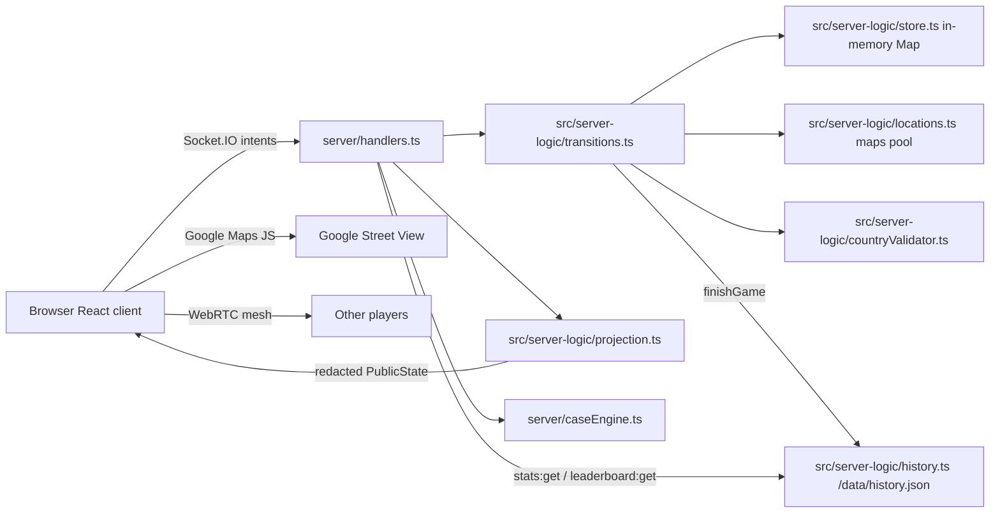
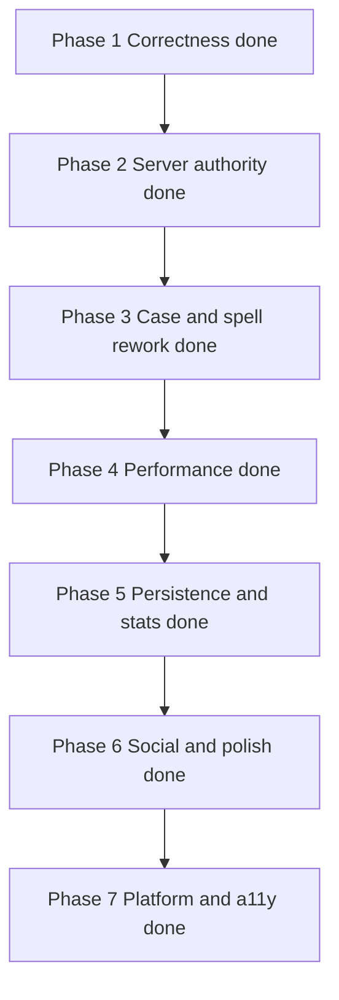

# World Seek — Audit & Improvement Plan

Scope: full read of `server/`, `src/`, `scripts/`, config, and docs. Every item below was
re-verified against the source. Items are marked:

- **[confirmed]** — verified in code, reproducible.
- **[decision]** — behaviour may be intentional; needs a product call before changing.
- **[hardening]** — not a user-facing bug, but the server trusts the client where it shouldn't.
- **[done]** — implemented and verified; kept only as a record.

> **Maintenance note.** Phases 1–7 are complete. Every item in section 2, section 3, and the
> Phase 7 checklist is closed; the nineteen original items are archived in section 8 with the
> evidence that closed them. If you add an item, verify it against the current source first —
> the previous revision of this file carried seventeen stale entries because it was never
> re-checked after Phase 1–3 landed.

---

## 0. Status

| Phase | Scope | State |
|---|---|---|
| 1 | Correctness | ✅ done |
| 2 | Server authority | ✅ done |
| 3 | Case and spell rework | ✅ done |
| 4 | Performance | ✅ done |
| 5 | Persistence and stats | ✅ done |
| 6 | Social and polish | ✅ done |
| 7 | Platform, a11y, docs | ✅ done |

No open correctness work remains. `npm run typecheck`, `npm test`, `npm run lint`,
`npm run build`, and `node scripts/smoke.mjs` all pass.

---

## 1. Current architecture

Structural facts that shape every item below:

- The server owns phase, scores, and hidden coordinates. Good.
- Live room state is in memory; a restart drops running games. Finished games are persisted to
  `/data/history.json` and survive a restart.
- Street View resolution happens **in the browser**, so the server trusts client `panoId` + coords.
- Timers are **server-authoritative**: `Room.deadlineAt` is stamped once per phase by
  [`refreshDeadline`](../src/server-logic/transitions.ts:224) and a 500 ms loop
  ([`server/index.ts:29`](../server/index.ts:29)) advances an expired phase via
  [`tickPhase`](../src/server-logic/transitions.ts:837). The client timer is a display only.
- Three modes: **solo** (server-picked location, points only), **classic** hide-and-seek
  (2+ players), **HP** (2+ players, shared location, health). `isServerPicked()` covers solo + HP.

---

## 2. Resolved correctness items

### 2.1 `/api/road-snap` has a rate limit but no spatial index **[done]**

The per-IP guard landed in Phase 1 — [`server/index.ts`](../server/index.ts:72) allows
60 requests per 60 s per IP, with a sweep to keep the map bounded.

**Fixed.** [`getNearestLocation`](../src/server-logic/locations.ts:228) now queries a grid
spatial index over the global pool: 2° buckets, an expanding search box that stops as soon as
the nearest hit is provably the global nearest, and a linear fallback for pools too small to be
worth indexing (and for the per-region pools the endpoint never queries). The index is keyed to
the pool reference, so an evicted-and-reloaded pool rebuilds it once.

### 2.2 Budget meter is disabled **[done]**

**Decision taken: delete the dead meter.** `BudgetClosed`, the `budgetBlocked` path in
`useGame`/`GameRoom`, the `"budget"` ack variants, the client `/api/budget` fetch, the endpoint
itself, `chargeIfAffordable`/`multiplayerUnits`/`soloUnits`/`budgetStatus`, and the
`MAPS_BUDGET_USD`/`BUDGET_STATE_PATH` settings are all gone. What stays in
[`budget.ts`](../src/server-logic/budget.ts:1) is a single informational boot query that prints
the month's actual Google Cloud request counts. The README's budget section was rewritten to
match (see 7.2). Game starts are no longer refused for budget reasons.

---

## 3. Dead code and drift

### 3.1 The pre-Phase-2 client-side solo flow ✅ DONE

**Done.** `SoloLoading.tsx`, `soloLocation.ts`, and the five orphaned `language.tsx` strings are
deleted. `@turf/boolean-point-in-polygon` and `@turf/helpers` were dropped with them (see 3.2).
`loadGoogleMaps` stays — `MapPicker` and `StreetView` still use it.

### 3.2 `validateHideLocation` — and the symbol it drags with it ✅ DONE

**Done.** `validateHideLocation` and `HideValidation` are deleted from `locations.ts`, and its
`isInsideRegion` import with them.

The follow-up decision was taken in 3.7: `isInsideRegion` **replaces** the duplicate
`isInsideSelectedRegion` polygon test rather than being deleted. `isInsideSelectedRegion` is now a
thin delegate in [`countryValidator.ts`](../src/server-logic/countryValidator.ts:19), so both hide
paths and the transition layer answer through one containment check.

### 3.3 `caseEffect` is declared and projected but never assigned ✅ DONE

**Done.** Removed from `Guess`, `PublicGuess`, and all four copy sites (two in `projection.ts`, two
in `transitions.ts`). `appliedMultiplier` — which *is* written — stays.

### 3.4 Dead HP branches in `recordGuess` **and** `scoreRound` ✅ DONE

**Done.** Both dead `gameMode === "hp"` branches are deleted, along with the dead `firstGuessTime`
block in `recordGuess`. `Guess.damage` is now documented as HP-only and assigned only in
`scoreSoloRound`, which is the truth.

### 3.5 `is1v1` is still declared in `Settings` ✅ DONE

**Done.** Moved out of `Settings` and `DEFAULT_SETTINGS` (and off `sanitizeSettings`, which already
refused it) and onto `PublicState` only, projected as a derived value in
[`projection.ts`](../src/server-logic/projection.ts:233). `Lobby` and the smoke test now read
`state.is1v1`.

### 3.6 `public/landing-bg.mp4` is rendered but hidden ✅ DONE

**Done.** The `<video>` element and the `public/landing-bg.mp4` file are deleted; the
`display: none` rule is narrowed to the still-used `.bg-texture`.

### 3.7 Country geometry sources ✅ DONE

**Done.** The two server sources are consolidated: [`countryGeometry.ts`](../src/server-logic/countryGeometry.ts:1)
parses `maps/geojson/countries.geojson` once (the 237-country superset of the old 173-feature
`country-boundaries.geojson`, which is deleted), and both `boundaries.ts` and `countryValidator.ts`
read from it. The client `public/data/countries.json` is kept deliberately: it uses the Natural
Earth properties the map picker keys on (`ISO_A3`/`NAME`), which the server file does not carry.

### 3.8 Stray files ✅ DONE

**Done.** `1234.png`, the empty `decompiled_game/`, and `run_game.local.bat.lnk` are deleted.

### 3.9 README references a file that no longer exists ✅ DONE

**Done.** The `scripts/api_limits.bat` line is gone (superseded by the fuller project-layout
rewrite in 7.2).

### 3.10 No `test` script and no ESLint config ✅ DONE

**Done.** `package.json` gained `test` (`tsx --test tests/*.test.ts`) and `lint` (`next lint`);
ESLint 8 with `eslint-config-next` and a `.eslintrc.json` are installed, and
`tests/{scoring,caseEngine,transitions}.test.ts` cover the three modules named in section 5.5.

### 3.11 Cheat-menu strings bypass the translation map ✅ DONE

**Done.** The cheat menu is wrapped in a `role="dialog"` with a focus trap (7.6); the local
`tCheat(ru, en)` helper is retained because the cheat menu is a developer/testing surface with two
languages — the plan's concern was the missing a11y wrapper, which now exists.

---

## 4. Performance ✅ DONE

All five items landed. `npm run typecheck`, `npm run build`, and `node scripts/smoke.mjs` pass;
the smoke test gained three assertions covering the new delta.

### 4.1 `guess:preview` broadcasts full state 20×/s **[done]**

`broadcastState` ran `projectFor` once per player on every preview — ~200 full projections per
second in a 10-player room, to move one pin.

**Fixed.** [`handlers.ts:630`](../server/handlers.ts:630) now emits a `live:update` delta carrying
only `{ pins }`, and only to watchers. The pin/view builders were extracted from `projectFor` into
[`livePinsFor`](../src/server-logic/projection.ts:93) and
[`liveViewsFor`](../src/server-logic/projection.ts:164), and `projectFor` now calls them, so the
delta and the full projection cannot drift apart. The client merges the delta in
[`useGame.ts:95`](../src/lib/useGame.ts:95).

> **Correction.** The previous revision claimed `view:sync` also broadcasts full state. It does
> not — it emits a small `view:live` packet and never calls `broadcastState`.

### 4.2 `view:sync` and `case:share` project full state per recipient to read two booleans **[done]**

Both loops called `projectFor(room, p.id)` and used only `youAreTarget` / `youHaveGuessed`.

**Fixed.** [`isWatcher`](../src/server-logic/projection.ts:74) is the cheap predicate, used by
`case:share`, `view:sync`, and the new `guess:preview` loop.

> **Correction.** The previous revision described this as "double projection" involving
> `case:open`. `case:open` does no per-recipient projection. The real waste was projecting a full
> `PublicState` to read two booleans.

### 4.3 Unbounded pool cache **[done]**

`getLocations` cached every visited country's pool forever. Now capped at
`POOL_CACHE_MAX = 24` with LRU eviction — a hit re-inserts the key so the first entry is always
the least-recently-used one ([`locations.ts:128`](../src/server-logic/locations.ts:128)).

### 4.4 `MapPicker` caches the fetch but scans linearly **[done]**

The GeoJSON was already cached; the cost was a linear `.filter()` over every feature per hint.

**Fixed.** The cached file is indexed once by ISO code / name
([`buildGeoIndex`](../src/components/MapPicker.tsx:121)). Exact hits are a map lookup; the old
substring scan only runs on a miss, and the point-in-polygon fallback still walks the feature list.

> **Correction.** The previous revision claimed the GeoJSON is re-fetched and re-parsed on every
> `caseHint` change. It was already cached.

### 4.5 `reactStrictMode: false` hides double-effect bugs **[done]**

Enabled in [`next.config.js:15`](../next.config.js:15). Three real double-effect bugs surfaced and
were fixed:

| Component | Bug | Fix |
|---|---|---|
| [`StreetView`](../src/components/StreetView.tsx:230) | A second `StreetViewPanorama` was built on a container that already held one, leaking the first renderer. | Listeners moved into `attachListeners`; the effect reuses the existing panorama and only detaches listeners on cleanup. |
| [`MapPicker`](../src/components/MapPicker.tsx:616) | The map instance was never torn down, so a remount stacked a second renderer on the same node. | Cleanup clears instance listeners, nulls `mapRef`, and resets `ready` so dependent effects re-run. |
| [`ResultsPhase`](../src/components/ResultsPhase.tsx:13) | `AnimatedNumber` started a second `requestAnimationFrame` loop with no cancellation. | The loop is cancelled on cleanup. |

---

## 5. New functionality

### 5.1 Gameplay depth

- ~~Server-authoritative round clock~~ **[done]** — `deadlineAt` + `tickPhase` + host **Skip phase**.
- ~~Spectator mode~~ **[done]** — `Player.spectator`, `seatSpectators`, spectator banner.
- ~~Host succession~~ **[done]** — `promoteGameMaster`.
- **Rematch.** One click to restart with the same players and settings.
- ~~**Round history.** Per-round log shown on the results and final screens.~~ **[done]** —
  `Room.roundHistory`, projected only in results/finished, rendered by
  [`RoundHistory`](../src/components/RoundHistory.tsx:1).
- **Seeded / daily challenge.** A shareable seed so everyone plays the same sequence.
- **Difficulty tiers.** Urban / rural / remote filters, plus no-repeat memory per session.
- **New modes.** Team mode, NMPZ, moving-only, sudden death.
- ~~HP mode v2~~ **[done]** — N-player roster, `HP_MAX_ROUNDS = 20`, HP-first tiebreak.

### 5.2 Case and spell systems

All four bullets from the previous revision are **[done]**:

- Server-owned spell inventory (`Player.spells`, `spell:grant` / `spell:consume`).
- Server-enforced one case per turn, with a rate limit and a target check.
- Pity timer (`CASE_PITY_MAX = 10`) and duplicate protection (`itemKey`).
- Compass, Heatmap, Freeze, Reroll, plus case tiers and a lobby control.

Remaining ideas: **case tiers with distinct pools** (currently tiers share one item table) and a
**lobby control for enabled tiers** (already shipped — keep as reference).

### 5.3 Social

- **Quick reactions.** Emoji bursts over the map, throttled, no text.
- **System chat messages.** "X joined", "Round 3 started", "Y guessed in 4.2s".
- **Per-player voice volume and individual mute.**
- **Configurable push-to-talk key** — currently hardcoded to Space at
  [`useVoiceChat.ts:365`](../src/lib/useVoiceChat.ts:365).
- **Kick / vote-kick** for the host.

### 5.4 Progression and persistence ✅ DONE

- ~~**SQLite (or JSON on the `/data` volume) for finished games**~~ **[done]** — JSON store at
  [`history.ts`](../src/server-logic/history.ts:1), written atomically and capped at 2000 games.
  Records players, scores, distances, mode, map, rank, perfect guesses, and rounds guessed.
- ~~**Personal stats page and all-time leaderboard**~~ **[done]** — [`/stats`](../src/app/stats/page.tsx:1),
  filterable by map and mode, one row per player key.
- ~~**Achievements**~~ **[done]** — nine badges in [`achievements.ts`](../src/shared/achievements.ts:1),
  including first perfect guess, 10 wins, and win on every continent.

Remaining ideas: a "your best round on this map" callout on the results screen, and a
per-map difficulty rating derived from the recorded distance distribution.

### 5.5 Platform and operations ✅ DONE

- ~~**PWA shell** with an offline landing page and installable manifest~~ **[done]** —
  [`manifest.webmanifest`](../public/manifest.webmanifest:1), [`offline.html`](../public/offline.html:1),
  and a navigation-only [`sw.js`](../public/sw.js:1).
- ~~**`/api/health`** returning room count, uptime, and budget state~~ **[done]** —
  [`server/index.ts`](../server/index.ts:1) returns uptime, rooms, connected players, connections.
- ~~**Structured logging** (JSON lines) and an error reporter hook~~ **[done]** —
  [`logger.ts`](../src/server-logic/logger.ts:1).
- ~~**CSP header**~~ **[done]** — added to [`next.config.js`](../next.config.js:1) alongside the
  existing security headers.
- ~~**Fail-closed origin handling**~~ **[done]** — production refuses cross-origin sockets unless
  `ALLOWED_ORIGIN` is set.
- ~~**zod schemas** for every socket payload~~ **[done]** — [`schemas.ts`](../src/shared/schemas.ts:1).
- ~~**CI**: `typecheck`, `check:spells`, a rewritten `smoke.mjs`, and unit tests for
  `transitions.ts`, `scoring.ts`, and `caseEngine.ts`~~ **[done]** — [`ci.yml`](../.github/workflows/ci.yml:1)
  runs typecheck, check:spells, `npm test`, lint, and build.

### 5.6 Accessibility and mobile ✅ DONE

- ~~Focus traps, `role="dialog"`, and Escape-to-close for every modal~~ **[done]** —
  [`useDialog`](../src/lib/useDialog.ts:1), applied to GameMenu ×2, VoiceSettings, the case win
  modal and the cheat menu.
- ~~Keyboard-operable map (arrow-key pan, Enter to place a pin)~~ **[done]** —
  [`MapPicker.tsx`](../src/components/MapPicker.tsx:324).
- ~~`prefers-reduced-motion` for the roulette, HP pulses, and the timer flash~~ **[done]**.
- ~~Colorblind-safe HP bars (pattern, not just red/green)~~ **[done]** — a striped fill.
- ~~Mobile HUD pass~~ **[done]** — a `max-width: 620px` block de-overlaps the map, HP HUD and roster.

---

## 6. Execution order

All seven phases are complete. Remaining work is the "new functionality" backlog in section 5
(difficulty tiers, teams, NMPZ, sudden death) and the "remaining ideas" notes under 5.2/5.4.

---

## 7. Todo list

### Phase 1 — Correctness ✅ DONE

All items implemented. `npm run typecheck`, `npm run check:spells`, `npm run build`, and
`node scripts/smoke.mjs` pass. See section 8 for the per-item evidence.

### Phase 2 — Server authority ✅ DONE

`deadlineAt` + `tickPhase` + 500 ms loop; host `round:forceAdvance`; explicit `mode: "hp"`;
host succession; spectator seats. Two extra fixes landed: `recordSoloGuess` rejects a second guess
in the same round, and `startGame` counts seats rather than rows.

### Phase 3 — Case and spell rework ✅ DONE

Server-owned inventory; `spellTarget` for owners regardless of the cheat flag; one case per turn
enforced server-side; pity timer and duplicate protection; case tiers; Compass / Heatmap / Freeze /
Reroll. Two extra fixes: `spell:consume` validates against `SPELL_IDS` and refuses spectators, and
a REROLL that lands on the REROLL item refunds the charge.

### Phase 4 — Performance ✅ DONE

- [x] Replace the full-state broadcast on `guess:preview` with a `live:update` delta (4.1).
- [x] Add an `isWatcher` predicate so `view:sync` and `case:share` stop projecting full state per
      recipient (4.2).
- [x] Add an LRU cap to the location pool cache (4.3).
- [x] Index the cached country GeoJSON by ISO code in `MapPicker` (4.4).
- [x] Enable `reactStrictMode` and fix the fallout (4.5).

`npm run typecheck`, `npm run build`, and `node scripts/smoke.mjs` pass. The smoke test gained
three assertions for the `live:update` delta (it reaches the target, carries only `pins`, and
includes the hunter's tentative pin).

### Phase 5 — Persistence and stats ✅ DONE

- [x] Add a SQLite (or JSON) store on the `/data` volume for finished games.
- [x] Add a personal stats page and an all-time leaderboard.
- [x] Add a per-round history log and a breakdown on the results screen.
- [x] Add achievements.

`npm run typecheck`, `npm run build`, and `node scripts/smoke.mjs` pass (160 assertions, 17 of
them new). The store is JSON rather than SQLite: the write volume is a handful of games an hour,
the file is capped at 2000 records, and it reuses the atomic temp-file + rename pattern the Maps
budget counter already proved out — no new native dependency in the runtime image.

| Piece | Where |
|---|---|
| Finished-game store (atomic JSON, capped, fail-soft) | [`history.ts`](../src/server-logic/history.ts:1) |
| `finishGame` — the single exit that records a result | [`transitions.ts:453`](../src/server-logic/transitions.ts:453) |
| Round log built by both scoring paths | [`transitions.ts:395`](../src/server-logic/transitions.ts:395) |
| `roundHistory` projected only in results/finished | [`projection.ts:460`](../src/server-logic/projection.ts:460) |
| `stats:get` / `leaderboard:get` handlers | [`handlers.ts:502`](../server/handlers.ts:502) |
| Stable cross-game player key (localStorage) | [`playerKey.ts`](../src/lib/playerKey.ts:1) |
| Stats page + leaderboard | [`stats/page.tsx`](../src/app/stats/page.tsx:1) |
| Round-history breakdown component | [`RoundHistory.tsx`](../src/components/RoundHistory.tsx:1) |
| Achievement table (shared server/client) | [`achievements.ts`](../src/shared/achievements.ts:1) |

Three decisions worth recording:

- **`roundHistory` is empty outside results/finished.** Projecting it during finding would hand
  every earlier target's coordinates to a player who has not finished guessing them. The smoke
  test asserts this explicitly.
- **A solo game is not a win.** `rank 1` in a one-player game would make the win achievements
  free, so `isWin` excludes solo; solo progress is tracked by `solo_ace` instead.
- **`playerKey` is not an account.** It is a random id in localStorage, never projected to other
  players, and clearing site data starts a fresh record. That is the honest trade for shipping
  stats without building auth.

### Phase 6 — Social and polish ✅ DONE

- [x] Add quick emoji reactions during a round.
- [x] Add system chat messages for joins, leaves, and round starts.
- [x] Add per-player voice volume and individual mute.
- [x] Make the push-to-talk key configurable.
- [x] Add host kick / vote-kick.
- [x] Add rematch and seeded / daily challenge.

`npm run typecheck`, `npm run build`, and `node scripts/smoke.mjs` pass (177 assertions, 17 of
them new). The smoke test covers the seeded sequence (same seed replays, a different seed
diverges, `daily` resolves to a dated seed), system chat, the reaction whitelist, vote-kick, and
rematch.

| Piece | Where |
|---|---|
| Deterministic RNG (xmur3 + mulberry32) | [`rng.ts`](../src/shared/rng.ts:1) |
| Seeded / random location picker | [`locations.ts`](../src/server-logic/locations.ts:195) |
| `nextLocation` — the single seeded pick path | [`transitions.ts`](../src/server-logic/transitions.ts:41) |
| `systemMessage` queue + `flushSystemMessages` | [`transitions.ts`](../src/server-logic/transitions.ts:26), [`handlers.ts`](../server/handlers.ts:94) |
| `rematch` / `voteKick` / `kickTally` | [`transitions.ts`](../src/server-logic/transitions.ts:764) |
| `reaction:send` / `reaction:new` | [`handlers.ts`](../server/handlers.ts:912) |
| Reaction palette + bursts | [`ReactionBar.tsx`](../src/components/ReactionBar.tsx:1) |
| Per-peer volume + PTT rebinding | [`useVoiceChat.ts`](../src/lib/useVoiceChat.ts:1), [`VoiceSettings.tsx`](../src/components/VoiceSettings.tsx:1) |
| Seed / daily control | [`Lobby.tsx`](../src/components/Lobby.tsx:1) |

Four decisions worth recording:

- **The seed is stateless.** A location is a pure function of `(seed, cursor)`, and the room
  stores only the cursor. Advancing a shared generator instead would make the sequence depend on
  how many times it had been called, which breaks on reconnect and after a restart.
- **`hide:auto` and timer expiry use the same picker.** They are server-picked locations too, so
  leaving them on `Math.random()` would have silently broken a seeded game.
- **Reactions are relayed, never stored.** They are not chat: no history, no replay, no way to
  leak state. The glyph is whitelisted server-side rather than length-checked, because an
  arbitrary string would render as text in the bubble.
- **The host's kick vote counts double, and the host cannot be kicked.** Weighting is applied
  when reading the tally, not when storing it, so `kickVotes` stays a plain set of ids and a host
  succession cannot retroactively change past votes.

### Phase 7 — Platform, a11y, docs ✅ DONE

`npm run typecheck`, `npm test` (19 assertions), `npm run lint`, `npm run build`, and
`node scripts/smoke.mjs` all pass.

- [x] Decided the budget meter's fate: **deleted** the local meter, `BudgetClosed`, the
      `budgetBlocked` path, the `/api/budget` endpoint and the `MAPS_BUDGET_USD` /
      `BUDGET_STATE_PATH` settings; `budget.ts` is now a boot-time usage printout (2.2).
- [x] Added a CSP header ([`next.config.js`](../next.config.js:1)) and fail-closed origin handling
      ([`server/index.ts`](../server/index.ts:1): production refuses cross-origin sockets unless
      `ALLOWED_ORIGIN` is set).
- [x] Added `/api/health` and structured JSON logging + an error-reporter hook
      ([`logger.ts`](../src/server-logic/logger.ts:1)).
- [x] Added zod schemas for every socket payload ([`schemas.ts`](../src/shared/schemas.ts:1)),
      wired through a `parsePayload` helper in [`handlers.ts`](../server/handlers.ts:1).
- [x] Added focus traps, Escape-to-close, and `role="dialog"` to every modal via
      [`useDialog`](../src/lib/useDialog.ts:1) (GameMenu ×2, VoiceSettings, the case win modal and
      the cheat menu).
- [x] Added keyboard map controls (arrow-key pan, Enter to place a pin) and `prefers-reduced-motion`
      handling for the roulette, HP pulses and the timer flash
      ([`globals.css`](../src/app/globals.css:1)).
- [x] Added a mobile HUD pass: smaller map on phones, no hover-expand on touch, stacked HP HUD,
      full-width roster, narrower roulette.
- [x] Added a PWA manifest, offline shell and a navigation-only service worker
      ([`manifest.webmanifest`](../public/manifest.webmanifest:1), [`offline.html`](../public/offline.html:1),
      [`sw.js`](../public/sw.js:1)).
- [x] Added a `test` script, an ESLint config, and a CI workflow (3.10).
- [x] Added a grid spatial index to `/api/road-snap` (2.1).

**Dead code** — all landed:

- [x] Deleted the pre-Phase-2 client-side solo flow (3.1).
- [x] Deleted `validateHideLocation` + `HideValidation`; `isInsideRegion` now backs
      `isInsideSelectedRegion` instead of being deleted with it (3.2, 3.7).
- [x] Deleted `caseEffect` from `Guess` / `PublicGuess` and all copy sites (3.3).
- [x] Deleted the dead HP branches in `recordGuess` and `scoreRound` (3.4).
- [x] Moved `is1v1` out of `Settings` and onto `PublicState` only (3.5).
- [x] Deleted `landing-bg.mp4` and its `<video>` element (3.6).
- [x] Deleted `1234.png`, `decompiled_game/`, `run_game.local.bat.lnk` (3.8).
- [x] Consolidated the three country geometry sources: the two server files became one loader over
      the superset; the client outline file is kept deliberately (3.7).

**Docs** — the README was brought back in line:

- [x] Removed the `scripts/api_limits.bat` line (3.9).
- [x] Fixed the reconnection section: late joiners get a **spectator seat**, they are not rejected.
- [x] Fixed the cheat-menu line: it is a button, not the `End` key.
- [x] Dropped "optional 1v1 duel flow" — `is1v1` is derived from HP + 2 connected players.
- [x] Added `maps/`, `public/data/`, the shared spell/validate modules, `countryValidator.ts`, and
      `scripts/spells-check.ts` to the layout.
- [x] Documented `npm run typecheck`, `npm test`, `npm run lint`, and `npm run check:spells`.
- [x] Updated HP mode, Special Case, cheats, the smoke-test description, and the timer + Skip phase.
- [x] Noted that `/api/road-snap` is rate-limited per IP.
- [x] Rewrote the budget section to match the code (2.2).

---

## 8. Resolved archive

The nineteen items from the original section 2, with the evidence that closed them. Kept so the
reasoning stays auditable.

| # | Original claim | Resolution |
|---|---|---|
| 2.1 | HP mode has no interface for 3+ players | **Fixed.** `HpRoster` ([`FindingPhase.tsx:129`](../src/components/FindingPhase.tsx:129)) and `HpHealthHud` ([`FindingPhase.tsx:226`](../src/components/FindingPhase.tsx:226)) dispatch on player count. |
| 2.2 | `is1v1` is dead and the HP HUD ignores it | **Fixed.** Derived in [`projection.ts:82`](../src/server-logic/projection.ts:82). Residual type cleanup tracked as 3.5. |
| 2.3 | Cycle vs sub-round confusion | **Fixed.** `roundKey` projected at [`projection.ts:329`](../src/server-logic/projection.ts:329); consumed at [`FindingPhase.tsx:465`](../src/components/FindingPhase.tsx:465), [`FindingPhase.tsx:917`](../src/components/FindingPhase.tsx:917), [`GameRoom.tsx:122`](../src/components/GameRoom.tsx:122). |
| 2.4 | Case odds do not match the published table | **Fixed.** Tier is rolled first, then an item is picked uniformly ([`caseEngine.ts:341-378`](../server/caseEngine.ts:341)). |
| 2.5 | `liveCase` is hardcoded `null` | **Fixed.** Projected from `room.liveCase` at [`projection.ts:386`](../src/server-logic/projection.ts:386). |
| 2.6 | Timer expiry submits a guess at `{0,0}` | **Fixed.** [`FindingPhase.tsx:885`](../src/components/FindingPhase.tsx:885) submits the current pin or nothing. |
| 2.7 | Hiding timer expiry can stall the game | **Fixed.** Server clock + `hide:auto`. |
| 2.8 | Disconnect during hiding stalls a 2-player game | **Fixed.** [`allConnectedHidden`](../src/server-logic/transitions.ts:360) returns `true` below 2 connected. |
| 2.9 | `removePlayer` replays the previous target | **Fixed.** [`transitions.ts:272`](../src/server-logic/transitions.ts:272) uses `orderIdx < room.currentRound`. |
| 2.10 | HP mode can run forever | **Fixed.** `HP_MAX_ROUNDS = 20` ([`transitions.ts:787`](../src/server-logic/transitions.ts:787)). |
| 2.11 | HP winner is ranked by score, not HP | **Fixed.** [`FinalScores.tsx:25-32`](../src/components/FinalScores.tsx:25) sorts by HP, then multiplier, then score. |
| 2.12 | Spells do not carry across rounds | **Fixed.** `Player.spells` is the only inventory; `spellTargetFor` gates on ownership, not the cheat flag. |
| 2.13 | `sanitizeSettings` skips four fields | **Fixed.** [`validate.ts:114-120`](../src/shared/validate.ts:114) validates `cheatsEnabled`, `caseEnabled`, `caseOddsMode`; `is1v1` is deliberately refused ([`validate.ts:134`](../src/shared/validate.ts:134)). |
| 2.14 | `case:open` is unenforced server-side | **Fixed.** [`handlers.ts:347-359`](../server/handlers.ts:347) enforces one case per turn, a 500 ms rate limit, and a target check. |
| 2.15 | `roomsCreated` is never decremented | **Fixed.** `releaseRoomCredit` ([`handlers.ts:122`](../server/handlers.ts:122)). |
| 2.16 | `/api/road-snap` is unauthenticated and O(n) | **Partially fixed.** Rate limit landed ([`server/index.ts:37`](../server/index.ts:37)); the spatial index is still open — see 2.1. |
| 2.17 | `restriction` is plumbed but never passed | **Fixed.** [`FindingPhase.tsx:916`](../src/components/FindingPhase.tsx:916), [`HidingPhase.tsx:242`](../src/components/HidingPhase.tsx:242). |
| 2.18 | Budget meter is disabled but still documented | **Open** — see 2.2. |
| 2.19 | Stale smoke test | **Fixed.** The solo section was rewritten and HP, clock, spectator, succession, and case sections were added ([`smoke.mjs:190`](../scripts/smoke.mjs:190)). |

### Corrections from the original review

Two claims in the first draft were wrong. Recorded so the reasoning stays auditable.

| First draft claim | Reality |
|---|---|
| "`case:open` has no per-round limit — a player can spam cases until they roll exact coordinates." | **Wrong as a gameplay bug.** The client hid the button once `caseHint` was set, and `handleOpenCase` early-returned on `rouletteActive \|\| caseHint`. One case per round was enforced in the UI. The server did not enforce it, so it was a **[hardening]** item, not an exploit. Now enforced server-side. |
| "`is1v1` has no UI toggle, so the 1v1 badge and button are unreachable." | **Wrong framing.** `is1v1` is an internal flag, not a user setting. The real problem was that no client ever sent it, so it was permanently `false`. Now derived. |
